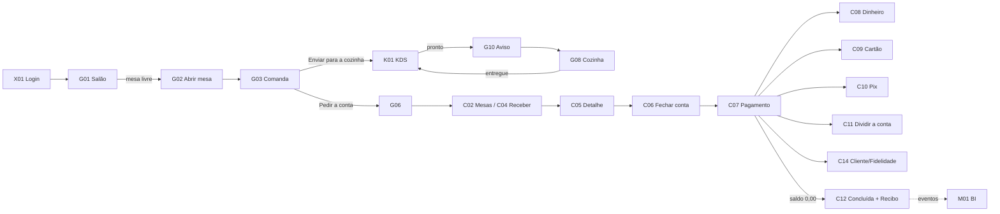
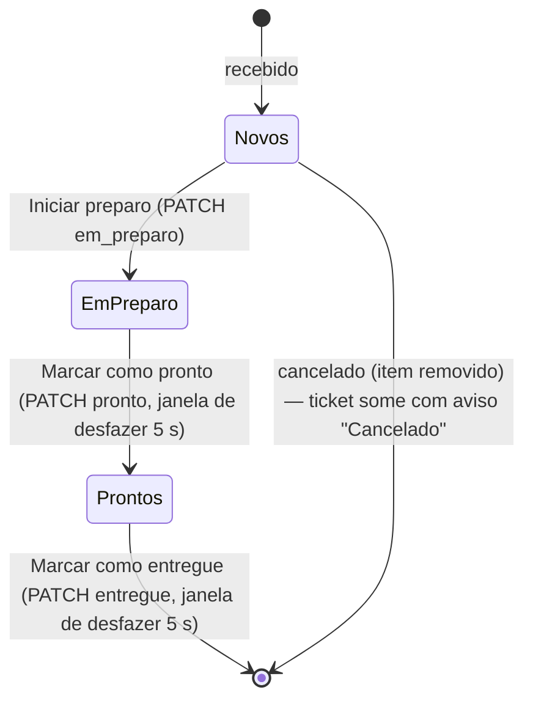

# 02 — Mapa de telas, permissões, navegação e fluxos

Tipos: **Tela** (rota própria), **Painel** (região de tela), **Modal**, **Drawer** (direita, desktop), **Sheet** (bottom sheet, celular), **Banner/Toast**.

## 1. Inventário completo

### 1.1 Transversais — `00-transversais.md`
| ID | Nome | Tipo | Rota/gatilho | Perfis |
|---|---|---|---|---|
| X01 | Login operacional | Tela | `/login` | todos |
| X02 | Trocar operador | Modal (desktop) / Sheet (celular) | menu do operador | todos |
| X03 | Status do sistema (pill + banner) | Componente global | sempre | todos |
| X04 | Toasts e "Desfazer" | Toast | eventos | todos |
| X05 | Diálogo de confirmação | Modal/Sheet genérico | ações destrutivas | todos |
| X06-a | 404 — Página não encontrada | Tela | `*` | todos |
| X06-b | Sem permissão | Tela | guarda de rota | todos |
| X06-c | Erro inesperado | Tela | *error boundary* | todos |
| X07 | Padrões de lista: carregando, vazio, filtro vazio, erro | Padrão | listas | todos |
| X08 | PWA: instalar e atualizar | Banner/Toast | SW | garçom, caixa |
| X09 | Seletor de tema | Controle | Perfil/Ajustes | todos |

### 1.2 Garçom (celular) — `10-garcom.md`
| ID | Nome | Tipo | Rota/gatilho |
|---|---|---|---|
| G01 | Salão (mapa de mesas) | Tela | `/garcom` |
| G02 | Abrir mesa | Sheet | FAB "Abrir mesa" / toque em mesa livre |
| G03 | Comanda (lançar itens) | Tela | `/garcom/mesa/:mesa` |
| G04 | Observação e alergia do item | Sheet | botão no item |
| G05 | Itens enviados | Sheet | card "itens enviados" |
| G06 | Pedir a conta | Sheet (confirmação) | botão "Pedir a conta" |
| G07 | Comandas (minhas) | Tela | `/garcom/comandas` |
| G08 | Cozinha (prontos para entregar) | Tela | `/garcom/cozinha` |
| G09 | Perfil | Tela | `/garcom/perfil` |
| G10 | Aviso de item pronto | Toast persistente + *badge* | polling |
| G11 | Mesa com conta aguardando pagamento | Sheet (confirmação) | abrir mesa em mesa "Conta pedida" |

### 1.3 Caixa (desktop/tablet) — `20-caixa.md`
| ID | Nome | Tipo | Rota/gatilho |
|---|---|---|---|
| C01 | Venda (balcão) | Tela | `/caixa/venda` |
| C02 | Mesas | Tela | `/caixa/mesas` |
| C03 | Pedidos (histórico/filtros) | Tela | `/caixa/pedidos` |
| C04 | Receber (fila de contas) | Tela | `/caixa/receber` |
| C05 | Detalhe da comanda | Drawer | `?comanda=<id>` |
| C06 | Fechar conta (gorjeta 10%) | Modal | "Fechar conta" / `F8` em comanda aberta |
| C07 | Pagamento | Tela | `/caixa/pagamento/:comandaId` |
| C08 | Pagar em dinheiro (troco) | Painel (em C07) | forma "Dinheiro" |
| C09 | Pagar com cartão | Painel (em C07) | formas Crédito/Débito/Vale-refeição |
| C10 | Pagar com Pix | Painel (em C07) | forma "Pix" |
| C11 | Dividir a conta | Modal | "Dividir a conta" |
| C12 | Venda concluída e recibo | Tela | `/caixa/concluida/:comandaId` |
| C13 | Cancelar comanda | Modal (confirmação) | "Cancelar pedido" |
| C14 | Cliente e fidelidade | Modal | `F4` / "Cliente" |
| C15 | Observação e alergia do item | Modal | botão no item |
| C16 | Ajustes do Caixa | Tela | `/caixa/ajustes` |
| C17 | Atalhos e ajuda | Modal | `?` / `Shift+/` |

### 1.4 KDS (TV/monitor) — `30-kds.md`
| ID | Nome | Tipo | Rota/gatilho |
|---|---|---|---|
| K01 | Painel de cozinha e bar | Tela | `/kds` |
| K02 | Ticket (componente) | Componente | — |
| K03 | Ajustes do KDS | Drawer | botão "Ajustes" |
| K04 | Estados do KDS (vazio, degradado, sem conexão) | Estados | — |
| K05 | Navegação por teclado | Interação | teclado/bump bar |
| K06 | Aviso de novo ticket | Feedback | polling |
| K07 | Desfazer avanço de status | Toast | após avançar |

### 1.5 Gestão (desktop) — `40-gestao.md`
| ID | Nome | Tipo | Rota/gatilho |
|---|---|---|---|
| M01 | Visão geral | Tela | `/gestao` |
| M02 | Cardápio (produtos) | Tela | `/gestao/cardapio` |
| M03 | Produto (criar/editar) | Drawer | `?produto=novo|<id>` |
| M04 | Inativar/Reativar produto | Modal (confirmação) | menu da linha |
| M05 | Estoque (Saldos · Alertas · Movimentos) | Tela | `/gestao/estoque` |
| M06 | Repor/ajustar estoque | Modal | "Repor" |
| M07 | Vendas — Comandas | Tela (aba) | `/gestao/vendas?aba=comandas` |
| M08 | Detalhe da comanda (gestão) | Drawer | `?comanda=<id>` |
| M09 | Vendas — Faturamento | Tela (aba) | `?aba=faturamento` |
| M10 | Vendas — Curva ABC | Tela (aba) | `?aba=curva-abc` |
| M11 | Vendas — Desempenho de garçons | Tela (aba) | `?aba=garcons` |
| M12 | Equipe | Tela | `/gestao/equipe` |
| M13 | Usuário (criar/editar/inativar) | Drawer + Modal | `?usuario=novo|<id>` |
| M14 | Fiscal (*placeholder*) | Tela | `/gestao/fiscal` |
| M15 | Exportar dados | Modal | "Exportar" |

## 2. Matriz de permissões de ação (UI)

| Ação | garcom | caixa | gerente | cozinha | Fonte |
|---|:-:|:-:|:-:|:-:|---|
| Abrir comanda / lançar / ajustar / remover itens | ✔ | ✔ (balcão) | — | — | RF03–RF05 |
| Pedir a conta (sinalizar) | ✔ | — | — | — | PB-01 |
| Fechar comanda (aplicar gorjeta) | — | ✔ | ✔ | — | RF06, RF14, UC04 |
| Registrar pagamento | — | ✔ | ✔ | — | RF07, UC05 |
| Cancelar comanda `aberta` | — | ✔ | ✔ | — | RF08, UC06 |
| Avançar ficha KDS (iniciar/pronto) | — | — | ✔ | ✔ | RF20 |
| Marcar ficha "entregue" | ✔ | — | ✔ | ✔ | UC03 |
| CRUD produtos / estoque / usuários | — | — | ✔ | — | RF01, RF02, UC07 |
| Ver BI (faturamento, ABC, garçons, alertas) | — | — | ✔ | — | UC08 |
| Consultar/cadastrar cliente de fidelidade | — | ✔ | ✔ | — | RF16, RF24 |

Ação sem permissão: **controle ausente** quando o perfil nunca a usa; **controle desabilitado + motivo** quando é perceptível que outro perfil a faz ("Somente o caixa fecha a conta").

## 3. Fluxos principais

### 3.1 Ponta a ponta (UC01 → UC05)



### 3.2 Máquina de estados da UI do Pagamento (C07)

```mermaid
stateDiagram-v2
  [*] --> Saldo_aberto : GET comanda (fechada)
  Saldo_aberto --> Lancando : escolher forma + valor
  Lancando --> Saldo_aberto : lançamento confirmado (falta > 0)
  Lancando --> Saldo_zero : lançamento confirmado (falta = 0)
  Saldo_aberto --> Saldo_aberto : remover lançamento (confirmação)
  Saldo_zero --> Liquidando : Concluir venda → POST /pagar
  Liquidando --> Concluida : 200 paga
  Liquidando --> Saldo_zero : erro (mantém lançamentos; "Tentar de novo")
  Concluida --> [*]
```
Lançamentos de pagamento existem **apenas na UI** até `Concluir venda` (P-08). Se o operador sair da tela com lançamentos pendentes: diálogo "Há R$ X lançados que ainda não foram concluídos. Sair e descartar?" (X05).

### 3.3 Ficha de preparo na UI do KDS



## 4. Navegação por módulo

| Módulo | Navegação primária | Secundária |
|---|---|---|
| Garçom | Barra inferior: **Mesas · Comandas · Cozinha · Perfil** (4 destinos, 64 px de altura + safe area) | voltar na comanda |
| Caixa | Rail 88 px: **Venda · Mesas · Pedidos · Caixa (=Receber) · Ajustes** | topo: busca F2, status, impressora, operador |
| KDS | sem navegação; filtros de setor no cabeçalho | Ajustes (drawer) |
| Gestão | Sidebar 248 px: **Visão geral · Cardápio · Estoque · Vendas · Equipe · Fiscal** | abas por tela (Estoque, Vendas) |

O item "Caixa" do rail abre **C04 Receber** (fila de contas). Não há abertura/fechamento de turno de caixa nesta versão.

## 5. Rastreabilidade tela × requisitos

| Telas | RF | RN | UC | RNF/ADR |
|---|---|---|---|---|
| X01, X02 | RF34, RF02 | RN23, RN08 | UC01 | RNF05 |
| X03, X04, X05, X06 | RF18 | RN17 | — | RNF02, RNF06, RNF07 |
| G01–G03, G05, G11 | RF03, RF04, RF05, RF09, RF10, RF13, RF15, RF17, RF22 | RN01, RN04, RN06, RN07, RN08, RN09, RN13 | UC01, UC02 | RNF01, RNF05 |
| G04, C15 | RF04 (+PB-02) | RN04 | UC02 | — |
| G06 | PB-01, RF14 | RN12 | UC04 | — |
| G07–G10 | RF09, RF15, RF20, RF21 | RN20 | UC03 | OBJ-05 |
| C01 | RF03, RF04, RF05, RF11, RF13, RF16 | RN01, RN04, RN06, RN08, RN13 | UC01, UC02 | ADR-05 |
| C02–C05 | RF09, RF10, RF16, RF22 | RN03, RN07 | UC04, UC06 | — |
| C06 | RF06, RF14 | RN05, RN11, RN12, RN15 | UC04 | ADR-03 |
| C07–C11 | RF07, RF16, RF25 | RN02, RN03, RN10, RN24 | UC05 | RNF04 |
| C12 | RF26, RF27, RF28 | RN18, RN19 | UC05 | — |
| C13 | RF08, RF23 | RN03, RN10 | UC06 | — |
| C14 | RF24, RF25 | RN14, RN19 | UC05 | RNF02 |
| K01–K07 | RF19, RF20, RF21, RF23 | RN18, RN20, RN22 | UC03 | OBJ-05 |
| M01 | RF30, RF31, RF33 | RN21 | UC08 | OBJ-06 |
| M02–M06 | RF01, RF11, RF12, RF33 | RN04, RN06, RN14, RN15 | UC07 | — |
| M07–M08 | RF09, RF10 | RN03 | UC08 | — |
| M09–M11 | RF30, RF31, RF32 | RN21 | UC08 | — |
| M12, M13 | RF02, RF17 | RN08, RN14 | UC07 | — |
| M14 | — (escopo fora) | — | — | Escopo §6.2.2 / DESIGN §14 |
| M15 | RF30 | RN21 | UC08 | — | Exportação CSV client-side |
