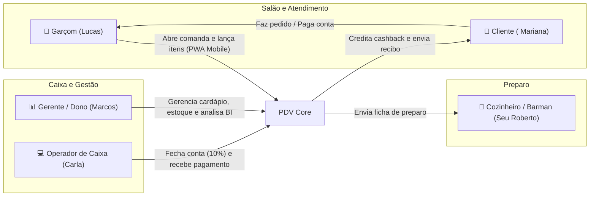
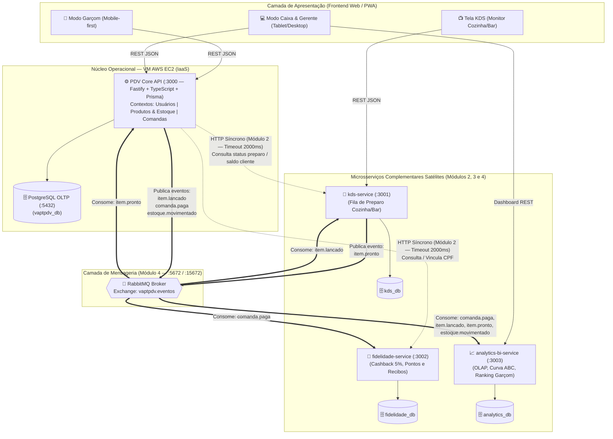
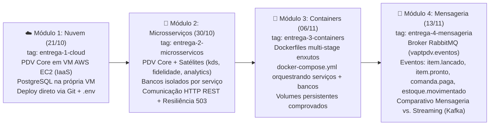

# 01 — Documento de Visão e Escopo do Sistema (Vision & Scope)

| Metadado | Valor |
| :--- | :--- |
| **Projeto** | **VaptPDV** — Sistema Distribuído de Ponto de Venda e Gestão Operacional para Bares, Botecos e Lanchonetes |
| **Versão** | 2.0.0 (Arquitetura PDV Core + 3 Microsserviços Satélites) |
| **Data** | 21 de Outubro de 2026 |
| **Instituição / Curso** | Universidade do Estado do Rio Grande do Norte (UERN) — Departamento de Ciência da Computação (DCC) |
| **Disciplina** | Sistemas Distribuídos — 3ª Unidade (Projeto Incremental) |
| **Docentes** | Profa. Glaucia Melissa e Profa. Luiziane Paulino dos Santos |
| **Autores (Equipe)** | Kaio França e Mateus Neri |
| **Agentes BMad Responsáveis** | **Mary** (Business Analyst) & **John** (Product Manager) |
| **Status** | Aprovado / Linha de Base (Baseline) |

---

## 1. Contexto de Negócio e Declaração do Problema

### 1.1 Cenário Atual de Pequenos Bares e Lanchonetes
Estabelecimentos gastronômicos de pequeno e médio porte — bares, botecos, espetinhos, hamburguerias e lanchonetes com equipes de **1 a 15 colaboradores** e operação de **até 30 mesas** — operam sob alta pressão em horários de pico (happy hour, finais de semana e dias de jogos). Na grande maioria desses negócios, o controle de consumo ainda é realizado por meio de **comandas de papel**, anotações informais em cadernos ou "conta de cabeça".

Esse modelo analógico e descentralizado gera gargalos operacionais severos e perdas financeiras recorrentes:

1. **Evasão de Receita por Esquecimento de Itens:** Na correria do salão, garçons esquecem de anotar cervejas, porções ou doses adicionais entregues rapidamente na mesa. Estima-se que estabelecimentos sem controle digital percam entre **5% e 12% do faturamento bruto** em itens consumidos e não cobrados.
2. **Erros de Soma e Divergência de Preços:** No fechamento da conta, o operador de caixa soma os valores manualmente ou em calculadora comum, frequentemente aplicando preços desatualizados do cardápio ou errando o cálculo da taxa de serviço opcional de 10%.
3. **Conflitos na Cozinha e no Bar:** Pedidos gritados no balcão ou entregues em papéis rasgados/ilegíveis geram atrasos no preparo, pratos trocados entre mesas e ausência de visibilidade sobre o que está pendente (`em_preparo` vs. `pronto`).
4. **Ruptura Cega de Estoque:** O garçom vende um item no salão sem saber que a última unidade acabou de sair no bar, causando constrangimento perante o cliente e retrabalho no estorno do pedido.
5. **Lentidão e Filas no Caixa:** No momento de ir embora, o cliente enfrenta fila enquanto o caixa decifra a caligrafia do garçom, confere itens consumidos e calcula o valor total.
6. **Ausência de Fidelização e Cegueira Gerencial:** O proprietário ou gerente encerra o expediente sem saber quais produtos trazem maior margem (Curva ABC), qual garçom teve melhor desempenho, qual o giro real do estoque ou quem são seus clientes recorrentes.

### 1.2 Matriz de Problema (Framework IEEE / BMad)

| Elemento | Descrição |
| :--- | :--- |
| **O problema de** | Controle manual de consumo em comandas de papel, descoordenação entre salão, cozinha e caixa, erros de cálculo monetário e falta de visibilidade de estoque e vendas |
| **Afeta** | Proprietários/gerentes, garçons, operadores de caixa, cozinheiros/barmen e clientes de bares, botecos e lanchonetes de pequeno e médio porte |
| **Cujo impacto é** | Perda direta de faturamento (itens não anotados ou somados incorretamente), filas no fechamento de conta, venda de produtos sem estoque, atraso na entrega de pratos/bebidas e impossibilidade de tomada de decisão baseada em dados |
| **Uma solução de sucesso seria** | O **VaptPDV**, uma plataforma distribuída composta por um **Núcleo Operacional (PDV Core)** com interface Web/PWA responsiva e **3 Microsserviços Satélites** especializados (**KDS**, **Fidelidade/Cashback** e **Analytics/BI**), garantindo precisão decimal exata, imutabilidade histórica de vendas e alta disponibilidade no salão mesmo sob falhas parciais |

---

## 2. Proposta de Valor e Objetivos Estratégicos

### 2.1 Proposta de Valor Única (UVP)
> *"Do pedido na mesa ao painel da cozinha e ao fechamento no caixa em segundos: o **VaptPDV** elimina a comanda de papel com uma arquitetura distribuída resiliente, garantindo que o atendimento no salão nunca pare, o preço nunca erre e o estoque nunca minta."*

### 2.2 Objetivos Estratégicos e Indicadores de Sucesso (KPIs Técnicos e de Negócio)

| ID | Objetivo Estratégico | Métrica / Indicador de Sucesso (KPI) | Meta Alvo |
| :--- | :--- | :--- | :--- |
| **OBJ-01** | **Agilidade no Salão** | Tempo de resposta (latência P95) para abertura de comanda e lançamento de item no PDV Core | `< 1 segundo` em condições normais de rede |
| **OBJ-02** | **Integridade Financeira Absoluta** | Divergência de arredondamento ou alteração retroativa de valores em comandas já lançadas/fechadas | `0 ocorrências` (uso de `Decimal` exato e congelamento de preço no lançamento) |
| **OBJ-03** | **Controle Fiel de Estoque** | Precisão na baixa de estoque após o pagamento da comanda (sem duplicidade e sem baixa em cancelamentos) | `100% de idempotência` por `comanda_id` |
| **OBJ-04** | **Continuidade Operacional (Resiliência)** | Disponibilidade do fluxo crítico do caixa e garçom caso um microsserviço satélite (`kds`, `fidelidade` ou `analytics`) fique indisponível | `100% de degradação graciosa` (timeout controlado, retorno HTTP 503 amigável ou fila assíncrona via RabbitMQ) |
| **OBJ-05** | **Sincronia Salão–Cozinha** | Tempo entre o lançamento do item pelo garçom e a exibição da ficha no painel `kds-service` | `< 2 segundos` via evento `item.lancado` |
| **OBJ-06** | **Isolamento Analítico (OLTP vs. OLAP)** | Impacto de geração de relatórios gerenciais e Curva ABC sobre a latência do banco transacional do PDV Core | `0% de sobrecarga` no banco OLTP (consultas analíticas isoladas no `analytics-bi-service`) |

---

## 3. Perfis de Usuário e Personas Detalhadas

O ecossistema **VaptPDV** foi desenhado em torno de cinco atores reais do cotidiano de um bar ou lanchonete:

### 3.1 Tabela Consolidada de Personas

| Persona | Perfil no Sistema | Dispositivo Principal | Dores Principais | O que espera do VaptPDV |
| :--- | :--- | :--- | :--- | :--- |
| **Lucas (24 anos)** — *Garçom de Salão* | `garcom` | Smartphone Android/iOS (uso com uma mão no salão) | Esquecer de anotar cerveja pedida no corredor; ir até a cozinha descobrir que o tira-gosto acabou; perder tempo procurando papel e caneta. | Interface rápida (Modo Garçom), poucos toques para abrir mesa e lançar itens, bloqueio imediato se o produto estiver sem estoque e visão de quando o prato fica `pronto`. |
| **Carla (29 anos)** — *Operadora de Caixa* | `caixa` | Tablet ou Desktop no balcão de saída | Fila de clientes querendo pagar ao mesmo tempo; rasuras na comanda de papel; calcular 10% manualmente; sistema travar na hora de passar o cartão/Pix. | Visão clara de todas as mesas abertas e fechadas (Modo Caixa), cálculo instantâneo de `subtotal`, `taxa_servico` (10%) e `total`, e fechamento/pagamento que nunca trava. |
| **Seu Roberto (45 anos)** — *Cozinheiro / Barman* | Operador do `kds-service` | Tablet ou Monitor fixado na parede da cozinha/bar | Papel molhado ou letra ilegível; garçom cobrando pedido fora de ordem; não saber qual pedido chegou primeiro. | Painel visual limpo (`kds-service`) com fila cronológica de fichas (`recebido` $\rightarrow$ `em_preparo` $\rightarrow$ `pronto` $\rightarrow$ `entregue`) com toque simples para avançar status. |
| **Marcos (38 anos)** — *Gerente / Proprietário* | `gerente` | Notebook ou Smartphone | Prejuízo invisível no fim do mês; produtos acabando sem aviso; reajuste de preço no cardápio alterando comandas abertas; relatórios lentos. | Cadastro seguro de cardápio e equipe (sem exclusão física), congelamento do preço na venda, alertas de estoque mínimo e dashboard analítico (`analytics-bi-service`) em tempo real. |
| **Mariana (31 anos)** — *Cliente Fiel* | Participante no `fidelidade-service` | Smartphone pessoal (recebimento de comprovante) | Cobrança de item que não pediu; demora para fechar a conta; não ganhar nenhum benefício por frequentar o bar toda semana. | Conta transparente e detalhada, pagamento ágil (`pix`, `cartao` ou `dinheiro`), recibo digital imediato e acúmulo automático de 5% de pontos/cashback por comanda paga. |

---

## 4. Visão Geral do Ecossistema Tecnológico

A arquitetura do **VaptPDV** combina a solidez transacional de um **Núcleo Operacional (PDV Core)** com a elasticidade e o desacoplamento de **3 Microsserviços Complementares Satélites**. Essa topologia resolve um problema clássico de engenharia de software para pontos de venda: **manter a transação financeira e de atendimento (abertura, lançamento, fechamento e pagamento) fortemente consistente, enquanto processos periféricos de cozinha, fidelização e inteligência analítica operam de forma independente e assíncrona.**

### 4.1 Diagrama de Contexto e Topologia Distribuída

### 4.2 Papéis dos Componentes do Ecossistema

1. **Núcleo Operacional (`PDV Core`):**
   - **Responsabilidade:** Coração transacional (OLTP) do estabelecimento. Compreende o **Frontend Web/PWA responsivo** (Modo Garçom para celulares e Modo Caixa/Gerente para tablets/desktops) e o **Backend Fastify/TypeScript + Prisma + PostgreSQL** hospedado na instância **AWS EC2 (IaaS)**.
   - **Domínios Internos:** Gestão de **Usuários** (`garcom`, `caixa`, `gerente`), **Produtos/Cardápio**, **Estoque e Movimentos de Estoque**, **Mesas** e **Comandas** (`aberta`, `fechada`, `paga`, `cancelada`), incluindo cópia imutável de nome/preço no lançamento (`nome_copiado`, `preco_copiado`), cálculo de taxa de serviço opcional de 10% e baixa idempotente de estoque no pagamento (`dinheiro`, `pix`, `cartao`).
2. **Microsserviço Satélite 1 — `kds-service` (Kitchen Display System):**
   - **Responsabilidade:** Orquestra a produção da cozinha e do bar em tempo real. Recebe os itens lançados nas comandas e gerencia o ciclo de vida de preparo de cada ficha (`recebido` $\rightarrow$ `em_preparo` $\rightarrow$ `pronto` $\rightarrow$ `entregue`).
   - **Integração:** Permite consulta HTTP síncrona pelo PDV Core (ex.: verificar se todos os pratos de uma comanda já foram entregues antes do fechamento no Módulo 2) e consome assincronamente o evento `item.lancado` via RabbitMQ (Módulo 4).
3. **Microsserviço Satélite 2 — `fidelidade-service` (Programa de Fidelidade, Cashback e Notificações):**
   - **Responsabilidade:** Mantém o cadastro de clientes participantes (identificados por CPF ou telefone), calcula e credita pontos/cashback (5% do subtotal pago) e emite recibos digitais detalhados.
   - **Integração:** Responde a consultas HTTP síncronas do PDV Core para identificar o cliente e consultar seu saldo de pontos (Módulo 2) e consome o evento `comanda.paga` via RabbitMQ (Módulo 4) para creditar pontos e disparar o comprovante sem adicionar latência ao fechamento do caixa.
4. **Microsserviço Satélite 3 — `analytics-bi-service` (Analytics, BI e Relatórios Gerenciais — OLAP):**
   - **Responsabilidade:** Isola o processamento analítico pesado (OLAP) do banco transacional do PDV (OLTP). Consolida faturamento diário/mensal, ticket médio, ranking de produtos mais vendidos (Curva ABC), desempenho de vendas e taxa de serviço por garçom, e histórico de giro/alertas de estoque mínimo.
   - **Integração:** Consome os eventos de domínio (`comanda.paga`, `item.lancado`, `estoque.movimentado`) e expõe rotas REST dedicadas para o painel gerencial do proprietário.

---

## 5. Alinhamento com os 4 Módulos de Sistemas Distribuídos (DCC/UERN)

O projeto **VaptPDV** foi projetado especificamente para cumprir com excelência acadêmica e rigor prático os quatro módulos incrementais da **3ª Unidade da disciplina de Sistemas Distribuídos** (DCC/UERN), ministrada pelas professoras **Glaucia Melissa** e **Luiziane Paulino dos Santos**, e desenvolvido pelos discentes **Kaio França** e **Mateus Neri**.

### 5.1 Evolução Arquitetural nos 4 Módulos Avaliativos

### 5.2 Matriz de Correlação Acadêmica e Entregáveis

| Módulo da Disciplina | Data da Prática | Tag Git Oficial | Como o Ecossistema VaptPDV Atende ao Módulo | Entregáveis Obrigatórios da Equipe |
| :--- | :--- | :--- | :--- | :--- |
| **Módulo 1: Computação em Nuvem (IaaS)** | **21/10/2026** | `entrega-1-cloud` | Implantação do **PDV Core** (API REST completa + Frontend Web/PWA) em máquina virtual **AWS EC2 (Linux)**, com banco **PostgreSQL instalado diretamente na VM** (sem Docker neste módulo). Configuração 100% via variáveis de ambiente (`.env`) e processo gerenciado por `pm2`/`systemd`. | • Repositório Git com código e `README.md` contendo a URL pública na AWS EC2. • Roteiro de testes documentado (`curl`/Postman/prints) cobrindo o ciclo completo da comanda. • Vídeo curto (YouTube não listado) demonstrando a aplicação em nuvem. |
| **Módulo 2: Serviços / Microsserviços** | **30/10/2026** | `entrega-2-microsservicos` | Decomposição distribuída em serviços independentes com **bancos de dados isolados** (`Database-per-Service`), integrando o **PDV Core** aos microsserviços satélites (`kds-service`, `fidelidade-service`, `analytics-bi-service`) e contextos isolados via chamadas HTTP REST síncronas com **timeout** e tratamento de indisponibilidade (`503 SERVICO_INDISPONIVEL`). | • Repositório Git atualizado em estrutura de serviços. • Diagrama de arquitetura detalhando serviços, bancos isolados e direção das chamadas HTTP. • Demonstração de resiliência: queda de serviço satélite sem derrubar o PDV Core. |
| **Módulo 3: Containers e Orquestração** | **06/11/2026** | `entrega-3-containers` | Empacotamento de cada serviço (PDV Core, `kds-service`, `fidelidade-service`, `analytics-bi-service`) em `Dockerfile` próprio otimizado (`node:20-alpine`), orquestrados com seus respectivos bancos PostgreSQL via `docker-compose.yml`, redes internas e volumes nomeados. | • `Dockerfile` por serviço e `docker-compose.yml` funcional. • Comprovação prática de persistência de dados após `docker compose down` e `docker compose up`. • Análise comparativa no `README.md` (Deploy direto na VM vs. Containers) + vídeo demonstrativo. |
| **Módulo 4: Mensageria e Streaming** | **13/11/2026** | `entrega-4-mensageria` | Inclusão do broker **RabbitMQ** (`rabbitmq:3-management-alpine`) no Docker Compose. Ao registrar pagamento ou lançar item, o PDV publica eventos (`comanda.paga`, `item.lancado`, `estoque.movimentado`) consumidos de forma assíncrona e idempotente para baixa de estoque, fila do KDS, crédito de fidelidade e consolidação de BI. | • Código do produtor e consumidores com fila durável, `ack` manual e idempotência por `comanda_id`/`item_id`. • Logs/prints da fila RabbitMQ processando mensagens. • Documento técnico comparando **Mensageria (RabbitMQ)** vs. **Streaming de Eventos (Apache Kafka / Redpanda)** aplicado ao VaptPDV. |

---

## 6. Limites do Escopo (In-Scope vs. Out-of-Scope)

Para garantir entregas pontuais dentro do cronograma da 3ª Unidade e manter a coesão arquitetural, o escopo do projeto é rigorosamente delimitado abaixo.

### 6.1 Dentro do Escopo (In-Scope por Camada e Fase)

| Camada / Componente | Funcionalidades Incluídas no Escopo (`In-Scope`) |
| :--- | :--- |
| **PDV Core — Cadastros e Retaguarda** | • CRUD e inativação lógica (`ativo = false`) de **Produtos** com controle de `preco` (`Decimal`), `estoque` e `estoque_minimo`. • CRUD e inativação lógica (`ativo = false`) de **Usuários** com perfis `garcom`, `caixa` e `gerente`. |
| **PDV Core — Operação de Comandas e Caixa** | • Abertura de comanda em mesa livre vinculada a um garçom ativo. • Lançamento, alteração de quantidade e remoção de itens em comanda `aberta` com **congelamento de nome e preço** (`nome_copiado`, `preco_copiado`). • Validação imediata de estoque disponível e status ativo do produto. • Fechamento de comanda com cálculo exato de `subtotal`, `taxa_servico` opcional (10%) e `total`. • Registro de pagamento (`dinheiro`, `pix`, `cartao`) com baixa única e idempotente de estoque e geração de `Movimento de Estoque`. • Cancelamento de comanda `aberta` sem movimentação de estoque. • Consulta e filtragem de comandas por `status`, `mesa` e período (`de`/`ate`). |
| **PDV Core — Interface Web/PWA** | • Interface responsiva para operação de salão (**Modo Garçom** mobile-first) e operação de balcão (**Modo Caixa/Gerente** para fechamento, pagamento e cadastros). |
| **Satélite 1: `kds-service`** | • Recebimento de fichas de preparo por item lançado. • Máquina de estados de preparo: `recebido` $\rightarrow$ `em_preparo` $\rightarrow$ `pronto` $\rightarrow$ `entregue`. • Painel visual de acompanhamento para cozinha/bar e endpoint de consulta de pendências por comanda. |
| **Satélite 2: `fidelidade-service`** | • Cadastro e consulta rápida de clientes por CPF ou telefone. • Crédito automático e idempotente de pontos/cashback (5% sobre o valor pago da comanda) via evento `comanda.paga`. • Geração de recibo digital estruturado da comanda paga. |
| **Satélite 3: `analytics-bi-service`** | • Consolidação assíncrona (OLAP) de faturamento por período (diário/mensal) e forma de pagamento. • Ranking de produtos mais vendidos (Curva ABC por volume e receita). • Métricas de desempenho por garçom (comandas atendidas, vendas e comissões de 10%). • Histórico de movimentação de estoque e listagem de produtos abaixo do `estoque_minimo`. |
| **Infraestrutura e Qualidade** | • Deploy IaaS na AWS EC2 + PostgreSQL local na VM (Módulo 1), comunicação REST resiliente (Módulo 2), Docker Compose com volumes (Módulo 3) e RabbitMQ (Módulo 4). • Health check (`GET /health`), documentação OpenAPI/Swagger (`GET /docs`) e logs estruturados em todos os serviços. |

### 6.2 Fora do Escopo (Out-of-Scope / Non-Goals)

Os itens abaixo estão **explicitamente excluídos** do escopo para evitar dispersão do foco em Sistemas Distribuídos e complexidades regulatórias/bancárias externas:

1. **Integração Bancária Real e Gateways de Pagamento:** O sistema registra a modalidade de pagamento (`dinheiro`, `pix`, `cartao`), mas **não** se conecta a adquirentes de maquininhas (TEF/Stone/Cielo) nem gera QR Codes Pix dinâmicos em instituições financeiras reais.
2. **Emissão Fiscal Eletrônica (NFC-e / SAT / CF-e):** Não haverá integração com a SEFAZ, assinatura digital via certificado A1/A3 ou cálculo de tributos (ICMS, PIS, COFINS). O recibo gerado pelo `fidelidade-service` tem caráter exclusivamente operacional/comprovante simples de consumo.
3. **Marketplaces de Delivery e Logística de Entregadores:** Integrações com iFood, Rappi, roteirização de motoboys e controle de taxa de entrega estão fora do escopo (o foco é o atendimento presencial em mesas/balcão).
4. **Ficha Técnica de Insumos Compostos (Receituário Industrial):** A baixa de estoque ocorre por unidade inteira do produto vendido no cardápio (ex.: `-1 Porção de Batata`, `-2 Cervejas 600ml`), não havendo decomposição fracionada em gramas de matéria-prima (farinha, óleo, sal).
5. **Orquestração em Kubernetes (K8s) ou Service Mesh (Istio):** A orquestração de containers exigida pela disciplina utiliza **Docker Compose**; clusters Kubernetes são opcionais na ementa e não fazem parte das entregas.
6. **Operação Multiestabelecimento (Multi-tenant SaaS):** A instância do VaptPDV atende a um único estabelecimento comercial por deploy.
