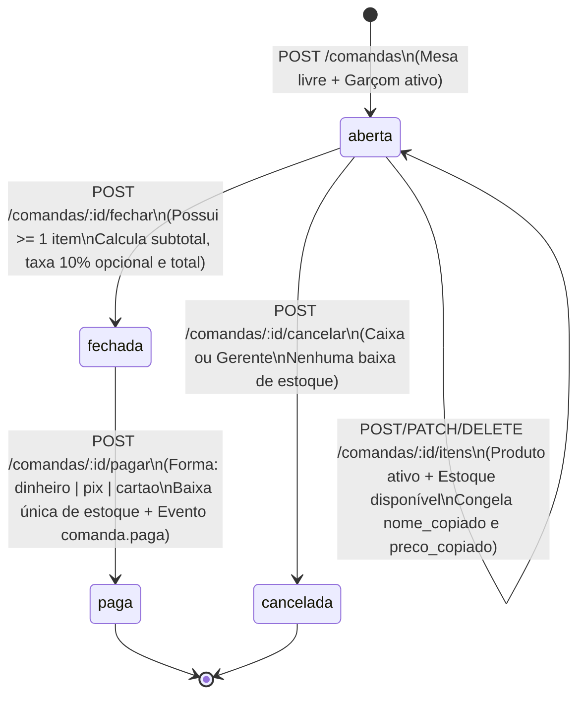
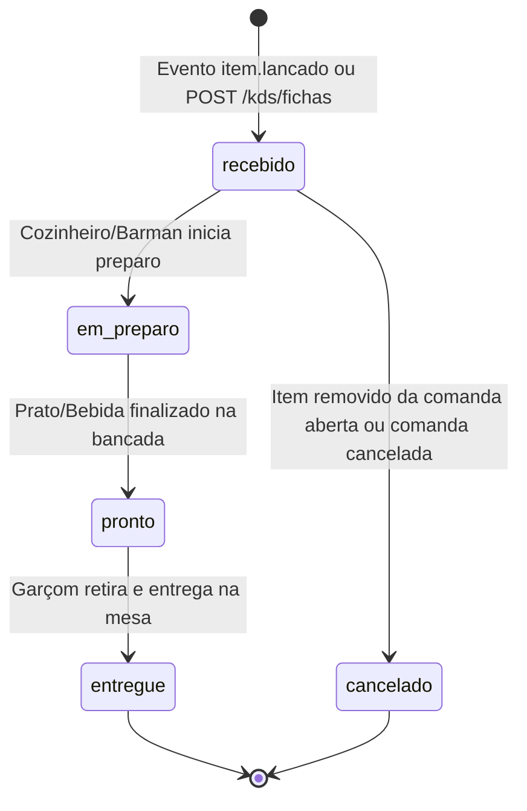
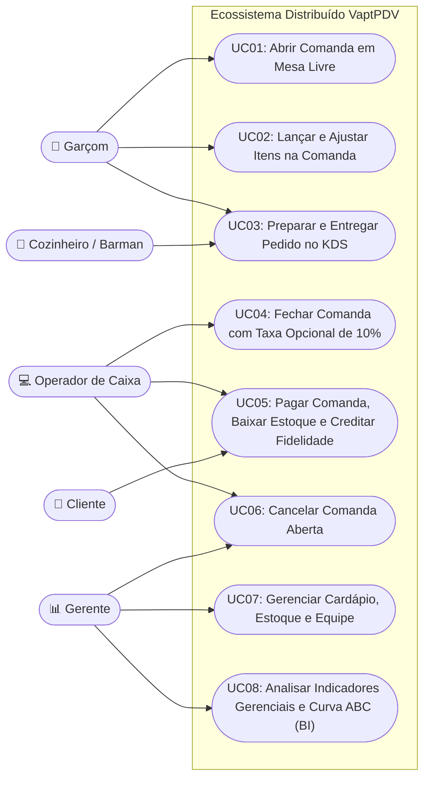

# 02 - Especificação de Requisitos de Software (SRS)

| Metadado | Valor |
| :--- | :--- |
| **Projeto** | **VaptPDV** |
| **Data** | 21 de Outubro de 2026 |
| **Equipe de Desenvolvimento** | Kaio França e Mateus Neri |

---

## 1. Introdução

### 1.1 Propósito deste Documento
Esta Especificação de Requisitos de Software (**SRS**) define, de maneira completa, verificável e rastreável, os Requisitos Funcionais (**RF01 a RF34**), o Catálogo de Regras de Negócio (**RN01 a RN24**), os Requisitos Não Funcionais (**RNF01 a RNF12**) e os Casos de Uso Detalhados (**UC01 a UC08**) do sistema **VaptPDV**. Este documento serve como contrato técnico definitivo para implementação, testes automatizados, validação acadêmica nos 4 módulos de Sistemas Distribuídos e operação em nuvem AWS EC2.

### 1.2 Convenções, Acrônimos e Definições
- **PDV Core:** Núcleo transacional do sistema (Frontend Web/PWA + Backend Fastify/TypeScript + Prisma + PostgreSQL em `:3000`, banco `vaptpdv_db`) responsável por Usuários, Produtos/Estoque e Comandas.
- **KDS (`kds-service`):** *Kitchen Display System* (`:3001`, banco `kds_db`) — Microsserviço satélite responsável pela fila de preparo da cozinha e do bar.
- **Fidelidade (`fidelidade-service`):** Microsserviço satélite (`:3002`, banco `fidelidade_db`) responsável pelo cadastro de clientes do clube de fidelidade, acúmulo de pontos/cashback (5%) e emissão de recibos digitais.
- **Analytics/BI (`analytics-bi-service`):** Microsserviço satélite (`:3003`, banco `analytics_db`) responsável pela consolidação analítica (OLAP), faturamento por período, Curva ABC de produtos, ranking de garçons e alertas de giro de estoque.
- **RabbitMQ (`vaptpdv.eventos`):** Message Broker AMQP 0-9-1 (`:5672` AMQP / `:15672` Management) responsável pelo barramento assíncrono dos eventos `item.lancado`, `item.pronto`, `comanda.paga` e `estoque.movimentado`.
- **OLTP (*Online Transaction Processing*):** Processamento transacional de baixa latência executado no banco do PDV Core.
- **OLAP (*Online Analytical Processing*):** Processamento analítico desacoplado executado no banco do `analytics-bi-service`.
- **Prioridades (MoSCoW):**
  - **Essencial (Must Have):** Indispensável para o funcionamento operacional do módulo correspondente.
  - **Importante (Should Have):** Agrega alto valor operacional e arquitetural nos módulos distribuídos.
  - **Desejável (Could Have):** Refinamento de experiência e visualização complementar.

---

## 2. Descrição Geral do Sistema e Arquitetura de Estados

### 2.1 Máquina de Estados da Comanda (`PDV Core`)
A entidade central do sistema é a **Comanda**. Seu ciclo de vida é estritamente controlado pelo backend segundo o diagrama abaixo:

### 2.2 Máquina de Estados da Ficha de Preparo (`kds-service`)
Cada item lançado em uma comanda gera uma ficha de preparo no **KDS** com o seguinte ciclo de vida:

---

## 3. Requisitos Funcionais (RF01 a RF33)

### 3.1 Requisitos Funcionais do Núcleo Operacional — `PDV Core` (RF01 a RF18)

| ID | Requisito Funcional | Descrição Técnica e Critérios de Aceitação | Prioridade | Módulo Alvo |
| :--- | :--- | :--- | :--- | :--- |
| **RF01** | **Gerenciar Produtos do Cardápio (CRUD + Inativação)** | O sistema deve permitir ao perfil `gerente` cadastrar (`POST /produtos`), listar com filtros de categoria e status (`GET /produtos?categoria=&ativo=`), consultar por ID (`GET /produtos/:id`), atualizar parcialmente (`PATCH /produtos/:id`) e inativar (`POST /produtos/:id/inativar`) produtos contendo `nome`, `categoria`, `preco` (`Decimal`), `estoque` (`Int >= 0`), `estoque_minimo` (`Int >= 0`) e `ativo` (`Boolean`). | Essencial | Módulo 1 |
| **RF02** | **Gerenciar Usuários Operadores (CRUD + Inativação)** | O sistema deve permitir cadastrar (`POST /usuarios`), listar por perfil e status (`GET /usuarios?perfil=&ativo=`), consultar (`GET /usuarios/:id`), atualizar (`PATCH /usuarios/:id`) e inativar (`POST /usuarios/:id/inativar`) usuários com `nome`, `perfil` (`garcom`, `caixa`, `gerente`, `cozinha`) e `ativo` (`Boolean`). | Essencial | Módulo 1 |
| **RF03** | **Abrir Comanda em Mesa Livre** | O sistema deve permitir abrir uma nova comanda (`POST /comandas`) informando `mesa`, `garcom_id` e `nome_cliente` (opcional). A comanda nasce com `status = "aberta"` e timestamp `aberta_em`. Deve rejeitar com `409 MESA_OCUPADA` se já houver comanda `aberta` na mesma mesa e com `422 GARCOM_INVALIDO` se o usuário não existir, estiver inativo ou não possuir perfil `garcom`. | Essencial | Módulo 1 |
| **RF04** | **Lançar Item em Comanda Aberta com Congelamento de Preço** | O sistema deve permitir adicionar um item a uma comanda `aberta` (`POST /comandas/:id/itens`) informando `produto_id` e `quantidade` ($> 0$). No ato do lançamento, o backend deve copiar e gravar no item os campos `nome_copiado` e `preco_copiado` a partir do cadastro vigente do produto. | Essencial | Módulo 1 |
| **RF05** | **Ajustar Quantidade ou Remover Item de Comanda Aberta** | O sistema deve permitir alterar a quantidade de um item já lançado (`PATCH /comandas/:id/itens/:itemId` com `quantidade > 0`, validando disponibilidade de estoque para acréscimos) ou remover o item (`DELETE /comandas/:id/itens/:itemId`), exclusivamente enquanto a comanda estiver `aberta`. | Essencial | Módulo 1 |
| **RF06** | **Fechar Comanda e Calcular Subtotal** | O sistema deve permitir ao caixa encerrar o consumo de uma comanda `aberta` que possua ao menos um item (`POST /comandas/:id/fechar`), alterando seu status para `fechada`, registrando `fechada_em`, bloqueando novas alterações de itens e calculando `subtotal = Σ(preco_copiado × quantidade)`. | Essencial | Módulo 1 |
| **RF07** | **Registrar Pagamento da Comanda** | O sistema deve permitir ao caixa liquidar uma comanda `fechada` (`POST /comandas/:id/pagar`) informando `forma_pagamento` (`dinheiro`, `pix` ou `cartao`), alterando seu status para `paga`, gravando `paga_em` e tornando o registro definitivamente imutável. | Essencial | Módulo 1 |
| **RF08** | **Cancelar Comanda Aberta** | O sistema deve permitir ao caixa ou gerente cancelar uma comanda que esteja no status `aberta` (`POST /comandas/:id/cancelar`), transitando-a para `cancelada` (imutável) sem realizar qualquer baixa no estoque. Comandas `fechadas` ou `pagas` não podem ser canceladas (`409`). | Essencial | Módulo 1 |
| **RF09** | **Listar e Filtrar Comandas** | O sistema deve permitir listar comandas (`GET /comandas`) com suporte a filtros combinados por `status` (`aberta`, `fechada`, `paga`, `cancelada`), `mesa` e intervalo de datas de abertura (`de`, `ate`), além de paginação (`limit` e `offset`), ordenadas da mais recente para a mais antiga. | Essencial | Módulo 1 |
| **RF10** | **Consultar Detalhe Completo da Comanda** | O sistema deve retornar os dados completos de uma comanda (`GET /comandas/:id`), incluindo a lista de itens com `nome_copiado`, `preco_copiado`, `quantidade`, `subtotal`, `taxa_servico`, `total`, `forma_pagamento` e timestamps de ciclo de vida (`aberta_em`, `fechada_em`, `paga_em`). | Essencial | Módulo 1 |
| **RF11** | **Bloquear Lançamento de Produto Inativo** | O sistema deve impedir o lançamento de qualquer produto cujo atributo `ativo` seja `false`, retornando erro HTTP `422 PRODUTO_INATIVO`. | Essencial | Módulo 1 |
| **RF12** | **Executar Baixa de Estoque e Registrar Movimento no Pagamento** | Na transição da comanda para `paga` (de forma síncrona no Módulo 1–3 ou assíncrona via evento `comanda.paga` no Módulo 4), o sistema deve deduzir a `quantidade` de cada item do `estoque` do respectivo produto uma única vez e gravar um registro auditável em `Movimento de Estoque` contendo `produto_id`, `quantidade`, `motivo` (`VENDA_COMANDA #<id>`), `comanda_id` e `data`. | Essencial | Módulos 1 e 4 |
| **RF13** | **Bloquear Lançamento sem Estoque Disponível** | O sistema deve validar no momento do lançamento ou aumento de quantidade se `produto.estoque >= quantidade_solicitada`, rejeitando a operação com HTTP `409 ESTOQUE_INSUFICIENTE` caso o saldo seja menor. | Essencial | Módulo 1 |
| **RF14** | **Aplicar Taxa de Serviço Opcional de 10% no Fechamento** | Na chamada de fechamento (`POST /comandas/:id/fechar`), o sistema deve receber o booleano `aplicar_taxa_servico`. Se `true`, calcula `taxa_servico = round_half_up(subtotal × 0.10, 2)`; se `false`, define `taxa_servico = "0.00"`. O campo `total` deve ser gravado como `subtotal + taxa_servico`. | Essencial | Módulo 1 |
| **RF15** | **Interface Frontend Web/PWA — Modo Garçom (Salão)** | O sistema deve prover uma interface Web/PWA responsiva otimizada para smartphones (uso com uma mão), permitindo ao garçom visualizar o mapa de mesas (livres vs. ocupadas), abrir comandas, buscar produtos ativos no cardápio por categoria, lançar/ajustar itens rapidamente e acompanhar o status de preparo vindo do KDS. | Importante | Módulo 1+ |
| **RF16** | **Interface Frontend Web/PWA — Modo Caixa e Retaguarda** | O sistema deve prover na interface Web/PWA uma visão para tablets e desktops dedicada ao operador de caixa e gerente, permitindo filtrar comandas abertas/fechadas, conferir o extrato detalhado da mesa, optar pela taxa de 10%, registrar o pagamento (`dinheiro`, `pix`, `cartao`), vincular CPF de fidelidade e gerenciar o cadastro de produtos e usuários. | Importante | Módulo 1+ |
| **RF17** | **Expor Endpoints Internos de Fronteira de Contexto** | O núcleo deve expor contratos explícitos de validação entre os contextos `Usuários` (`GET /usuarios/:id/validar-garcom`) e `Produtos` (`GET /produtos/:id/disponibilidade?quantidade=N` e `POST /produtos/baixa-estoque`), garantindo desacoplamento via interfaces de gateway desde o Módulo 1. | Essencial | Módulos 1 e 2 |
| **RF18** | **Monitoramento de Saúde (`Health Check`) e Documentação OpenAPI** | Todos os serviços do ecossistema devem expor `GET /health` (verificando conectividade com seu banco de dados e retornando `200 {"status":"ok"}`) e `GET /docs` com a especificação interativa OpenAPI/Swagger gerada a partir dos schemas. | Essencial | Módulo 1 a 4 |
| **RF34** | **Login Operacional por Perfil e Roteamento de Estação** | O frontend deve prover tela de login operacional (`/login`) permitindo selecionar o operador ativo (`GET /usuarios?ativo=true`), definir o usuário logado no store da sessão (`useSessionStore`) e despachar imediatamente para a rota/estação de trabalho correspondente ao seu perfil: `garcom` $\rightarrow$ Modo Garçom PWA (`/garcom`), `caixa` $\rightarrow$ Modo Caixa Desktop (`/caixa`), `gerente` $\rightarrow$ Painel de Gestão (`/gestao`), `cozinha` $\rightarrow$ Painel KDS (`/kds`). No Módulo 1, opera sem exigência de senha/JWT para máxima fluidez de salão. | Essencial | Módulo 1+ |

---

### 3.2 Requisitos Funcionais do `kds-service` — Painel de Cozinha e Bar (RF19 a RF23)

| ID | Requisito Funcional | Descrição Técnica e Critérios de Aceitação | Prioridade | Módulo Alvo |
| :--- | :--- | :--- | :--- | :--- |
| **RF19** | **Receber Fichas de Preparo de Itens Lançados** | O `kds-service` deve criar automaticamente uma ficha de preparo sempre que um item for lançado em uma comanda, seja via chamada HTTP (`POST /kds/fichas` nos Módulos 2–3) ou via consumo do evento `item.lancado` no RabbitMQ (Módulo 4). A ficha deve armazenar `id`, `comanda_id`, `item_id`, `mesa`, `nome_produto`, `categoria` (`cozinha` ou `bar`), `quantidade`, `nome_garcom`, `status` (`recebido`) e `criado_em`. | Essencial | Módulos 2 a 4 |
| **RF20** | **Gerenciar Transição de Estados de Preparo** | O `kds-service` deve permitir atualizar o status de uma ficha (`PATCH /kds/fichas/:id/status`) respeitando a ordem `recebido` $\rightarrow$ `em_preparo` $\rightarrow$ `pronto` $\rightarrow$ `entregue` (ou `cancelado`), registrando os timestamps `iniciado_em`, `pronto_em` e `entregue_em` para cálculo de tempo médio de preparo ( SLA de cozinha). | Essencial | Módulos 2 a 4 |
| **RF21** | **Listar Fila de Preparo para o Painel Visual (Cozinha e Bar)** | O `kds-service` deve expor `GET /kds/fila?setor=cozinha|bar&status=` retornando as fichas ativas (`recebido`, `em_preparo`, `pronto`) ordenadas por ordem cronológica de chegada (FIFO), destacando visualmente pedidos cujo tempo de espera ultrapasse o limite parametrizado (ex.: 15 minutos). | Importante | Módulos 2 a 4 |
| **RF22** | **Consultar Pendências de Preparo por Comanda (Integração Síncrona)** | O `kds-service` deve expor `GET /kds/comandas/:comandaId/status-preparo` para que o `PDV Core` consulte sincronicamente se há itens ainda `recebido` ou `em_preparo` antes ou durante o fechamento da conta, exibindo aviso preventivo ao operador de caixa. | Importante | Módulo 2 |
| **RF23** | **Cancelar Fichas de Preparo de Itens Estornados** | Caso um item seja removido da comanda aberta ou a comanda seja cancelada, o `kds-service` deve permitir marcar a ficha correspondente como `cancelado` (se ainda não estiver `entregue`), evitando desperdício de insumos na cozinha. | Desejável | Módulos 2 a 4 |

---

### 3.3 Requisitos Funcionais do `fidelidade-service` — Fidelidade, Cashback e Recibos (RF24 a RF28)

| ID | Requisito Funcional | Descrição Técnica e Critérios de Aceitação | Prioridade | Módulo Alvo |
| :--- | :--- | :--- | :--- | :--- |
| **RF24** | **Cadastrar e Consultar Participante do Clube de Fidelidade** | O `fidelidade-service` deve permitir cadastrar clientes (`POST /fidelidade/clientes`) e consultá-los rapidamente por CPF ou telefone (`GET /fidelidade/clientes?documento=`), armazenando `id`, `nome`, `cpf` (único), `telefone`, `email` (opcional), `saldo_pontos` (`Int`), `saldo_cashback` (`Decimal` de 2 casas) e `criado_em`. | Essencial | Módulos 2 a 4 |
| **RF25** | **Consultar Elegibilidade e Saldo de Cliente pelo PDV Core (HTTP Síncrono)** | O `fidelidade-service` deve expor `GET /fidelidade/clientes/:cpf/resumo` para que o `PDV Core`, no momento da abertura ou fechamento da comanda, valide sincronicamente a existência do cliente e exiba no caixa seu saldo atual de pontos e cashback acumulado. | Importante | Módulo 2 |
| **RF26** | **Creditar Pontos e Cashback Automaticamente por Comanda Paga** | Ao receber a confirmação de pagamento de uma comanda vinculada a um cliente (via `POST /fidelidade/creditar` no Módulo 2/3 ou consumindo o evento `comanda.paga` no Módulo 4), o `fidelidade-service` deve calcular e creditar **5% do `subtotal` da comanda em cashback** (`round_half_up(subtotal × 0.05, 2)`) e **1 ponto para cada R\$ 1,00 inteiro gasto**, garantindo idempotência estrita por `comanda_id`. | Essencial | Módulos 2 e 4 |
| **RF27** | **Gerar e Armazenar Recibo Digital da Comanda Paga** | Para toda comanda paga processada, o `fidelidade-service` deve gerar um registro de **Recibo Digital** (`GET /fidelidade/recibos/:comandaId`) contendo cabeçalho do estabelecimento, mesa, garçom, itens consumidos, `subtotal`, `taxa_servico`, `total`, forma de pagamento, cashback ganho na transação e hash de autenticidade operacional. | Importante | Módulos 2 a 4 |
| **RF28** | **Consultar Extrato de Movimentações de Fidelidade** | O `fidelidade-service` deve expor `GET /fidelidade/clientes/:id/extrato`, listando todo o histórico de créditos de pontos/cashback com referência ao `comanda_id`, valor base da compra e data/hora do evento. | Desejável | Módulos 2 a 4 |

---

### 3.4 Requisitos Funcionais do `analytics-bi-service` — Analytics, BI e Relatórios OLAP (RF29 a RF33)

| ID | Requisito Funcional | Descrição Técnica e Critérios de Aceitação | Prioridade | Módulo Alvo |
| :--- | :--- | :--- | :--- | :--- |
| **RF29** | **Ingerir Eventos de Domínio e Consolidar Base OLAP** | O `analytics-bi-service` deve ingerir de maneira idempotente os eventos `comanda.paga`, `item.lancado` e `estoque.movimentado` (via RabbitMQ no Módulo 4 ou webhook interno no Módulo 2/3), mantendo tabelas analíticas desnormalizadas em seu próprio banco (`analytics_db`) sem realizar queries no banco transacional do PDV Core. | Essencial | Módulos 2 e 4 |
| **RF30** | **Relatório de Faturamento por Período e Forma de Pagamento** | O `analytics-bi-service` deve expor `GET /analytics/faturamento?de=&ate=&agrupamento=dia|mes`, retornando: receita bruta (`total`), receita líquida de produtos (`subtotal`), total arrecadado em `taxa_servico` (10%), quantidade de comandas pagas, **ticket médio por comanda** e distribuição percentual por `forma_pagamento` (`dinheiro`, `pix`, `cartao`). | Essencial | Módulos 2 a 4 |
| **RF31** | **Ranking de Produtos Mais Vendidos e Curva ABC** | O `analytics-bi-service` deve expor `GET /analytics/produtos/curva-abc?de=&ate=&categoria=`, classificando os produtos vendidos por volume total (`quantidade` acumulada) e participação na receita (`Σ(preco_copiado × quantidade)`), categorizando-os nas faixas **A** (até 80% da receita), **B** (80% a 95%) e **C** (últimos 5%). | Importante | Módulos 2 a 4 |
| **RF32** | **Relatório de Desempenho e Comissões por Garçom** | O `analytics-bi-service` deve expor `GET /analytics/garcons/desempenho?de=&ate=`, consolidando para cada `garcom_id`: número de mesas atendidas, valor total vendido em produtos, valor total de `taxa_servico` (10%) gerada para repasse de comissão e ticket médio das mesas sob sua responsabilidade. | Importante | Módulos 2 a 4 |
| **RF33** | **Histórico de Giro e Painel de Alertas de Estoque Mínimo** | O `analytics-bi-service` deve expor `GET /analytics/estoque/alertas`, listando todos os produtos ativos cujo saldo atual (`estoque`) seja menor ou igual ao `estoque_minimo` (`estoque <= estoque_minimo`), acompanhado da velocidade média de saída diária (giro de estoque) e estimativa de ruptura. | Importante | Módulos 2 a 4 |

---

## 4. Catálogo Completo de Regras de Negócio (RN01 a RN22)

As Regras de Negócio abaixo governam invariantes de domínio e restrições arquiteturais em todo o ecossistema **VaptPDV**. As regras **RN01 a RN13** constituem o núcleo invariante do domínio de Comandas, Produtos e Usuários; as regras **RN14 a RN22** regem a operação distribuída com os microsserviços satélites e mensageria.

### 4.1 Regras do Núcleo de Domínio (RN01 a RN13)

| Código | Título da Regra | Definição Normativa e Impacto no Sistema | Requisitos Relacionados |
| :--- | :--- | :--- | :--- |
| **RN01** | **Edição Exclusiva em Comanda Aberta** | Uma comanda só aceita lançamento (`POST`), ajuste de quantidade (`PATCH`) ou remoção (`DELETE`) de itens enquanto seu status for estritamente `aberta`. Qualquer tentativa em status `fechada`, `paga` ou `cancelada` deve retornar `409 COMANDA_NAO_ABERTA` (ou `COMANDA_IMUTAVEL`). | RF04, RF05, RF06 |
| **RN02** | **Pagamento Exclusivo de Comanda Fechada** | Só é permitido registrar o pagamento (`POST /comandas/:id/pagar`) de uma comanda cujo status atual seja estritamente `fechada`. Tentativas sobre comandas `abertas` ou `canceladas` devem retornar `409 COMANDA_NAO_FECHADA`. | RF06, RF07 |
| **RN03** | **Imutabilidade de Estados Terminais** | Uma comanda com status `paga` ou `cancelada` encontra-se em estado terminal definitivo: não pode ter itens alterados, não pode ser reaberta, não pode ser fechada novamente nem cancelada (`409 COMANDA_IMUTAVEL`). | RF07, RF08 |
| **RN04** | **Congelamento Histórico de Nome e Preço no Item** | Cada item lançado guarda cópia fiel do nome (`nome_copiado`) e do preço unitário (`preco_copiado`) do produto no exato instante do lançamento. Alterações posteriores de nome ou preço no cadastro de produtos (`PATCH /produtos/:id`) **jamais** alteram itens já lançados em comandas abertas, fechadas ou pagas. | RF01, RF04, RF10 |
| **RN05** | **Cálculo Backend do Subtotal no Fechamento** | O `subtotal` da comanda é calculado exclusivamente pelo servidor no momento do fechamento a partir da fórmula $\text{subtotal} = \sum (\text{preco\_copiado} \times \text{quantidade})$ dos itens vigentes na comanda. Antes do fechamento, `subtotal`, `taxa_servico` e `total` permanecem `null` no registro persistido. | RF06, RF10 |
| **RN06** | **Proibição de Venda de Produto Inativo** | Produto com atributo `ativo = false` não pode ser lançado em nenhuma comanda (`422 PRODUTO_INATIVO`), embora continue existindo no banco para preservar a integridade referencial de vendas passadas. | RF01, RF04, RF11 |
| **RN07** | **Unicidade de Comanda Aberta por Mesa** | Não pode existir mais de uma comanda com `status = "aberta"` para o mesmo número/identificador de `mesa` simultaneamente. Essa invariante deve ser garantida tanto na aplicação quanto por **índice único parcial no PostgreSQL** (`CREATE UNIQUE INDEX ... ON comandas (mesa) WHERE status = 'aberta'`). Assim que a comanda muda para `fechada`, `paga` ou `cancelada`, a mesa fica livre imediatamente. | RF03, RF06, RF08 |
| **RN08** | **Obrigatoriedade de Garçom Válido e Ativo** | Toda abertura de comanda exige um `garcom_id` correspondente a um usuário existente, com `ativo = true` e `perfil = "garcom"`. Usuários inativos ou com perfil `caixa`/`gerente` são rejeitados na abertura com `422 GARCOM_INVALIDO`. | RF02, RF03, RF17 |
| **RN09** | **Quantidade Estritamente Positiva** | A quantidade de qualquer item lançado ou ajustado em uma comanda deve ser um número inteiro estritamente maior que zero ($\text{quantidade} > 0$). Valores $\le 0$ ou fracionados retornam `400 VALIDACAO`. | RF04, RF05 |
| **RN10** | **Baixa Única de Estoque Exclusiva no Pagamento** | A dedução do saldo de estoque dos produtos ocorre **uma única vez por comanda**, exclusivamente quando a comanda transita para `paga`, gerando um registro em `Movimento de Estoque` vinculado ao `comanda_id`. Comandas `canceladas` nunca movimentam estoque. | RF07, RF08, RF12 |
| **RN11** | **Proibição de Fechamento de Comanda Vazia** | Uma comanda que não possua pelo menos 1 item vigente (`itens.length === 0`) não pode ser fechada, retornando `409 COMANDA_SEM_ITENS`. Caso tenha sido aberta por engano, deve ser cancelada (`POST /comandas/:id/cancelar`). | RF06, RF08 |
| **RN12** | **Taxa de Serviço Opcional de 10% Segregada** | A cobrança da taxa de serviço de 10% sobre o subtotal é opcional no ato do fechamento (`aplicar_taxa_servico: true | false`). Quando aplicada, utiliza arredondamento financeiro `ROUND_HALF_UP` para 2 casas decimais. Os valores de `subtotal`, `taxa_servico` e `total` ($\text{subtotal} + \text{taxa\_servico}$) devem ficar armazenados em colunas separadas. | RF06, RF14 |
| **RN13** | **Validação Estrita de Disponibilidade de Estoque** | Nenhum produto pode ser lançado (ou ter sua quantidade aumentada) se a quantidade solicitada superar o saldo disponível em estoque (`produto.estoque < quantidade_adicional`), retornando `409 ESTOQUE_INSUFICIENTE`. | RF04, RF05, RF13 |

### 4.2 Regras de Arquitetura, Dados e Microsserviços Satélites (RN14 a RN22)

| Código | Título da Regra | Definição Normativa e Impacto no Sistema | Requisitos Relacionados |
| :--- | :--- | :--- | :--- |
| **RN14** | **Proibição Absoluta de Exclusão Física (Soft Delete Only)** | Registros de **Produtos**, **Usuários** e **Clientes de Fidelidade** jamais podem sofrer exclusão física (`DELETE FROM`) no banco de dados. A remoção operacional ocorre exclusivamente por inativação lógica (`ativo = false`), preservando auditoria e chaves estrangeiras históricas. | RF01, RF02, RF24 |
| **RN15** | **Precisão Monetária Decimal Exata** | É proibido o uso de tipos de ponto flutuante binário (`Float`, `REAL`, `DOUBLE PRECISION` ou aritmética nativa `number` sem controle decimal) para valores monetários. No banco utiliza-se `DECIMAL(10,2)` / `NUMERIC(10,2)` e, nos contratos JSON da API, strings decimais formatadas com exatamente 2 casas (ex.: `"12.50"`). | RF01, RF04, RF06, RF14, RF26, RF30 |
| **RN16** | **Isolamento de Fronteira de Contexto e Bancos de Dados** | Nenhum módulo ou microsserviço pode acessar tabelas de outro contexto via `JOIN` SQL ou cliente Prisma compartilhado. No Módulo 1 a comunicação respeita interfaces de Gateway em memória; a partir do Módulo 2 cada serviço possui seu próprio banco lógico (`Database-per-Service`) e comunica-se exclusivamente via HTTP REST ou eventos RabbitMQ. | RF17, RF19, RF25, RF29 |
| **RN17** | **Degradação Graciosa perante Falha de Satélites** | A indisponibilidade ou lentidão dos microsserviços satélites (`kds-service`, `fidelidade-service`, `analytics-bi-service`) **não pode bloquear nem abortar** as operações vitais do `PDV Core` (abrir comanda, lançar item, fechar conta e receber pagamento). Chamadas síncronas não críticas devem possuir timeout curto ($\le 2000\text{ ms}$) e fallback seguro; chamadas a dependências obrigatórias fora do ar retornam `503 SERVICO_INDISPONIVEL` indicando o serviço afetado em `detalhes.servico`. | RF03, RF04, RF07, RF22, RF25 |
| **RN18** | **Idempotência de Consumidores de Eventos (`comanda_id` / `item_id`)** | Como brokers de mensageria operam com semântica *at-least-once delivery* (uma mensagem pode ser entregue mais de uma vez em caso de falha de rede ou *redelivery*), todo consumidor do evento `comanda.paga` (baixa de estoque em Produtos, crédito de cashback em Fidelidade e consolidação em Analytics) deve verificar previamente se o `comanda_id` já foi processado, ignorando duplicatas com `ack` seguro. O mesmo vale para `item_id` no `kds-service`. | RF12, RF19, RF26, RF29 |
| **RN19** | **Regra de Cálculo de Cashback e Pontos de Fidelidade** | O benefício de fidelidade incide exclusivamente sobre o `subtotal` de produtos consumidos (excluindo a `taxa_servico` de 10% destinada ao garçom) e somente após a comanda atingir o status `paga`. A alíquota padrão é de **5% de cashback** e **1 ponto por R\$ 1,00 inteiro de subtotal**. Comandas sem cliente vinculado pagam normalmente sem gerar pontos. | RF24, RF26, RF27 |
| **RN20** | **Sequenciamento de Estados da Ficha KDS** | Uma ficha de preparo no `kds-service` nasce no estado `recebido` e só pode avançar linearmente (`recebido` $\rightarrow$ `em_preparo` $\rightarrow$ `pronto` $\rightarrow$ `entregue`), exceto quando cancelada enquanto ainda estiver em `recebido`. Fichas já `entregues` são imutáveis. | RF19, RF20, RF23 |
| **RN21** | **Isolamento Estrito OLTP vs. OLAP** | Consultas agregadas de relatórios gerenciais, Curva ABC, somatórios mensais e rankings de garçom nunca devem ser executadas diretamente sobre as tabelas transacionais de `Comandas` do PDV Core durante o atendimento. Toda carga analítica é servida a partir das visões materializadas/consolidados do `analytics-bi-service`. | RF29, RF30, RF31, RF32, RF33 |
| **RN22** | **Roteamento de Setor no KDS por Categoria do Produto** | O `kds-service` classifica automaticamente o destino da ficha de preparo (`setor = "bar"` ou `setor = "cozinha"`) com base na `categoria` do produto lançado (ex.: categorias `Bebidas`, `Cervejas`, `Drinks` vão para o painel do **Bar**; categorias `Porções`, `Lanches`, `Pratos`, `Espetinhos` vão para o painel da **Cozinha**). | RF19, RF21 |
| **RN23** | **Login Operacional por Perfil sem Senha no Módulo 1** | O acesso ao sistema no Módulo 1 é baseado na seleção de perfil e operador ativo da equipe (`garcom`, `caixa`, `gerente`, `cozinha`), sem autenticação pesada (sem JWT/senhas/OAuth). A troca de operador pode ocorrer a qualquer momento através do cabeçalho operacional ou tela `/login`, redirecionando o operador para sua respectiva estação de trabalho. | RF02, RF34 |
| **RN24** | **Mapeamento de Formas de Pagamento e Quitação Parcial (Split)** | A API persiste formalmente `forma_pagamento: "dinheiro" | "pix" | "cartao"`. No frontend do Modo Caixa, as opções de cartão de crédito, débito e vale-refeição são mapeadas para o valor canônico `"cartao"`. A interface de quitação suporta split payments em múltiplas parcelas até que o saldo restante seja igual a `0.00`, momento no qual a comanda é liquidada no backend. | RF07, RF16 |

---

## 5. Requisitos Não Funcionais (RNF01 a RNF12)

| ID | Categoria (ISO 25010) | Título do Requisito | Especificação Mensurável e Critério de Verificação |
| :--- | :--- | :--- | :--- |
| **RNF01** | **Desempenho (Performance Efficiency)** | Latência do Caminho Crítico de Salão e Caixa | As operações de abertura de comanda (`POST /comandas`), lançamento de item (`POST /comandas/:id/itens`), fechamento (`POST /comandas/:id/fechar`) e pagamento (`POST /comandas/:id/pagar`) devem responder em **menos de 1000 ms (1 segundo)** no percentil 95 (P95) sob carga normal de até 30 mesas simultâneas. |
| **RNF02** | **Disponibilidade e Resiliência (Reliability)** | Tolerância a Falhas Parciais e Timeout entre Serviços | Toda chamada HTTP síncrona entre serviços (Módulo 2+) deve configurar timeout explícito de **2000 ms**. Quando uma dependência obrigatória estiver indisponível, o serviço chamador não pode travar nem encerrar o processo: deve capturar a falha e responder em até 2,5 s com HTTP `503` e payload padronizado `{"erro": {"codigo": "SERVICO_INDISPONIVEL", "mensagem": "...", "detalhes": {"servico": "..."}}}`. |
| **RNF03** | **Integridade e Concorrência (Data Integrity)** | Transações ACID e Prevenção de Condição de Corrida | Toda mutação de estado de comanda (lançar item, fechar, pagar, cancelar) deve executar dentro de uma transação de banco de dados verificando o status atual. A restrição de uma única comanda aberta por mesa deve ser protegida no nível do SGBD por índice único parcial (`WHERE status = 'aberta'`), impedindo que dois garçons abram a mesma mesa simultaneamente. |
| **RNF04** | **Precisão Financeira (Accuracy)** | Aritmética Decimal Livre de Ponto Flutuante | O armazenamento no PostgreSQL deve utilizar `DECIMAL(10,2)` e a camada de aplicação TypeScript deve operar com `Prisma.Decimal` (ou aritmética inteira em centavos), garantindo erro zero de representação binária (como `0.1 + 0.2 !== 0.3`). |
| **RNF05** | **Usabilidade e Ergonomia (Usability)** | Interface Web/PWA Mobile-First para o Garçom | O Frontend do Modo Garçom deve ser responsivo para viewports a partir de `360px` de largura, com botões de toque mínimo de `44x44px`, permitindo lançar um item em uma mesa aberta em no máximo **3 interações (toques)**. |
| **RNF06** | **Segurança (Security)** | Gestão de Segredos e Sanitização de Erros | Nenhuma credencial de banco (`DATABASE_URL`), senha do RabbitMQ ou chave privada pode constar no código-fonte ou histórico Git. Toda configuração sensível deve ser injetada via variáveis de ambiente (`.env`), com template documentado em `.env.example`. Respostas de erro `500 ERRO_INTERNO` jamais devem expor *stack traces* ou detalhes internos do banco ao cliente. |
| **RNF07** | **Observabilidade (Observability)** | Logs Estruturados e Monitoramento de Saúde | Todos os serviços devem emitir logs estruturados em JSON (via Pino/Fastify) contendo `timestamp`, `level`, `service`, `requestId` e `comanda_id` (quando aplicável), além de disponibilizar a rota `GET /health` verificando a conexão ativa com o PostgreSQL. |
| **RNF08** | **Portabilidade em Nuvem IaaS (Portability — Módulo 1)** | Implantação Nativa em Máquina Virtual AWS EC2 | No Módulo 1, o sistema deve rodar diretamente em uma instância **AWS EC2 (Ubuntu Server LTS)** com Node.js $\ge 20$ e PostgreSQL instalados na própria máquina virtual, gerenciado por supervisor de processos (`pm2` ou `systemd`) e acessível publicamente via IP/DNS público da EC2 com regras de *Security Group* restritas às portas necessárias. |
| **RNF09** | **Portabilidade em Containers (Portability — Módulo 3)** | Empacotamento Docker e Persistência de Volumes | A partir do Módulo 3, cada serviço deve possuir um `Dockerfile` multi-stage baseado em imagem enxuta (`node:20-alpine`) rodando com usuário não-root, e o ambiente completo deve subir com um único comando (`docker compose up -d --build`), preservando 100% dos dados dos bancos PostgreSQL em volumes nomeados após reinicialização (`docker compose down && docker compose up`). |
| **RNF10** | **Confiabilidade Assíncrona (Message Durability — Módulo 4)** | Persistência de Filas e Confirmação Manual no RabbitMQ | No Módulo 4, as filas do RabbitMQ devem ser declaradas como **duráveis** (`durable: true`), as mensagens publicadas como **persistentes** (`persistent: true`) e os consumidores devem utilizar **confirmação manual** (`noAck: false`), enviando `ack` somente após o commit da transação local no banco de dados do serviço consumidor. |
| **RNF11** | **Padronização de Interoperabilidade (Interoperability)** | Contrato REST JSON e Documentação OpenAPI Viva | Todas as APIs do ecossistema devem comunicar-se em JSON (`UTF-8`), datas em formato `ISO 8601 UTC`, validação de entrada por JSON Schema no Fastify e documentação automática disponível em `/docs`. |
| **RNF12** | **Manutenibilidade e Rastreabilidade Acadêmica (Maintainability)** | Reprodutibilidade e Versionamento por Entregas | O repositório deve manter `README.md` autoexplicativo, `CHANGELOG.md` atualizado por entrega e tags Git imutáveis correspondentes aos quatro módulos avaliativos da UERN (`entrega-1-cloud`, `entrega-2-microsservicos`, `entrega-3-containers`, `entrega-4-mensageria`). |

---

## 6. Casos de Uso Detalhados (UC01 a UC08)

### Diagrama Geral de Casos de Uso UML

---

### UC01 — Abrir Comanda em Mesa Livre
- **Ator Principal:** Garçom (`garcom`).
- **Requisitos e Regras Associados:** RF03, RF15, RF17, RN07, RN08.
- **Pré-condições:**
  1. O garçom está cadastrado e com `ativo = true` e `perfil = "garcom"`.
  2. A mesa desejada não possui nenhuma comanda com `status = "aberta"`.
- **Fluxo Principal (Caminho Feliz):**
  1. No Modo Garçom (PWA) ou via API (`POST /comandas`), o garçom informa o identificador da `mesa` (ex.: `12`), seu `garcom_id` e opcionalmente o `nome_cliente` (ex.: `"Mesa da Mariana"`).
  2. O `Comandas` valida junto ao módulo/serviço `Usuários` se o `garcom_id` existe, está ativo e possui perfil `garcom`.
  3. O sistema verifica no banco de dados se não há outra comanda `aberta` para a `mesa = 12`.
  4. O sistema cria a comanda com `status = "aberta"`, registra o timestamp `aberta_em` em UTC e mantém `subtotal`, `taxa_servico` e `total` como `null`.
  5. O sistema retorna HTTP `201 Created` com os dados da comanda recém-aberta.
- **Fluxos Alternativos e de Exceção:**
  - **FE01 — Mesa já ocupada (`RN07`):** No passo 3, se já existir uma comanda com `status = "aberta"` na mesma mesa, o banco/aplicação rejeita a criação e retorna HTTP `409 Conflict` com código `MESA_OCUPADA`.
  - **FE02 — Garçom inexistente, inativo ou perfil incorreto (`RN08`):** No passo 2, caso o usuário não exista, esteja com `ativo = false` ou tenha perfil `caixa`/`gerente`, o sistema retorna HTTP `422 Unprocessable Entity` com código `GARCOM_INVALIDO`.
  - **FE03 — Serviço de Usuários indisponível (Módulo 2+):** Se a chamada HTTP para `usuarios-service` exceder o timeout de 2 s ou falhar por conexão recusada, o sistema retorna HTTP `503 Service Unavailable` com código `SERVICO_INDISPONIVEL` e `"detalhes": {"servico": "usuarios"}`.
- **Pós-condições:** A mesa passa a constar como ocupada com uma única comanda `aberta` pronta para receber itens.

---

### UC02 — Lançar e Ajustar Itens na Comanda
- **Ator Principal:** Garçom (`garcom`).
- **Ator Secundário:** `Produtos` (validação de preço e estoque) e `kds-service` (recebimento da ficha de preparo).
- **Requisitos e Regras Associados:** RF04, RF05, RF11, RF13, RF19, RN01, RN04, RN06, RN09, RN13, RN17, RN22.
- **Pré-condições:** A comanda existe e encontra-se com `status = "aberta"`.
- **Fluxo Principal (Caminho Feliz):**
  1. O garçom seleciona um produto do cardápio e informa a `quantidade` desejada ($> 0$) via `POST /comandas/:id/itens`.
  2. O sistema verifica se a comanda existe e está `aberta`.
  3. O sistema consulta a disponibilidade do produto no módulo/serviço `Produtos` (`GET /produtos/:id/disponibilidade?quantidade=N`).
  4. O módulo `Produtos` confirma que o produto existe, está `ativo = true` e possui `estoque >= quantidade`.
  5. O sistema grava o `Item da Comanda` copiando `nome_copiado = produto.nome` e `preco_copiado = produto.preco` (`Decimal`).
  6. O sistema notifica o `kds-service` (via evento `item.lancado` no RabbitMQ no Módulo 4 ou chamada não-bloqueante no Módulo 2/3) para criar a ficha de preparo na fila da cozinha ou bar.
  7. O sistema retorna HTTP `201 Created` com o item criado em menos de 1 segundo.
- **Fluxos Alternativos e de Exceção:**
  - **FA01 — Ajustar quantidade de item já lançado (`PATCH /comandas/:id/itens/:itemId`):** O garçom altera a quantidade de um item existente. Se a nova quantidade for maior que a anterior, o sistema valida se há estoque para a diferença positiva; se for menor (mas $> 0$), atualiza imediatamente mantendo o `preco_copiado` original.
  - **FA02 — Remover item lançado por engano (`DELETE /comandas/:id/itens/:itemId`):** Enquanto a comanda estiver `aberta`, o garçom remove o item, que é excluído da comanda (`204 No Content`), e a ficha correspondente no KDS é cancelada se ainda não tiver sido entregue.
  - **FE01 — Comanda não está aberta (`RN01`):** Se a comanda estiver `fechada`, `paga` ou `cancelada`, retorna HTTP `409 COMANDA_NAO_ABERTA`.
  - **FE02 — Produto inativo (`RN06`):** Se o produto estiver com `ativo = false`, retorna HTTP `422 PRODUTO_INATIVO`.
  - **FE03 — Estoque insuficiente (`RN13`):** Se `produto.estoque < quantidade`, retorna HTTP `409 ESTOQUE_INSUFICIENTE`.
  - **FE04 — Degradação graciosa se o `kds-service` estiver fora do ar (`RN17`):** Se o `kds-service` estiver inacessível no momento do lançamento, o item **é salvo normalmente** na comanda e o erro de comunicação com o KDS é registrado em log estruturado (ou retido na fila do RabbitMQ no Módulo 4), garantindo que o garçom nunca seja impedido de vender.
- **Pós-condições:** Item registrado na comanda com preço e nome congelados; ficha de preparo enfileirada para a cozinha/bar.

---

### UC03 — Preparar e Entregar Pedido no KDS (`kds-service`)
- **Atores Principais:** Cozinheiro / Barman e Garçom.
- **Requisitos e Regras Associados:** RF19, RF20, RF21, RF22, RN20, RN22.
- **Pré-condições:** Existem fichas de preparo com status `recebido`, `em_preparo` ou `pronto` no `kds-service`.
- **Fluxo Principal (Caminho Feliz):**
  1. O monitor da cozinha ou do bar consulta `GET /kds/fila?setor=cozinha` (ou `bar`) e exibe os cartões ordenados por ordem de chegada.
  2. O cozinheiro toca em **"Iniciar Preparo"** na ficha; o sistema executa `PATCH /kds/fichas/:id/status` com `{"status": "em_preparo"}` e grava `iniciado_em`.
  3. Ao finalizar a montagem do prato/bebida, o cozinheiro toca em **"Pronto"**; o sistema atualiza o status para `pronto` e grava `pronto_em`, destacando o aviso para retirada pelo garçom.
  4. O garçom retira o pedido no balcão, leva até a mesa do cliente e marca **"Entregue"** (`status = "entregue"`, gravando `entregue_em`).
- **Fluxos Alternativos e de Exceção:**
  - **FE01 — Transição de estado inválida (`RN20`):** Se houver tentativa de pular etapas indevidamente ou alterar uma ficha já `entregue` ou `cancelado`, o `kds-service` retorna HTTP `409 TRANSICAO_KDS_INVALIDA`.
- **Pós-condições:** Pedido entregue na mesa e tempo total de preparo contabilizado para métricas operacionais.

---

### UC04 — Fechar Comanda com Taxa de Serviço Opcional de 10%
- **Ator Principal:** Operador de Caixa (`caixa`).
- **Requisitos e Regras Associados:** RF06, RF14, RF22, RN01, RN05, RN11, RN12.
- **Pré-condições:** A comanda encontra-se com `status = "aberta"` e possui pelo menos 1 item lançado.
- **Fluxo Principal (Caminho Feliz):**
  1. O cliente solicita o fechamento da conta. O operador de caixa seleciona a comanda da mesa e consulta o resumo.
  2. *(Opcional — Módulo 2+)* O sistema consulta `GET /kds/comandas/:id/status-preparo` para informar ao caixa se todos os itens já foram entregues na mesa.
  3. O caixa pergunta ao cliente se concorda com a taxa de serviço de 10% e aciona `POST /comandas/:id/fechar` enviando `{"aplicar_taxa_servico": true}` (ou `false`).
  4. Em transação atômica, o backend verifica que a comanda está `aberta` e possui itens vigentes.
  5. O backend calcula exatamente:
     - $\text{subtotal} = \sum (\text{preco\_copiado} \times \text{quantidade})$
     - $\text{taxa\_servico} = \text{round\_half\_up}(\text{subtotal} \times 0.10, 2)$ se `aplicar_taxa_servico == true`, ou `"0.00"` caso contrário.
     - $\text{total} = \text{subtotal} + \text{taxa\_servico}$
  6. O sistema altera o `status` para `"fechada"`, grava `fechada_em` e persiste `subtotal`, `taxa_servico` e `total`.
  7. O sistema retorna HTTP `200 OK` com a comanda fechada e pronta para pagamento.
- **Fluxos Alternativos e de Exceção:**
  - **FE01 — Comanda sem itens (`RN11`):** Se a comanda não tiver nenhum item vigente, o sistema rejeita o fechamento com HTTP `409 COMANDA_SEM_ITENS`.
  - **FE02 — Comanda não está aberta (`RN01`):** Se a comanda já estiver `fechada`, `paga` ou `cancelada`, retorna HTTP `409 COMANDA_NAO_ABERTA`.
- **Pós-condições:** Comanda no status `fechada` (bloqueada para novos itens); valores financeiros definitivos gravados; mesa liberada para eventual nova abertura se necessário.

---

### UC05 — Registrar Pagamento, Baixar Estoque e Creditar Fidelidade
- **Ator Principal:** Operador de Caixa (`caixa`).
- **Atores Secundários:** Contexto/Serviço `Produtos`, `fidelidade-service` e `analytics-bi-service`.
- **Requisitos e Regras Associados:** RF07, RF12, RF26, RF27, RF29, RN02, RN03, RN10, RN17, RN18, RN19.
- **Pré-condições:** A comanda encontra-se com `status = "fechada"`.
- **Fluxo Principal (Caminho Feliz):**
  1. O cliente realiza o pagamento no balcão. O operador de caixa seleciona a forma de pagamento (`dinheiro`, `pix` ou `cartao`), opcionalmente informa o CPF do cliente para o clube de fidelidade e envia `POST /comandas/:id/pagar`.
  2. O sistema valida que a comanda está `fechada` e que a `forma_pagamento` é válida.
  3. O sistema atualiza o status da comanda para `paga`, grava `forma_pagamento` e `paga_em`.
  4. **Processamento da Baixa de Estoque e Satélites (conforme o Módulo da disciplina):**
     - **Nos Módulos 1, 2 e 3 (Síncrono):** O sistema aciona a baixa de estoque em `Produtos` (na mesma transação no Módulo 1 ou via `POST /produtos/baixa-estoque` nos Módulos 2–3), deduzindo a quantidade de cada item e criando os registros de `Movimento de Estoque` com motivo `VENDA_COMANDA #<id>`.
     - **No Módulo 4 (Assíncrono via RabbitMQ):** Após o commit do status `paga`, o `comandas-service` publica o evento persistente `comanda.paga` no RabbitMQ e responde imediatamente `200 OK` ao caixa. Em background:
       1. O **`produtos-service`** consome `comanda.paga`, verifica idempotência por `comanda_id`, baixa o estoque de cada produto, grava `Movimento de Estoque` e emite o log de confirmação exigido pela disciplina.
       2. O **`fidelidade-service`** consome `comanda.paga`, credita 5% de cashback e os pontos ao cliente (se CPF informado) e gera o Recibo Digital.
       3. O **`analytics-bi-service`** consome `comanda.paga`, atualizando os consolidados de faturamento diário, Curva ABC e comissão do garçom.
  5. O sistema retorna HTTP `200 OK` com a comanda `paga`.
- **Fluxos Alternativos e de Exceção:**
  - **FE01 — Comanda ainda aberta ou cancelada (`RN02`, `RN03`):** Se o caixa tentar pagar uma comanda `aberta` (sem fechar antes) ou `cancelada`, retorna HTTP `409 COMANDA_NAO_FECHADA` (ou `COMANDA_IMUTAVEL`).
  - **FE02 — Reentrega de mensagem `comanda.paga` no RabbitMQ (`RN18`):** Se o broker reentregar o evento `comanda.paga` para uma comanda cujo estoque e cashback já foram processados, os consumidores detectam a existência prévia do `comanda_id` na tabela de movimentos/extratos, ignoram a duplicação e enviam `ack` ao broker.
- **Pós-condições:** Comanda liquidada e imutável; estoque deduzido exatamente uma vez; cashback creditado e recibo emitido; indicadores analíticos atualizados.

---

### UC06 — Cancelar Comanda Aberta
- **Ator Principal:** Operador de Caixa (`caixa`) ou Gerente (`gerente`).
- **Requisitos e Regras Associados:** RF08, RF23, RN03, RN07, RN10.
- **Pré-condições:** A comanda encontra-se com `status = "aberta"`.
- **Fluxo Principal (Caminho Feliz):**
  1. Por desistência do cliente ou erro de abertura de mesa, o caixa ou gerente aciona `POST /comandas/:id/cancelar`.
  2. O sistema verifica que o status atual da comanda é `aberta`.
  3. O sistema altera o status da comanda para `cancelada` e torna o registro imutável.
  4. Nenhum movimento ou baixa de estoque é executado. Caso existam fichas `recebido` no `kds-service`, são marcadas como `cancelado`.
  5. O sistema retorna HTTP `200 OK` com a comanda cancelada e a mesa volta a ficar disponível para novas comandas.
- **Fluxos Alternativos e de Exceção:**
  - **FE01 — Tentativa de cancelar comanda fechada ou paga (`RN03`):** O sistema rejeita a operação com HTTP `409 Conflict` (`COMANDA_NAO_ABERTA` / `COMANDA_IMUTAVEL`).
- **Pós-condições:** Comanda encerrada no estado `cancelada`; estoque intacto; mesa livre.

---

### UC07 — Gerenciar Cardápio, Estoque e Equipe (Retaguarda)
- **Ator Principal:** Gerente (`gerente`).
- **Requisitos e Regras Associados:** RF01, RF02, RN04, RN06, RN14, RN15.
- **Pré-condições:** Acesso às rotas administrativas de Produtos e Usuários.
- **Fluxo Principal (Caminho Feliz):**
  1. O gerente cadastra novos produtos (`POST /produtos`) definindo `nome`, `categoria`, `preco` (ex.: `"14.90"`), `estoque` inicial e `estoque_minimo`, ou cadastra membros da equipe (`POST /usuarios`) definindo `nome` e `perfil` (`garcom`, `caixa`, `gerente`).
  2. Quando chega reposição de mercadorias ou ocorre reajuste inflacionário no cardápio, o gerente atualiza o produto via `PATCH /produtos/:id` (alterando `estoque` ou `preco`).
  3. O novo `preco` passa a valer apenas para lançamentos futuros; todas as comandas que já tinham o item lançado mantêm o `preco_copiado` antigo (`RN04`).
  4. Quando um produto sai de linha ou um funcionário deixa o estabelecimento, o gerente aciona `POST /produtos/:id/inativar` ou `POST /usuarios/:id/inativar`, marcando `ativo = false` (`RN14`).
- **Pós-condições:** Catálogo de produtos e quadro de operadores atualizados sem perda de integridade histórica.

---

### UC08 — Analisar Indicadores Gerenciais, Curva ABC e Alertas de Estoque (`analytics-bi-service`)
- **Ator Principal:** Gerente / Proprietário (`gerente`).
- **Requisitos e Regras Associados:** RF29, RF30, RF31, RF32, RF33, RN21.
- **Pré-condições:** Eventos operacionais consolidados na base OLAP do `analytics-bi-service`.
- **Fluxo Principal (Caminho Feliz):**
  1. O gerente acessa o painel de gestão conectado ao `analytics-bi-service`.
  2. O sistema consulta `GET /analytics/faturamento?de=2026-10-01&ate=2026-10-31&agrupamento=dia`, exibindo o total vendido, o total de taxa de serviço (10%), o ticket médio e a divisão entre `pix`, `cartao` e `dinheiro`.
  3. O gerente visualiza a **Curva ABC de Produtos** (`GET /analytics/produtos/curva-abc`), identificando os itens Classe A que respondem por 80% da receita do bar.
  4. O gerente consulta o **Ranking de Garçons** (`GET /analytics/garcons/desempenho`) para apurar o repasse das comissões de 10% do período.
  5. O gerente verifica os **Alertas de Estoque Mínimo** (`GET /analytics/estoque/alertas`) para planejar a compra de reposição junto aos fornecedores antes do fim de semana.
- **Pós-condições:** Tomada de decisão gerencial concluída sem impactar a performance do banco transacional (OLTP) que atende o salão e o caixa.

---

## 7. Matriz de Rastreabilidade Completa (Requisitos $\times$ Regras $\times$ Casos de Uso $\times$ Módulos SD)

| Serviço / Contexto | Requisitos Funcionais | Regras de Negócio Aplicáveis | Requisitos Não Funcionais | Casos de Uso | Módulo Avaliativo (UERN) |
| :--- | :--- | :--- | :--- | :--- | :--- |
| **PDV Core — Usuários** | RF02, RF17, RF18, RF34 | RN08, RN14, RN16, RN23 | RNF02, RNF06, RNF07, RNF11 | UC01, UC07 | Módulos 1, 2, 3 |
| **PDV Core — Produtos e Estoque** | RF01, RF11, RF12, RF13, RF17, RF18 | RN04, RN06, RN10, RN13, RN14, RN15, RN16, RN18 | RNF01, RNF02, RNF04, RNF09, RNF10 | UC02, UC05, UC07 | Módulos 1, 2, 3, 4 |
| **PDV Core — Comandas, Caixa e PWA** | RF03, RF04, RF05, RF06, RF07, RF08, RF09, RF10, RF14, RF15, RF16, RF18, RF34 | RN01, RN02, RN03, RN04, RN05, RN07, RN08, RN09, RN10, RN11, RN12, RN15, RN17, RN23, RN24 | RNF01, RNF02, RNF03, RNF04, RNF05, RNF08, RNF12 | UC01, UC02, UC04, UC05, UC06 | Módulos 1, 2, 3, 4 |
| **Satélite 1 — `kds-service`** | RF19, RF20, RF21, RF22, RF23 | RN16, RN17, RN18, RN20, RN22 | RNF02, RNF07, RNF09, RNF10, RNF11 | UC02, UC03, UC04, UC06 | Módulos 2, 3, 4 |
| **Satélite 2 — `fidelidade-service`** | RF24, RF25, RF26, RF27, RF28 | RN14, RN15, RN16, RN17, RN18, RN19 | RNF02, RNF04, RNF07, RNF09, RNF10, RNF11 | UC05 | Módulos 2, 3, 4 |
| **Satélite 3 — `analytics-bi-service`** | RF29, RF30, RF31, RF32, RF33 | RN15, RN16, RN17, RN18, RN21 | RNF02, RNF04, RNF07, RNF09, RNF10, RNF11 | UC05, UC08 | Módulos 2, 3, 4 |
