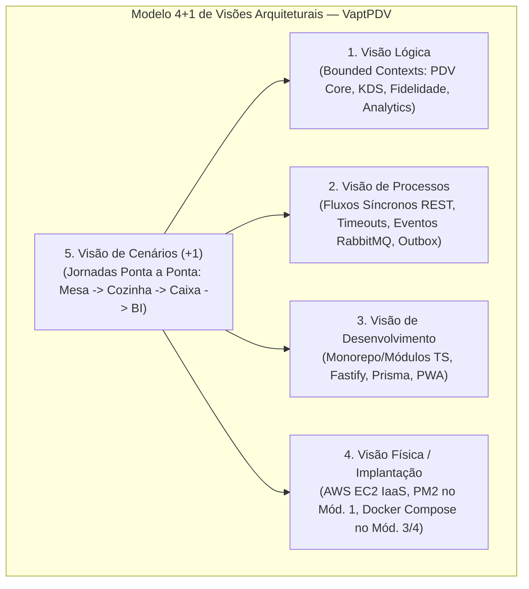
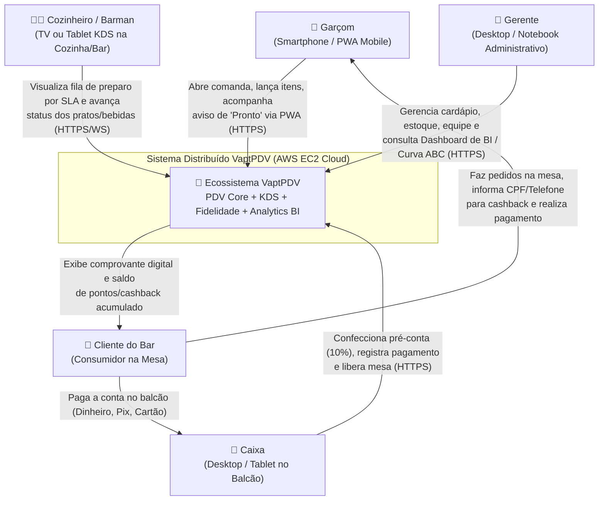
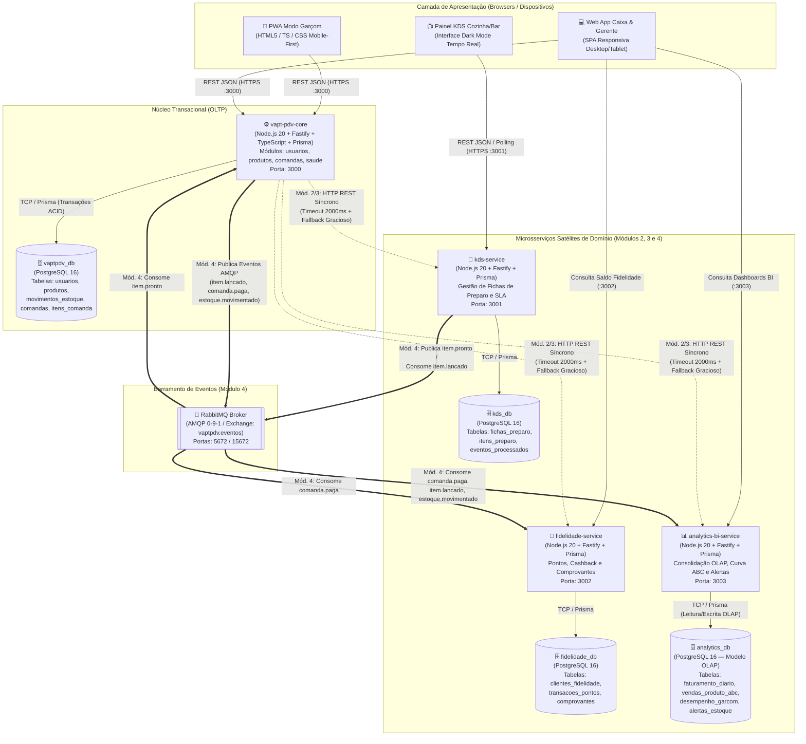
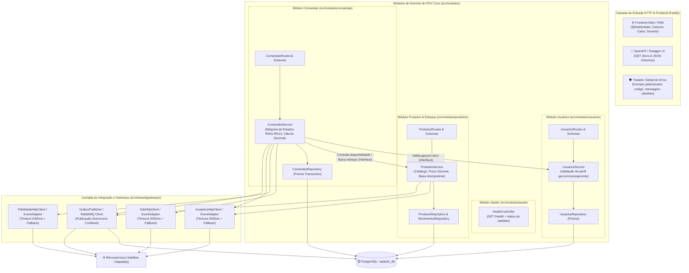
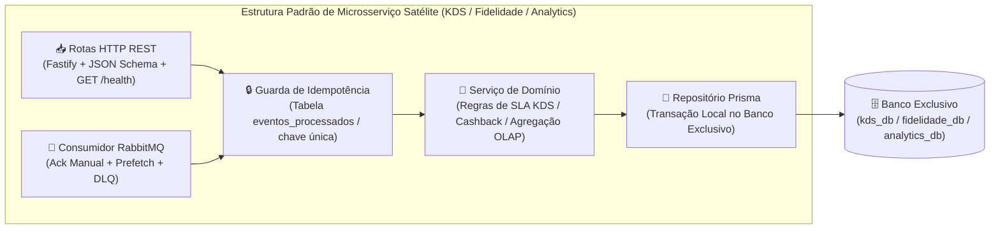
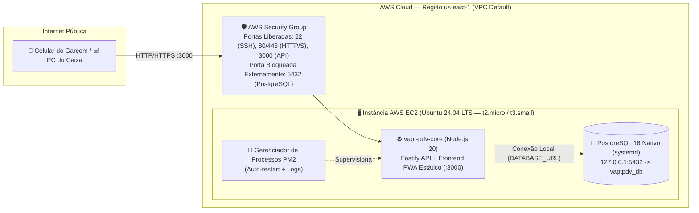
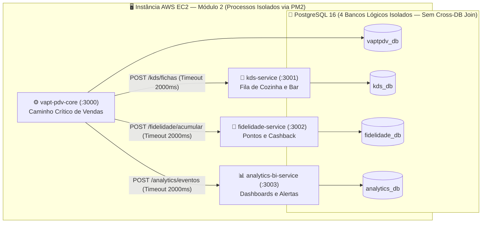
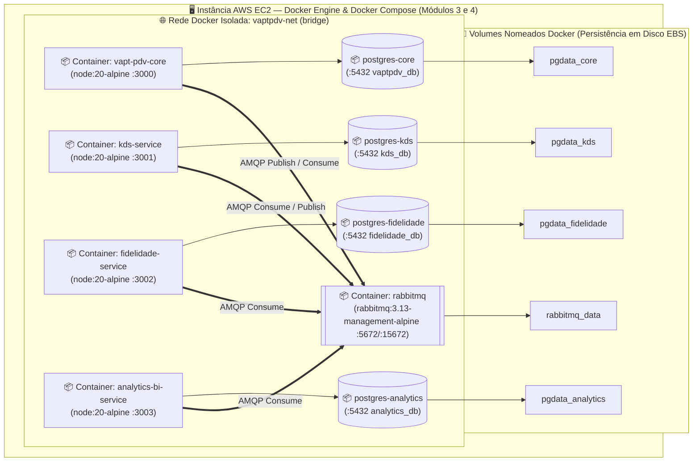
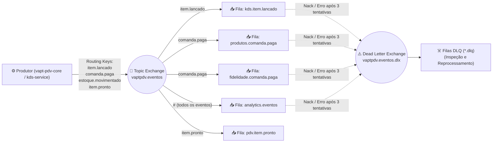

# 03 — Arquitetura de Software: Modelo C4, Visão 4+1 e Decisões Arquiteturais (ADRs)

> **Responsável:** Winston (System Architect — BMad Method)  
> **Projeto:** VaptPDV — Ecossistema Distribuído de Ponto de Venda, KDS, Fidelidade e Analytics para Bares e Lanchonetes  
> **Disciplina:** Sistemas Distribuídos (3ª Unidade — DCC/UERN)  
> **Autores:** Kaio França & Mateus Neri  
> **Status:** Aprovado e Baseline Arquitetural (Módulos 1 a 4)

---

## 1. Introdução e Princípios Arquiteturais

O **VaptPDV** é uma plataforma distribuída para operação em tempo real de bares, botecos e lanchonetes (1 a 15 funcionários, até ~30 mesas). Em vez de fragmentar artificialmente operações transacionais fortemente acopladas (como usuário, cardápio e comanda), a arquitetura adota o padrão **Core Operacional Coeso + Microsserviços Satélites Orientados a Domínio**:

1. **PDV Core (`vapt-pdv-core` — Monólito Modular Operacional):** Concentra o caminho crítico de venda (abertura de mesa, lançamento de itens com preço congelado, conferência, fechamento com taxa de 10% e recebimento com baixa transacional/idempotente de estoque), além da **Interface Web/PWA** responsiva (Modo Garçom Mobile-First e Modo Caixa/Gerente Desktop/Tablet). Possui seu próprio banco relacional **PostgreSQL (`vaptpdv_db`)** dividido internamente em módulos desacoplados (`usuarios`, `produtos`, `comandas`, `saude`).
2. **Três Microsserviços Satélites Independentes:**
   - **`kds-service` (Kitchen Display System — Cozinha e Bar):** Gerencia a fila de preparo de alimentos e bebidas (`recebido` → `em_preparo` → `pronto` → `entregue`), com banco exclusivo **`kds_db`** e painel visual Dark Mode para cozinheiros e barmen.
   - **`fidelidade-service` (Programa de Fidelidade, Cashback e Comprovantes):** Gerencia o cadastro de clientes recorrentes, acúmulo de pontos/cashback (5% por padrão) a cada comanda paga e emissão de comprovantes digitais, com banco exclusivo **`fidelidade_db`**.
   - **`analytics-bi-service` (Inteligência Operacional, BI e Alertas OLAP):** Consolida métricas de faturamento por turno, ticket médio, curva ABC de produtos, ranking de comissões de garçons e alertas de estoque mínimo em base analítica desnormalizada **`analytics_db`**.

> [!IMPORTANT]
> **Princípio da Sobrevivência do Caixa (Zero Downtime no Caminho Crítico):** O bar não pode parar de abrir mesas, lançar cervejas ou receber pagamentos caso o painel da cozinha (`kds-service`), o motor de pontos (`fidelidade-service`) ou o BI (`analytics-bi-service`) sofram lentidão ou queda. Toda comunicação do **PDV Core** com os serviços satélites aplica **Timeouts agressivos**, **Degradação Graciosa (Graceful Degradation)** no Módulo 2/3 e **Desacoplamento Assíncrono via RabbitMQ (Transactional Outbox)** no Módulo 4.

---

## 2. Visão Arquitetural 4+1 de Kruchten

A arquitetura do VaptPDV é documentada sob as cinco visões clássicas de Philippe Kruchten, garantindo rastreabilidade desde os requisitos de negócio até a topologia física na nuvem **AWS EC2**.



| Visão | Foco Principal | Artefatos e Decisões no VaptPDV |
| :--- | :--- | :--- |
| **1. Visão Lógica** | Decomposição funcional, entidades de domínio e fronteiras de contexto. | Separação entre **PDV Core** (módulos `usuarios`, `produtos`, `comandas`, `saude`) e os 3 domínios satélites (`kds-service`, `fidelidade-service`, `analytics-bi-service`). |
| **2. Visão de Processos** | Concorrência, sincronismo, assincronismo, tolerância a falhas e vazão. | Transações ACID com índice parcial de mesa única no Core; chamadas HTTP com timeout padronizado (`2000ms` / 2,0s) no Módulo 2; publicação assíncrona via **RabbitMQ** (`item.lancado`, `item.pronto`, `comanda.paga`, `estoque.movimentado`) no exchange `vaptpdv.eventos` no Módulo 4. |
| **3. Visão de Desenvolvimento** | Organização de código, camadas internas, pacotes, contratos e testes. | Node.js >= 20 + TypeScript + Fastify + JSON Schema / OpenAPI + Prisma ORM + Frontend Web/PWA. Isolamento estrito por interfaces (`Gateways`) entre módulos e serviços. |
| **4. Visão Física (Deployment)** | Topologia de hardware, rede, contêineres e armazenamento em nuvem. | Instância **AWS EC2 (Ubuntu Server LTS)** com PostgreSQL local no Módulo 1 (IaaS puro via Git + PM2) evoluindo para orquestração **Docker Compose** (Módulos 3 e 4) com volumes nomeados e rede bridge isolada. |
| **5. Visão de Cenários (+1)** | Casos de uso críticos que validam a integração das quatro visões anteriores. | Cenário completo de abertura de comanda pelo garçom, preparo na cozinha (KDS), fechamento com taxa de 10%, pagamento com baixa única de estoque, pontuação de fidelidade e consolidação no BI. |

---

## 3. Modelo C4 — Nível 1: Diagrama de Contexto do Sistema

O Nível 1 mostra como os cinco perfis de atores humanos interagem com o ecossistema **VaptPDV** durante a operação diária do estabelecimento.



### Atores e Responsabilidades no Contexto

| Ator | Dispositivo Típico | Interação com o Ecossistema VaptPDV |
| :--- | :--- | :--- |
| **Garçom (`garcom`)** | Smartphone Android/iOS (PWA) | Abre comandas em mesas livres, lança produtos do cardápio com observações de preparo (ex.: *"sem cebola"*, *"bem gelada"*), recebe alerta quando o item fica pronto no KDS e entrega na mesa. |
| **Cozinheiro / Barman (`cozinha`)** | Smart TV ou Tablet Horizontal (Dark Mode) | Acompanha os pedidos recém-lançados no painel do **`kds-service`**, inicia o preparo e marca itens como `pronto` com 1 toque. |
| **Caixa (`caixa`)** | Computador ou Tablet no Balcão | Consulta comandas abertas/fechadas, aplica ou dispensa a taxa de serviço de 10%, registra o pagamento (`dinheiro`, `pix`, `cartao`), identifica o cliente no programa de fidelidade e libera a mesa. |
| **Gerente (`gerente`)** | Desktop ou Smartphone | Mantém o catálogo de produtos, ajusta preços e estoques, gerencia usuários e analisa indicadores do **`analytics-bi-service`** (faturamento, curva ABC, comissões e alertas de ruptura de estoque). |
| **Cliente (`cliente`)** | Presencial (Mesa / Balcão) | Consome os produtos, acumula cashback no **`fidelidade-service`** e recebe o resumo detalhado e transparente da conta. |

---

## 4. Modelo C4 — Nível 2: Diagrama de Contêineres

O Nível 2 detalha os contêineres de software (aplicações, serviços de backend, bancos de dados isolados e broker de mensageria) que compõem a arquitetura completa do VaptPDV (estado alvo nos Módulos 2 a 4).



### Catálogo de Contêineres

| Contêiner | Tecnologia | Banco de Dados | Porta Padrão | Responsabilidade Central |
| :--- | :--- | :--- | :--- | :--- |
| **`vapt-pdv-core`** | Node.js 20, Fastify, TypeScript, Prisma | `vaptpdv_db` (PostgreSQL) | `3000` | Servidor da API central e do Frontend PWA. Gerencia usuários, catálogo/estoque de produtos e todo o ciclo de vida transacional da comanda. |
| **`kds-service`** | Node.js 20, Fastify, TypeScript, Prisma | `kds_db` (PostgreSQL) | `3001` | Recebe itens recém-lançados que exigem preparo (cozinha/bar), organiza por ordem de chegada e SLA, e notifica quando o item está pronto para entrega. |
| **`fidelidade-service`** | Node.js 20, Fastify, TypeScript, Prisma | `fidelidade_db` (PostgreSQL) | `3002` | Calcula e credita pontos/cashback para clientes cadastrados após o pagamento da comanda e gera o comprovante digital da venda. |
| **`analytics-bi-service`** | Node.js 20, Fastify, TypeScript, Prisma | `analytics_db` (PostgreSQL) | `3003` | Motor analítico (OLAP) que agrega faturamento, ranking de produtos (Curva ABC), produtividade por garçom e alertas de produtos abaixo do estoque mínimo. |
| **`rabbitmq`** | RabbitMQ 3.13 (`management-alpine`) | Armazenamento Mnesia/Disco | `5672` (AMQP) / `15672` (UI) | Broker de mensageria responsável pelo roteamento assíncrono via Topic Exchange (`vaptpdv.eventos`), filas duráveis e Dead Letter Queues (DLQ). |

---

## 5. Modelo C4 — Nível 3: Diagrama de Componentes

### 5.1. Arquitetura Interna do `vapt-pdv-core` (Monólito Modular)

Mesmo residindo em um único processo e banco de dados (`vaptpdv_db`), o **PDV Core** respeita fronteiras rígidas de módulos. O módulo `comandas` nunca acessa tabelas de `usuarios` ou `produtos` diretamente via join SQL arbitrário; ele utiliza contratos internos (`UsuarioGateway`, `EstoqueGateway`) e integra-se aos microsserviços satélites por meio de adaptadores resilientes (`KdsGateway`, `FidelidadeGateway`, `AnalyticsGateway` e `EventBusPublisher`).



### 5.2. Arquitetura Interna dos Microsserviços Satélites

Cada microsserviço satélite (`kds-service`, `fidelidade-service`, `analytics-bi-service`) segue uma estrutura interna enxuta, padronizada e autônoma:



---

## 6. Modelo C4 — Nível 4: Diagramas de Implantação (Evolução Módulos 1 a 4)

A arquitetura física evolui incrementalmente ao longo das quatro entregas da disciplina na infraestrutura **AWS EC2**.

### 6.1. Módulo 1 — Nuvem Pública IaaS (Deploy Nativo na AWS EC2)

No Módulo 1, o foco é provar o funcionamento completo do **PDV Core** (API REST + Frontend PWA + PostgreSQL) em uma Máquina Virtual Linux na AWS EC2, sem Docker, gerenciado por **PM2** e configurado exclusivamente por variáveis de ambiente (`.env`).



### 6.2. Módulo 2 — Arquitetura de Microsserviços (Comunicação HTTP Síncrona)

No Módulo 2, entram em operação os três microsserviços satélites (`kds-service`, `fidelidade-service`, `analytics-bi-service`), cada um com seu próprio processo Node.js e seu próprio banco lógico isolado no PostgreSQL (`kds_db`, `fidelidade_db`, `analytics_db`), comunicando-se via HTTP REST síncrono com tratamento de falha e degradação graciosa.



### 6.3. Módulos 3 e 4 — Containers (Docker Compose) + Mensageria (RabbitMQ)

No Módulo 3, todos os serviços e bancos são empacotados em contêineres Docker (`node:20-alpine` multi-stage e `postgres:16-alpine`) orquestrados por `docker-compose.yml` com volumes persistentes. No Módulo 4, adiciona-se o contêiner **`rabbitmq:3.13-management-alpine`**, substituindo o acoplamento temporal das notificações síncronas por eventos duráveis.



---

## 7. Padrões de Sistemas Distribuídos e Resiliência Aplicados

### 7.1. Degradação Graciosa (Graceful Degradation) e Proteção do Caminho Crítico
No Módulo 2 e 3 (comunicação HTTP síncrona), quando o garçom lança um item (`POST /comandas/:id/itens`) ou o caixa registra o pagamento (`POST /comandas/:id/pagar`):
1. O **PDV Core** primeiro executa e confirma (`COMMIT`) a transação local no `vaptpdv_db` (garantindo que o item foi salvo ou a comanda foi paga e o estoque baixado).
2. Em seguida, dispara a chamada HTTP para os serviços satélites (`kds-service`, `fidelidade-service`, `analytics-bi-service`) com **`AbortSignal.timeout(2000)`** (`2000ms` / 2 segundos).
3. Se um satélite estiver fora do ar ou exceder o timeout:
   - Na operação crítica de **venda/pagamento**, o PDV Core **não reverte a venda**; ele grava um registro pendente de sincronização (`integracao_pendente = true`), registra log estruturado de alerta (`WARN`) e retorna `200 OK` / `201 Created` com metadado de aviso (`avisos: [{ servico: "kds-service", status: "INDISPONIVEL_SINCRONIZACAO_PENDENTE" }]`).
   - Em consultas diretas a endpoints dependentes de satélites (ex.: consultar painel do KDS ou extrato de fidelidade via proxy), a API retorna imediatamente **`HTTP 503 Service Unavailable`** no formato padronizado:
     ```json
     {
       "erro": {
         "codigo": "SERVICO_INDISPONIVEL",
         "mensagem": "O serviço de Cozinha (kds-service) está temporariamente indisponível.",
         "detalhes": { "servico": "kds-service", "timeout_ms": 2000 }
       }
     }
     ```

### 7.2. Padrão Transactional Outbox (Módulo 4)
Para evitar o problema de escrita dupla (*Dual-Write Problem* — salvar no PostgreSQL mas falhar ao publicar no RabbitMQ por queda momentânea de rede):
1. Na mesma transação ACID em que a comanda muda para `paga` (ou um item é lançado), o **PDV Core** insere o evento na tabela local `outbox_eventos` com `status = 'PENDENTE'`.
2. Um *worker* interno lê os eventos pendentes, publica no exchange `vaptpdv.eventos` do RabbitMQ com confirmação do broker (`Publisher Confirms`) e marca `status = 'PUBLICADO'`.

### 7.3. Idempotência nos Consumidores e nas Rotas Internas
Tanto nas chamadas HTTP com retentativa (Módulo 2/3) quanto na entrega *At-Least-Once* do RabbitMQ (Módulo 4), mensagens podem ser entregues mais de uma vez:
- **No `vapt-pdv-core` (Estoque):** A tabela `movimentos_estoque` possui constraint única `UNIQUE (comanda_id, produto_id, tipo_movimento)`. Tentar baixar o estoque da mesma comanda duas vezes é ignorado com segurança.
- **No `kds-service`:** Cada ficha de preparo possui `UNIQUE (item_comanda_id)`. Se o evento `item.lancado` for reentregue, nenhuma ficha duplicada é criada na TV da cozinha.
- **No `fidelidade-service`:** Cada crédito de pontos possui `UNIQUE (comanda_id)`. Uma comanda paga pontua exatamente uma vez.
- **No `analytics-bi-service`:** Cada evento processado registra seu `evento_id` (UUID) na tabela `eventos_processados` dentro da mesma transação de atualização dos agregados OLAP.

### 7.4. Topologia RabbitMQ, Retentativas e Dead Letter Queue (DLQ)



### 7.5. Isolamento OLTP vs. OLAP (CQRS Simplificado)
Consultas analíticas pesadas (soma de vendas do mês, curva ABC de produtos e cálculo de comissões de garçons) não disputam *locks* nem CPU com o banco transacional `vaptpdv_db` (OLTP). O **`analytics-bi-service`** mantém tabelas pré-agregadas em seu banco exclusivo `analytics_db` (OLAP), atualizadas a cada evento de negócio.

---

## 8. Análise Comparativa: Mensageria Tradicional (RabbitMQ) vs. Streaming de Eventos (Apache Kafka / Redpanda)

Conforme exigido no Módulo 4 da disciplina, a tabela abaixo fundamenta a escolha do **RabbitMQ** para a operação em tempo real do VaptPDV e delimita onde uma plataforma de **Streaming de Eventos (Kafka/Redpanda)** seria aplicável:

| Critério Arquitetural | Mensageria base em Filas (RabbitMQ — AMQP) | Streaming de Eventos (Apache Kafka / Redpanda) | Adequação ao VaptPDV |
| :--- | :--- | :--- | :--- |
| **Abstração Principal** | Filas inteligentes com roteamento flexível (*Exchanges* Direct, Topic, Fanout) e remoção da mensagem após `ACK`. | Log distribuído imutável particionado (*Append-only Commit Log*) com retenção configurável por tempo/tamanho. | **RabbitMQ vence no operacional:** rotear `item.lancado` para o KDS e `comanda.paga` para Fidelidade e BI com confirmação individual por fila é direto e sem burocracia. |
| **Consumo de Memória na VM AWS EC2** | Muito baixo (~80 MB a 150 MB RAM em `management-alpine`), ideal para instâncias `t2.micro` / `t3.small`. | Mais elevado (Kafka exige JVM pesada; Redpanda é mais leve em C++, mas ainda demanda mais I/O e memória para segmentos). | **RabbitMQ vence em custo IaaS:** cabe confortavelmente na mesma VM EC2 junto com os 4 serviços Node.js e PostgreSQL. |
| **Garantia de Entrega e DLQ Nativa** | Suporte nativo a `ACK`/`NACK`, TTL por mensagem, *Dead Letter Exchanges (DLX)* e prioridade por fila. | Requer implementação manual de tópicos de *retry* e *DLQ* no código da aplicação consumidora. | **RabbitMQ vence em resiliência simples:** configuração declarativa de DLQ sem complexidade extra no consumidor. |
| **Reprocessamento Histórico (*Event Replay*)** | Mensagens consumidas com `ACK` são removidas da fila (não permite *replay* histórico nativo). | Consumidores podem reposicionar o *offset* para o início do log e reconstruir projeções de BI inteiras do zero. | **Kafka/Redpanda vence em Big Data/BI histórico:** se o `analytics-bi-service` precisasse recalcular métricas de 2 anos atrás a partir dos eventos brutos, o log retido do Kafka seria superior. |

---

## 9. Architecture Decision Records (ADRs)

### ADR-01: Adoção do PDV Core Coeso (Monólito Modular) + 3 Microsserviços Satélites
- **Contexto:** Em sistemas de PDV para bares, abrir comanda, validar garçom, consultar preço do produto, lançar item e baixar estoque fazem parte de um fluxo transacional único e de baixíssima latência (< 200ms). Dividir `usuarios`, `produtos` e `comandas` em microsserviços separados cria um "monólito distribuído" onde nenhum serviço funciona sozinho e uma simples adição de item exige múltiplas viagens de rede.
- **Decisão:** Manter `usuarios`, `produtos` e `comandas` coesos dentro do **`vapt-pdv-core`** (com separação modular estrita no código) e extrair **três microsserviços satélites genuínos de negócio**: **`kds-service`** (Cozinha/Bar), **`fidelidade-service`** (Cashback/Clientes) e **`analytics-bi-service`** (Relatórios OLAP e Alertas).
- **Consequências Positivas:** Zero acoplamento destrutivo no caminho crítico do caixa; transações ACID para comanda + estoque; demonstração real de tolerância a falhas (se o KDS ou Fidelidade cair, o bar continua vendendo normalmente).
- **Trade-offs:** Requer disciplina da equipe para manter as fronteiras de módulos dentro do `vapt-pdv-core` e implementar o padrão Outbox/Fallback para os satélites.

### ADR-02: Stack Tecnológica Baseada em Node.js 20, Fastify, TypeScript e Prisma
- **Contexto:** O sistema precisa de alta performance em I/O concorrente, validação rigorosa de payloads JSON, documentação OpenAPI automática e segurança de tipos para quatro serviços distintos.
- **Decisão:** Padronizar **Node.js 20 LTS + TypeScript 5 + Fastify 5 + Prisma ORM** em todo o ecossistema (`vapt-pdv-core` e nos 3 microsserviços).
- **Consequências:** Baixo consumo de memória por processo (~45 MB RAM), validação nativa por JSON Schema que já gera o Swagger (`/docs`), e migrações declarativas reprodutíveis via Prisma.

### ADR-03: Representação Monetária Exclusiva em Decimal Exato (`NUMERIC(10,2)`)
- **Contexto:** Aritmética de ponto flutuante binário IEEE 754 (`Float` / `number` do JavaScript) produz erros clássicos de arredondamento (ex.: `0.1 + 0.2 = 0.30000000000000004`), inaceitáveis em fechamento de conta e cálculo de taxa de 10% ou cashback de 5%.
- **Decisão:** Armazenar todos os valores monetários como `DECIMAL(10,2)` no PostgreSQL, realizar cálculos no backend usando `Prisma.Decimal` (com arredondamento `ROUND_HALF_UP` para 2 casas) e serializar valores monetários na API REST como strings de duas casas decimais (`"12.50"`).
- **Consequências:** Precisão contábil absoluta em 100% das operações financeiras.

### ADR-04: Garantia de Mesa Única Aberta por Índice Único Parcial no PostgreSQL
- **Contexto:** Dois garçons podem tentar abrir comanda para a mesma mesa (`mesa = 5`) simultaneamente pelo celular. Uma simples verificação `SELECT` seguida de `INSERT` na aplicação sofre condição de corrida (*Race Condition* TOCTOU).
- **Decisão:** Criar no banco `vaptpdv_db` o índice único parcial `CREATE UNIQUE INDEX comandas_mesa_aberta_unique_idx ON comandas (mesa) WHERE status = 'aberta';`.
- **Consequências:** O próprio motor do PostgreSQL impede duas comandas abertas na mesma mesa sob qualquer nível de concorrência, enquanto permite histórico ilimitado de comandas `fechada`, `paga` e `cancelada` para aquela mesma mesa.

### ADR-05: Preço e Nome Congelados no Lançamento do Item (`Snapshot Pattern`)
- **Contexto:** O gerente pode reajustar o preço da cerveja no cardápio às 22h, enquanto dezenas de mesas estão abertas desde as 19h.
- **Decisão:** Ao lançar um item na comanda, copiar `nome_copiado` e `preco_copiado` diretamente para a tabela `itens_comanda`.
- **Consequências:** Imutabilidade histórica garantida (RN04); alterações de cardápio nunca recalculam itens já consumidos.

### ADR-06: Infraestrutura em Nuvem IaaS na AWS EC2 com PostgreSQL Local
- **Contexto:** O Módulo 1 exige deploy em nuvem pública IaaS com banco relacional configurado por variáveis de ambiente e controle explícito de sistema operacional, processos e firewall.
- **Decisão:** Utilizar uma instância **AWS EC2 (Ubuntu Server LTS)** com regras de Security Group restritas (porta `5432` fechada para a internet pública, acessível apenas internamente) e PostgreSQL 16 instalado na própria VM (no Módulo 1 via pacote nativo e `pm2`; a partir do Módulo 3 via containers Docker com volumes EBS).
- **Consequências:** Controle total sobre rede, processos, logs e bancos múltiplos sem limites artificiais de conexões de tiers gratuitos de DBaaS.

### ADR-07: Estratégia de Evolução Síncrona (Módulo 2) para Assíncrona (Módulo 4)
- **Contexto:** A disciplina avalia a comunicação HTTP entre microsserviços no Módulo 2 e a introdução de mensageria no Módulo 4.
- **Decisão:** Encapsular toda comunicação do `vapt-pdv-core` com os serviços satélites atrás de interfaces de Gateway (`NotificadorCozinhaGateway`, `FidelidadeGateway`, `AnalyticsGateway`). No Módulo 2 e 3, a implementação concreta usa `fetch` HTTP com timeout de `2000ms` (2,0s); no Módulo 4, a implementação concreta passa a publicar eventos no RabbitMQ (exchange `vaptpdv.eventos`) via Outbox sem alterar uma única linha das regras de negócio de `ComandasService`.
- **Consequências:** Transição limpa entre arquiteturas e comprovação prática do princípio Aberto/Fechado (OCP) e Inversão de Dependência (DIP).

### ADR-08: Interface Frontend Web/PWA Integrada ao Ecossistema
- **Contexto:** Um sistema de PDV, KDS e BI é muito melhor compreendido, operado e demonstrado nos vídeos de entrega quando possui interfaces visuais dedicadas para cada papel (Garçom no celular, Cozinheiro na TV KDS, Caixa/Gerente no desktop), mantendo 100% das regras de negócio no backend.
- **Decisão:** Incluir uma aplicação **Web/PWA responsiva e leve**, servida pelo próprio ecossistema, com quatro visões especializadas (Mapa de Mesas Mobile para Garçom, Painel de Fechamento para Caixa, Painel KDS Dark Mode para Cozinha e Dashboard Gerencial de BI), consumindo exclusivamente as rotas públicas documentadas no contrato REST.
- **Consequências:** Experiência de produto real em demonstrações e testes de ponta a ponta, respeitando rigorosamente a restrição de que nenhum cálculo financeiro ou validação de estado reside no cliente.
