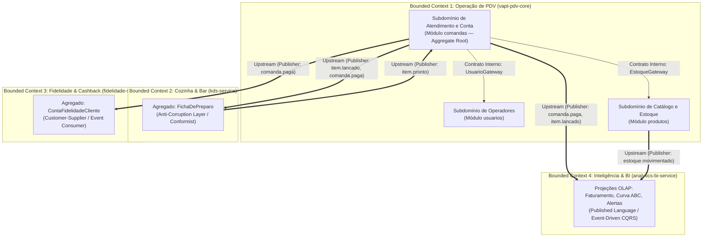
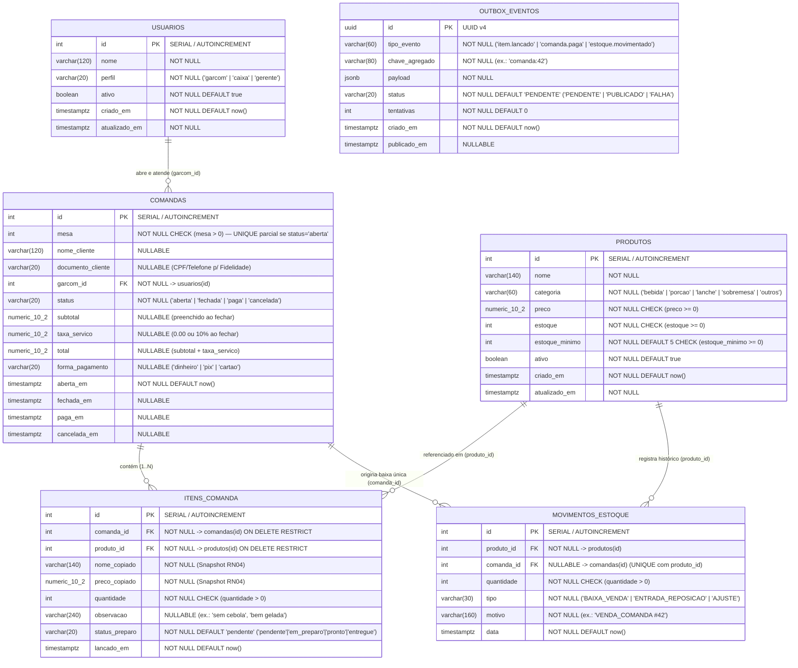
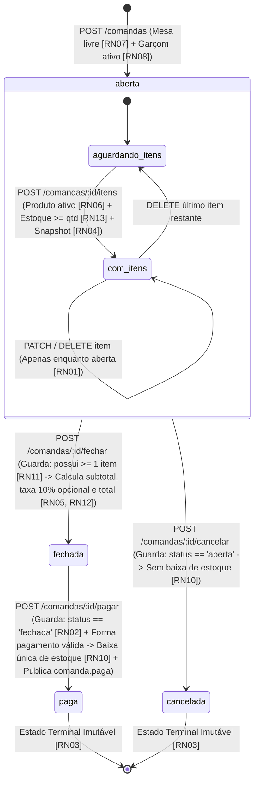
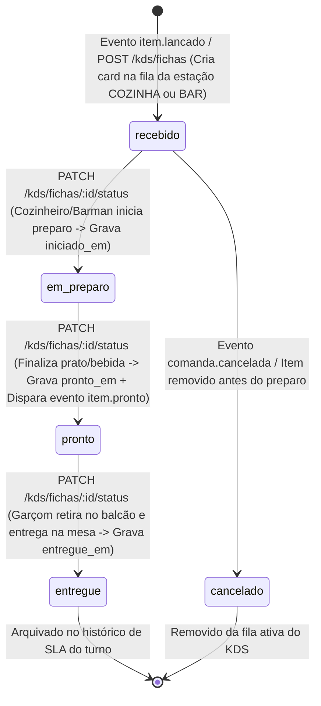

# 04 — Modelagem de Dados, Domain-Driven Design (DDD) e Máquinas de Estados

> **Responsável:** Winston (System Architect — BMad Method)  
> **Projeto:** VaptPDV — Ecossistema Distribuído de Ponto de Venda, KDS, Fidelidade e Analytics  
> **Bancos de Dados:** PostgreSQL 16 (`vaptpdv_db`, `kds_db`, `fidelidade_db`, `analytics_db`)  
> **ORM & Migrações:** Prisma ORM (`Decimal` / `NUMERIC(10,2)`)

---

## 1. Modelagem Estratégica e Tática com Domain-Driven Design (DDD)

### 1.1. Bounded Contexts (Contextos Delimitados) e Linguagem Ubíqua

O domínio do VaptPDV é particionado em **quatro Contextos Delimitados (Bounded Contexts)** com responsabilidades claras, vocabulário próprio e bancos de dados fisicamente isolados a partir do Módulo 2:

| Bounded Context | Implementação Física | Banco de Dados | Tipo de Carga | Conceitos Centrais da Linguagem Ubíqua |
| :--- | :--- | :--- | :--- | :--- |
| **1. Operação de PDV, Cardápio e Estoque (Core Domain)** | `vapt-pdv-core` (Módulos internos: `usuarios`, `produtos`, `comandas`, `saude`) | `vaptpdv_db` | OLTP Crítico (ACID) | *Comanda*, *Item Lançado*, *Preço Congelado*, *Mesa Livre*, *Fechamento de Conta*, *Taxa de Serviço (10%)*, *Pagamento*, *Movimento de Estoque*, *Operador (Garçom/Caixa/Gerente)*. |
| **2. Preparo de Cozinha e Bar (Supporting Domain)** | `kds-service` | `kds_db` | OLTP Tempo Real | *Ficha de Preparo*, *Estação (Cozinha/Bar)*, *Fila de Pedidos*, *SLA de Preparo*, *Pronto para Entrega*. |
| **3. Relacionamento, Fidelidade e Comprovantes (Supporting Domain)** | `fidelidade-service` | `fidelidade_db` | OLTP Secundário | *Participante Fidelidade*, *Acúmulo de Pontos*, *Saldo de Cashback (5%)*, *Extrato de Benefícios*, *Comprovante Digital*. |
| **4. Inteligência Gerencial e BI (Generic / Analytical Domain)** | `analytics-bi-service` | `analytics_db` | OLAP Analítico (Leitura Pesada) | *Faturamento por Turno*, *Ticket Médio*, *Curva ABC de Produtos*, *Ranking de Garçons*, *Alerta de Ruptura de Estoque*. |

### 1.2. Context Map (Mapa de Contextos e Padrões de Integração)



### 1.3. Desenho Tático: Entidades, Objetos de Valor, Agregados e Eventos

| Elemento Tático DDD | Nome no Domínio | Contexto | Descrição e Invariantes Protegidas |
| :--- | :--- | :--- | :--- |
| **Aggregate Root** | `Comanda` | PDV Core (`comandas`) | Raiz de agregado que governa os `ItemComanda`. Garante que itens só são modificados com status `aberta` (RN01), que o fechamento exige $\ge 1$ item (RN11) e que `total = subtotal + taxa_servico` (RN12). |
| **Entity (Filha)** | `ItemComanda` | PDV Core (`comandas`) | Pertence exclusivamente a uma `Comanda`. Imutável após o fechamento da comanda. Preserva o snapshot do produto no instante da venda (RN04). |
| **Aggregate Root** | `Produto` | PDV Core (`produtos`) | Governa o saldo de estoque e a emissão de `MovimentoEstoque`. Impede estoque negativo (RN13) e exclusão física (RN14). |
| **Aggregate Root** | `Usuario` | PDV Core (`usuarios`) | Representa funcionários (`garcom`, `caixa`, `gerente`). Nunca sofre `DELETE` físico; apenas inativação lógica (`ativo = false`). |
| **Aggregate Root** | `FichaPreparo` | KDS (`kds-service`) | Controla o ciclo de preparo de um item na cozinha ou no bar (`recebido` → `em_preparo` → `pronto` → `entregue`) e calcula o tempo decorrido para SLA visual. |
| **Aggregate Root** | `ClienteFidelidade` | Fidelidade (`fidelidade-service`) | Mantém o saldo de pontos e cashback (`DECIMAL(10,2)`) de um cliente identificado por CPF ou telefone, garantindo crédito idempotente por `comanda_id`. |
| **Value Object** | `Dinheiro` (`Decimal(10,2)`) | Todos | Objeto de valor imutável com 2 casas decimais exatas e arredondamento `ROUND_HALF_UP`. Rejeita `NaN`, infinito ou valores negativos. |
| **Value Object** | `SnapshotProduto` | PDV Core (`comandas`) | Par imutável `(nome_copiado, preco_copiado)` capturado no momento em que o garçom confirma o lançamento do item. |
| **Domain Event** | `item.lancado` | PDV Core → KDS / BI | Emitido quando um item é adicionado à comanda aberta. Contém `comanda_id`, `item_id`, `mesa`, `produto_id`, `nome_copiado`, `categoria`, `quantidade`, `observacao`. |
| **Domain Event** | `item.pronto` | KDS → PDV Core | Emitido quando o cozinheiro/barman finaliza o preparo. Permite notificar o garçom responsável no PWA. |
| **Domain Event** | `comanda.paga` | PDV Core → Fidelidade / BI | Emitido após o commit do pagamento. Contém totais, forma de pagamento, garçom, cliente opcional e lista de itens vendidos. |
| **Domain Event** | `estoque.movimentado` | PDV Core → BI | Emitido após baixa de estoque ou ajuste manual, informando `estoque_atual` e `estoque_minimo` para disparo de alerta de reposição. |

---

## 2. Diagramas Entidade-Relacionamento (DER — Modelo Físico)

### 2.1. Banco de Dados Transacional Principal: `vaptpdv_db` (`vapt-pdv-core`)



### 2.2. Bancos de Dados dos Microsserviços Satélites (`kds_db`, `fidelidade_db`, `analytics_db`)

> [!NOTE]
> Como cada microsserviço possui seu próprio banco de dados isolado, referências como `comanda_id`, `item_comanda_id`, `produto_id` e `garcom_id` nos bancos satélites são **IDs lógicos externos** (sem Foreign Key física cruzando bancos), sincronizados via payload de eventos ou chamadas REST.

```mermaid
erDiagram
    FICHAS_PREPARO {
        int id PK "Banco: kds_db"
        int comanda_id "NOT NULL (ID lógico da comanda)"
        int item_comanda_id UK "NOT NULL UNIQUE (Idempotência)"
        int mesa "NOT NULL"
        varchar(120) nome_garcom "NOT NULL"
        varchar(30) estacao "NOT NULL ('COZINHA' | 'BAR')"
        varchar(140) nome_produto "NOT NULL"
        int quantidade "NOT NULL"
        varchar(240) observacao "NULLABLE"
        varchar(20) status "NOT NULL ('recebido' | 'em_preparo' | 'pronto' | 'entregue' | 'cancelado')"
        timestamptz recebido_em "NOT NULL DEFAULT now()"
        timestamptz iniciado_em "NULLABLE"
        timestamptz pronto_em "NULLABLE"
        timestamptz entregue_em "NULLABLE"
    }

    CLIENTES_FIDELIDADE ||--o{ TRANSACOES_FIDELIDADE : "acumula / resgata"
    CLIENTES_FIDELIDADE ||--o{ COMPROVANTES_DIGITAIS : "recebe"

    CLIENTES_FIDELIDADE {
        int id PK "Banco: fidelidade_db"
        varchar(120) nome "NOT NULL"
        varchar(20) documento UK "NOT NULL UNIQUE (CPF ou Telefone)"
        int saldo_pontos "NOT NULL DEFAULT 0"
        numeric_10_2 saldo_cashback "NOT NULL DEFAULT 0.00"
        boolean ativo "NOT NULL DEFAULT true"
        timestamptz criado_em "NOT NULL DEFAULT now()"
    }

    TRANSACOES_FIDELIDADE {
        int id PK "Banco: fidelidade_db"
        int cliente_id FK "NOT NULL -> clientes_fidelidade(id)"
        int comanda_id UK "NOT NULL UNIQUE (Idempotência por comanda paga)"
        numeric_10_2 valor_comanda "NOT NULL"
        int pontos_gerados "NOT NULL"
        numeric_10_2 cashback_gerado "NOT NULL (5% do subtotal)"
        timestamptz criado_em "NOT NULL DEFAULT now()"
    }

    COMPROVANTES_DIGITAIS {
        uuid codigo_autenticacao PK "Banco: fidelidade_db"
        int comanda_id UK "NOT NULL UNIQUE"
        int cliente_id FK "NULLABLE -> clientes_fidelidade(id)"
        jsonb resumo_conta "NOT NULL (Snapshot completo da nota)"
        timestamptz emitido_em "NOT NULL DEFAULT now()"
    }

    FATURAMENTO_DIARIO {
        date data_referencia PK "Banco: analytics_db (OLAP)"
        int total_comandas_pagas "NOT NULL DEFAULT 0"
        numeric_12_2 receita_bruta "NOT NULL DEFAULT 0.00"
        numeric_12_2 total_taxa_servico "NOT NULL DEFAULT 0.00"
        numeric_10_2 ticket_medio "NOT NULL DEFAULT 0.00"
        timestamptz atualizado_em "NOT NULL"
    }

    VENDAS_PRODUTO_ABC {
        int produto_id PK "Banco: analytics_db (OLAP)"
        varchar(140) nome_produto "NOT NULL"
        varchar(60) categoria "NOT NULL"
        int quantidade_total_vendida "NOT NULL DEFAULT 0"
        numeric_12_2 receita_acumulada "NOT NULL DEFAULT 0.00"
        char(1) classe_abc "NOT NULL DEFAULT 'C' ('A' | 'B' | 'C')"
        timestamptz atualizado_em "NOT NULL"
    }

    DESEMPENHO_GARCOM {
        int garcom_id PK "Banco: analytics_db (OLAP)"
        varchar(120) nome_garcom "NOT NULL"
        int comandas_atendidas "NOT NULL DEFAULT 0"
        numeric_12_2 volume_vendas "NOT NULL DEFAULT 0.00"
        numeric_12_2 comissao_acumulada "NOT NULL DEFAULT 0.00"
        timestamptz atualizado_em "NOT NULL"
    }

    ALERTAS_ESTOQUE {
        int id PK "Banco: analytics_db (OLAP)"
        int produto_id "NOT NULL"
        varchar(140) nome_produto "NOT NULL"
        int estoque_atual "NOT NULL"
        int estoque_minimo "NOT NULL"
        varchar(20) severidade "NOT NULL ('CRITICO_ZERADO' | 'ABAIXO_MINIMO')"
        boolean resolvido "NOT NULL DEFAULT false"
        timestamptz detectado_em "NOT NULL DEFAULT now()"
    }
```



---

## 3. Dicionário de Dados Completo e Constraints SQL

### 3.1. Índices Críticos e Regras de Integridade no `vaptpdv_db`

```sql
-- 1. Garantia de Mesa Livre (RN07): Impede duas comandas abertas na mesma mesa sob concorrência
CREATE UNIQUE INDEX comandas_mesa_aberta_unique_idx
    ON comandas (mesa)
    WHERE status = 'aberta';

-- 2. Garantia de Baixa Única de Estoque por Comanda e Produto (RN10 / Idempotência)
CREATE UNIQUE INDEX movimentos_estoque_comanda_produto_unique_idx
    ON movimentos_estoque (comanda_id, produto_id)
    WHERE comanda_id IS NOT NULL AND tipo = 'BAIXA_VENDA';

-- 3. Índices de Performance para Listagens Operacionais (CAP-8)
CREATE INDEX comandas_status_aberta_em_idx ON comandas (status, aberta_em DESC);
CREATE INDEX produtos_categoria_ativo_idx ON produtos (categoria, ativo);
CREATE INDEX outbox_eventos_pendentes_idx ON outbox_eventos (status, criado_em ASC) WHERE status = 'PENDENTE';
```

### 3.2. Dicionário de Colunas — Tabelas do `vaptpdv_db`

#### Tabela `usuarios`
| Coluna | Tipo PostgreSQL | Tipo Prisma | Nulo? | Valor Padrão | Restrições e Semântica |
| :--- | :--- | :--- | :---: | :--- | :--- |
| `id` | `SERIAL` | `Int @id @default(autoincrement())` | Não | Sequencial | Identificador único do operador. |
| `nome` | `VARCHAR(120)` | `String` | Não | — | Nome completo ou apelido operacional (mín. 2 caracteres). |
| `perfil` | `VARCHAR(20)` | `PerfilUsuario` (Enum) | Não | — | Valores permitidos: `garcom`, `caixa`, `gerente`. |
| `ativo` | `BOOLEAN` | `Boolean` | Não | `true` | Soft delete lógico; `false` impede abrir novas comandas. |
| `criado_em` | `TIMESTAMPTZ` | `DateTime @default(now())` | Não | `now()` | Data/hora UTC de criação do registro. |
| `atualizado_em`| `TIMESTAMPTZ` | `DateTime @updatedAt` | Não | `now()` | Atualizado automaticamente em cada `PATCH` ou inativação. |

#### Tabela `produtos`
| Coluna | Tipo PostgreSQL | Tipo Prisma | Nulo? | Valor Padrão | Restrições e Semântica |
| :--- | :--- | :--- | :---: | :--- | :--- |
| `id` | `SERIAL` | `Int @id @default(autoincrement())` | Não | Sequencial | Identificador único do item no cardápio. |
| `nome` | `VARCHAR(140)` | `String` | Não | — | Nome comercial exibido no cardápio (ex.: `"Cerveja Pilsen 600ml"`). |
| `categoria` | `VARCHAR(60)` | `String` | Não | — | Agrupador de cardápio e roteamento KDS (`bebida`, `porcao`, `lanche`, etc.). |
| `preco` | `NUMERIC(10,2)` | `Decimal @db.Decimal(10, 2)` | Não | — | Preço unitário vigente (`CHECK (preco >= 0)`). |
| `estoque` | `INTEGER` | `Int` | Não | `0` | Quantidade física disponível (`CHECK (estoque >= 0)`). |
| `estoque_minimo`| `INTEGER` | `Int` | Não | `5` | Gatilho para emissão de alerta de reposição no BI (`>= 0`). |
| `ativo` | `BOOLEAN` | `Boolean` | Não | `true` | Quando `false`, bloqueia novos lançamentos (RN06), mantendo histórico. |
| `criado_em` | `TIMESTAMPTZ` | `DateTime @default(now())` | Não | `now()` | Timestamp UTC de cadastro. |
| `atualizado_em`| `TIMESTAMPTZ` | `DateTime @updatedAt` | Não | `now()` | Timestamp UTC da última alteração. |

#### Tabela `comandas`
| Coluna | Tipo PostgreSQL | Tipo Prisma | Nulo? | Valor Padrão | Restrições e Semântica |
| :--- | :--- | :--- | :---: | :--- | :--- |
| `id` | `SERIAL` | `Int @id @default(autoincrement())` | Não | Sequencial | Número da comanda digital. |
| `mesa` | `INTEGER` | `Int` | Não | — | Número da mesa física (`> 0`). Índice único parcial quando `status = 'aberta'`. |
| `nome_cliente` | `VARCHAR(120)` | `String?` | Sim | `NULL` | Identificação amigável opcional (ex.: `"Mesa do Carlos"`). |
| `documento_cliente` | `VARCHAR(20)` | `String?` | Sim | `NULL` | CPF ou WhatsApp opcional para pontuar no `fidelidade-service`. |
| `garcom_id` | `INTEGER` | `Int` | Não | — | FK para `usuarios(id)`. Deve estar ativo e ter perfil `garcom` na abertura (RN08). |
| `status` | `VARCHAR(20)` | `StatusComanda` (Enum) | Não | `'aberta'` | Estados válidos: `aberta`, `fechada`, `paga`, `cancelada`. |
| `subtotal` | `NUMERIC(10,2)` | `Decimal? @db.Decimal(10, 2)` | Sim | `NULL` | Soma exata de `(preco_copiado * quantidade)` gravada no fechamento (RN05). |
| `taxa_servico` | `NUMERIC(10,2)` | `Decimal? @db.Decimal(10, 2)` | Sim | `NULL` | `"0.00"` ou `round_half_up(subtotal * 0.10, 2)` gravada no fechamento (RN12). |
| `total` | `NUMERIC(10,2)` | `Decimal? @db.Decimal(10, 2)` | Sim | `NULL` | Valor final a pagar (`subtotal + taxa_servico`). |
| `forma_pagamento`| `VARCHAR(20)` | `FormaPagamento?` (Enum) | Sim | `NULL` | Preenchido no pagamento: `dinheiro`, `pix` ou `cartao`. |
| `aberta_em` | `TIMESTAMPTZ` | `DateTime @default(now())` | Não | `now()` | Instante de abertura da mesa. |
| `fechada_em` | `TIMESTAMPTZ` | `DateTime?` | Sim | `NULL` | Instante de emissão da pré-conta pelo caixa. |
| `paga_em` | `TIMESTAMPTZ` | `DateTime?` | Sim | `NULL` | Instante de quitação e baixa de estoque. |

#### Tabela `itens_comanda`
| Coluna | Tipo PostgreSQL | Tipo Prisma | Nulo? | Valor Padrão | Restrições e Semântica |
| :--- | :--- | :--- | :---: | :--- | :--- |
| `id` | `SERIAL` | `Int @id @default(autoincrement())` | Não | Sequencial | Identificador único do lançamento. |
| `comanda_id` | `INTEGER` | `Int` | Não | — | FK para `comandas(id)`. |
| `produto_id` | `INTEGER` | `Int` | Não | — | FK para `produtos(id)`. |
| `nome_copiado` | `VARCHAR(140)` | `String` | Não | — | Cópia imutável do nome do produto no momento do lançamento (RN04). |
| `preco_copiado` | `NUMERIC(10,2)` | `Decimal @db.Decimal(10, 2)` | Não | — | Cópia imutável do preço unitário no momento do lançamento (RN04). |
| `quantidade` | `INTEGER` | `Int` | Não | — | Quantidade solicitada (`CHECK (quantidade > 0)` — RN09). |
| `observacao` | `VARCHAR(240)` | `String?` | Sim | `NULL` | Instrução especial enviada ao KDS (ex.: `"Sem gelo"`). |
| `status_preparo`| `VARCHAR(20)` | `String` | Não | `'pendente'` | Sincronizado com o KDS (`pendente`, `em_preparo`, `pronto`, `entregue`). |

---

## 4. Máquinas de Estados Formais

### 4.1. Ciclo de Vida da Comanda (`vapt-pdv-core`)

A entidade `Comanda` governa o fluxo financeiro e de estoque do estabelecimento, obedecendo rigorosamente às regras de negócio **RN01 a RN13**.



#### Matriz de Invariantes e Transições da Comanda

| Transição | Rota da API | Pré-condições Obrigatórias (Guards) | Cálculos e Efeitos Transacionais | Eventos Emitidos |
| :--- | :--- | :--- | :--- | :--- |
| `(início)` → `aberta` | `POST /comandas` | 1. Usuário `garcom_id` existe, `ativo = true` e `perfil = 'garcom'` (`422 GARCOM_INVALIDO`).<br/>2. Não há comanda `aberta` na mesma `mesa` (`409 MESA_OCUPADA`). | Cria registro com `status = 'aberta'`, `aberta_em = now()`, totais `null`. | — |
| `aberta` → `aberta` (Lançar/Editar Item) | `POST /comandas/:id/itens`<br/>`PATCH .../itens/:itemId`<br/>`DELETE .../itens/:itemId` | 1. Comanda está `aberta` (`409 COMANDA_NAO_ABERTA`).<br/>2. `quantidade > 0` (`400 VALIDACAO`).<br/>3. Produto existe e `ativo = true` (`422 PRODUTO_INATIVO`).<br/>4. `produto.estoque >= quantidade` (`409 ESTOQUE_INSUFICIENTE`). | Grava `nome_copiado` e `preco_copiado` congelados no item (RN04). Não desconta estoque físico ainda. | `item.lancado` (enviado ao `kds-service` e `analytics-bi-service`) |
| `aberta` → `fechada` | `POST /comandas/:id/fechar` | 1. Comanda está `aberta` (`409 COMANDA_NAO_ABERTA`).<br/>2. Comanda possui pelo menos 1 item (`409 COMANDA_SEM_ITENS`). | Calcula `subtotal = Σ(preco_copiado × quantidade)`. Se `aplicar_taxa_servico = true`, `taxa_servico = round_half_up(subtotal × 0.10, 2)`, senão `"0.00"`. Grava `total = subtotal + taxa_servico` e `fechada_em = now()`. Bloqueia itens. | — |
| `fechada` → `paga` | `POST /comandas/:id/pagar` | 1. Comanda está `fechada` (`409 COMANDA_NAO_FECHADA`).<br/>2. `forma_pagamento` $\in$ `{dinheiro, pix, cartao}` (`400 VALIDACAO`). | Grava `forma_pagamento` e `paga_em = now()`. Reduz `estoque` de cada produto consumido uma única vez e insere `MovimentoEstoque` (RN10). Libera a mesa. | `comanda.paga` e `estoque.movimentado` |
| `aberta` → `cancelada` | `POST /comandas/:id/cancelar` | 1. Comanda está `aberta` (`409 COMANDA_NAO_ABERTA` ou `409 COMANDA_IMUTAVEL` se já fechada/paga). | Muda status para `cancelada`, grava `cancelada_em = now()`, libera a mesa. Nenhum estoque é alterado. | `comanda.cancelada` (cancela fichas pendentes no KDS) |

---

### 4.2. Ciclo de Vida da Ficha de Preparo no KDS (`kds-service`)

O microsserviço **`kds-service`** gerencia sua própria máquina de estados para cada item enviado à cozinha (porções, lanches, pratos) ou ao bar (drinks, cervejas), permitindo visibilidade operacional em tempo real.



#### Regras de SLA e Roteamento Automático de Estação no KDS

| Categoria do Produto | Estação de Destino no KDS | Faixa Verde (No Prazo) | Faixa Amarela (Atenção) | Faixa Vermelha (Atrasado / Alerta Visual) |
| :--- | :--- | :---: | :---: | :---: |
| **`bebida` / `drink`** | Estação **BAR** | `< 3 min` | `3 a 6 min` | `> 6 min` (Borda vermelha pulsante) |
| **`porcao` / `lanche` / `prato`** | Estação **COZINHA** | `< 10 min` | `10 a 20 min` | `> 20 min` (Borda vermelha pulsante + topo da fila) |

---

## 5. Contratos de Eventos de Domínio (Payloads JSON — Módulo 4)

Todos os eventos publicados no exchange `vaptpdv.eventos` (tipo `topic`) seguem um envelope padronizado com metadados de rastreabilidade e chave de idempotência:

### 5.1. Evento `item.lancado` (PDV Core → KDS Service & Analytics BI)
```json
{
  "evento_id": "9b1deb4d-3b7d-4bad-9bdd-2b0d7b3dcb6d",
  "evento": "item.lancado",
  "ocorrido_em": "2026-11-13T20:15:30.000Z",
  "dados": {
    "comanda_id": 42,
    "item_comanda_id": 108,
    "mesa": 7,
    "garcom": { "id": 3, "nome": "Carlos Garçom" },
    "produto": {
      "id": 12,
      "nome_copiado": "Porção de Batata com Cheddar",
      "categoria": "porcao",
      "preco_copiado": "38.90"
    },
    "quantidade": 1,
    "observacao": "Sem cebolinha, bacon bem crocante"
  }
}
```

### 5.2. Evento `item.pronto` (KDS Service → PDV Core)
```json
{
  "evento_id": "4f8c2e11-7a9b-4d3e-8f12-9a0b1c2d3e4f",
  "evento": "item.pronto",
  "ocorrido_em": "2026-11-13T20:27:10.000Z",
  "dados": {
    "ficha_id": 55,
    "comanda_id": 42,
    "item_comanda_id": 108,
    "mesa": 7,
    "estacao": "COZINHA",
    "nome_produto": "Porção de Batata com Cheddar",
    "tempo_preparo_segundos": 700
  }
}
```

### 5.3. Evento `comanda.paga` (PDV Core → Fidelidade Service & Analytics BI)
```json
{
  "evento_id": "c72a1890-12e4-4c9a-9e87-61e4b389d01a",
  "evento": "comanda.paga",
  "ocorrido_em": "2026-11-13T21:10:00.000Z",
  "dados": {
    "comanda_id": 42,
    "mesa": 7,
    "garcom": { "id": 3, "nome": "Carlos Garçom" },
    "cliente": {
      "nome": "Mateus Cliente",
      "documento": "84999990000"
    },
    "valores": {
      "subtotal": "88.90",
      "taxa_servico": "8.89",
      "total": "97.79",
      "forma_pagamento": "pix"
    },
    "itens": [
      { "produto_id": 7, "nome_copiado": "Cerveja Pilsen 600ml", "categoria": "bebida", "preco_copiado": "25.00", "quantidade": 2 },
      { "produto_id": 12, "nome_copiado": "Porção de Batata com Cheddar", "categoria": "porcao", "preco_copiado": "38.90", "quantidade": 1 }
    ]
  }
}
```

### 5.4. Evento `estoque.movimentado` (PDV Core → Analytics BI)
```json
{
  "evento_id": "e19f4501-88c1-44d2-a910-55f1e880012b",
  "evento": "estoque.movimentado",
  "ocorrido_em": "2026-11-13T21:10:01.000Z",
  "dados": {
    "produto_id": 7,
    "nome_produto": "Cerveja Pilsen 600ml",
    "comanda_id": 42,
    "quantidade_movimentada": 2,
    "estoque_atual": 4,
    "estoque_minimo": 6,
    "abaixo_do_minimo": true
  }
}
```
