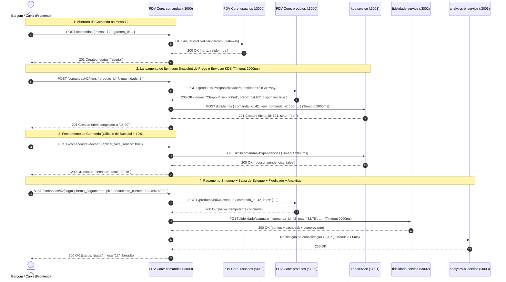
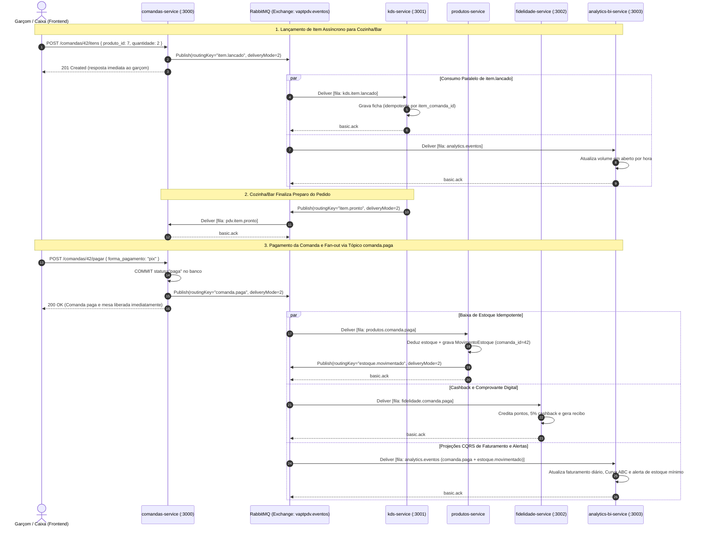

# 05. Contrato de APIs REST e Catálogo de Eventos de Mensageria

> **Projeto:** VaptPDV — Ponto de Venda Distribuído para Bares e Lanchonetes  
> **Padrões de Comunicação:** HTTP/1.1 REST (JSON UTF-8) e Mensageria Assíncrona AMQP 0-9-1 (RabbitMQ)  
> **Documentação Interativa:** OpenAPI 3.0 / Swagger UI exposto em `GET /docs` em cada serviço

Este documento estabelece o contrato técnico oficial de integração síncrona (REST) e assíncrona (Eventos via RabbitMQ) entre o **Frontend Web**, o **PDV Core** e os **3 Microsserviços Complementares** (`kds-service`, `fidelidade-service` e `analytics-bi-service`), abrangendo a evolução arquitetural dos Módulos 1 a 4 da disciplina de Sistemas Distribuídos.

---

## 1. Convenções Gerais HTTP/REST

Todas as APIs do ecossistema VaptPDV seguem rigorosamente as seguintes convenções de projeto:

### 1.1. Formato de Payload, Identificadores e Datas
- **Content-Type e Codificação:** Todas as requisições com corpo e todas as respostas utilizam `application/json; charset=utf-8`.
- **Nomenclatura de Campos:** Identificadores de domínio no corpo JSON e parâmetros de query utilizam português em formato `snake_case` (ex.: `garcom_id`, `nome_cliente`, `estoque_minimo`, `preco_copiado`, `aplicar_taxa_servico`).
- **Identificadores Primários (`id`):** Inteiros positivos autoincrementais (`1`, `2`, `3`, ...), gerados pelo PostgreSQL.
- **Datas e Horários (Timestamps):** Sempre serializados em formato **ISO 8601 UTC** (`YYYY-MM-DDTHH:mm:ss.sssZ`, ex.: `"2026-10-21T18:30:00.000Z"`).

### 1.2. Representação de Valores Monetários
- **Proibição de Ponto Flutuante Binário:** Valores monetários nunca são trafegados na saída como `Float`/`number` para evitar erros de arredondamento IEEE 754.
- **Saída Padronizada:** Sempre retornados como **string decimal com exatamente 2 casas decimais** separadas por ponto (ex.: `"0.00"`, `"12.50"`, `"148.90"`), mapeados diretamente de colunas `DECIMAL(10, 2)` no PostgreSQL.
- **Entrada Flexível e Validada:** Nos payloads de entrada (como cadastro/atualização de produto), aceita-se string decimal (`"12.50"`) ou número com até 2 casas decimais (`12.5`), sendo normalizado e persistido como `Decimal(10, 2)`.
- **Regra de Arredondamento:** Cálculos percentuais (como a taxa de serviço opcional de 10%) utilizam arredondamento comercial **`round_half_up`** com 2 casas decimais.

### 1.3. Paginação e Ordenação
Todas as rotas de listagem suportam paginação via *Query Parameters*:
- `limit`: Quantidade máxima de registros retornados por página. Padrão: `50` | Mínimo: `1` | Máximo: `200`.
- `offset`: Quantidade de registros a deslocar a partir do início. Padrão: `0` | Mínimo: `0`.

Exemplo de chamada paginada:
```http
GET /produtos?categoria=Bebidas&ativo=true&limit=20&offset=0 HTTP/1.1
```

### 1.4. Envelope Padronizado de Erro e Catálogo de Códigos
Qualquer falha (validação de schema TypeBox/Ajv, violação de regra de negócio, conflito de estado ou indisponibilidade de microsserviço) retorna **sempre** o mesmo envelope JSON implementado em `src/shared/erros.ts`:

```json
{
  "erro": {
    "codigo": "COMANDA_NAO_ABERTA",
    "mensagem": "A comanda não está aberta para lançamento de itens.",
    "detalhes": {
      "comanda_id": 42,
      "status_atual": "fechada"
    }
  }
}
```

#### Tabela de Códigos de Erro Padronizados

| Código de Erro | HTTP Status | Significado e Cenário de Ocorrência | Exemplo de `detalhes` |
| :--- | :---: | :--- | :--- |
| `VALIDACAO` | `400 Bad Request` | Payload JSON ou parâmetros de URL/Query inválidos (campo obrigatório ausente, quantidade $\le 0$, preço negativo, propriedade não permitida — RN09). | `{"quantidade": "Deve ser >= 1"}` |
| `NAO_ENCONTRADO` | `404 Not Found` | Recurso solicitado (usuário, produto, comanda, item, ficha KDS ou cliente fidelidade) não existe, ou rota HTTP inexistente. | `{"id": 999}` |
| `MESA_OCUPADA` | `409 Conflict` | Tentativa de abrir comanda em uma mesa que já possui outra comanda com `status = "aberta"` (RN07 + índice único parcial no PostgreSQL). | `{"mesa": "12"}` |
| `COMANDA_NAO_ABERTA` | `409 Conflict` | Tentativa de adicionar/alterar/remover item, fechar ou cancelar uma comanda cujo status atual não é `"aberta"` (RN01). | `{"comanda_id": 10, "status": "fechada"}` |
| `COMANDA_NAO_FECHADA` | `409 Conflict` | Tentativa de registrar pagamento (`POST /comandas/:id/pagar`) em uma comanda que ainda não foi fechada (`status != "fechada"` — RN02). | `{"comanda_id": 10, "status": "aberta"}` |
| `COMANDA_SEM_ITENS` | `409 Conflict` | Tentativa de fechar (`POST /comandas/:id/fechar`) uma comanda que não possui nenhum item lançado (RN11). | `{"comanda_id": 10}` |
| `COMANDA_IMUTAVEL` | `409 Conflict` | Tentativa de alterar qualquer dado de uma comanda que já atingiu estado terminal (`"paga"` ou `"cancelada"` — RN03). | `{"comanda_id": 10, "status": "paga"}` |
| `ESTOQUE_INSUFICIENTE` | `409 Conflict` | Quantidade solicitada no lançamento/alteração de item ou na baixa do pagamento excede o saldo disponível do produto (RN10 / RN13). | `{"produto_id": 7, "solicitado": 5, "disponivel": 2}` |
| `PRODUTO_INATIVO` | `422 Unprocessable Entity` | Tentativa de lançar em uma comanda um produto que foi inativado (`ativo = false`) no cardápio (RN06). | `{"produto_id": 7}` |
| `GARCOM_INVALIDO` | `422 Unprocessable Entity` | O `garcom_id` informado na abertura da comanda não existe, está inativo (`ativo = false`) ou possui perfil diferente de `"garcom"` (RN08). | `{"garcom_id": 3}` |
| `SERVICO_INDISPONIVEL` | `503 Service Unavailable` | Falha de comunicação, *timeout* (`2000ms`) ou banco de dados indisponível ao consultar um microsserviço dependente (RN17 / RNF02 — Módulo 2+). | `{"servico": "kds-service", "timeout_ms": 2000}` |
| `ERRO_INTERNO` | `500 Internal Server Error` | Exceção não tratada na camada de infraestrutura. Não expõe *stack trace* nem credenciais de banco ao cliente (RNF06). | `{}` |

---

## 2. API do PDV Core (Porta `3000`)

No **Módulo 1**, todos os contextos do núcleo (`saude`, `usuarios`, `produtos`, `comandas`) executam no mesmo processo Node.js/Fastify na porta `3000`, mantendo isolamento estrito de código em `src/modules/` e comunicação entre contextos exclusivamente via interfaces de Gateway (`GarcomGateway` e `EstoqueGateway`). A partir do **Módulo 2**, as rotas marcadas como **[interna]** são consumidas via cliente HTTP entre serviços independentes.

### 2.1. Infraestrutura e Interface Web

| Método | Rota | Descrição | Resposta de Sucesso |
| :---: | :--- | :--- | :--- |
| `GET` | `/` | Entrega estática do **Frontend Web Operacional** (HTML5/CSS/JS) para operação de Mesas, Caixa, Cardápio, KDS, Fidelidade e Analytics. | `200 OK` (`text/html`) |
| `GET` | `/docs` | Interface interativa **Swagger UI / OpenAPI 3.0** gerada automaticamente a partir dos schemas TypeBox. | `200 OK` (`text/html`) |
| `GET` | `/health` | Verifica a disponibilidade do processo Fastify e executa `SELECT 1` no PostgreSQL. | `200 OK` / `503 Service Unavailable` |

#### Exemplo — `GET /health`
**Resposta `200 OK`:**
```json
{
  "status": "ok"
}
```
**Resposta `503 Service Unavailable` (quando o PostgreSQL está inacessível):**
```json
{
  "erro": {
    "codigo": "SERVICO_INDISPONIVEL",
    "mensagem": "Banco de dados indisponível.",
    "detalhes": {
      "servico": "database"
    }
  }
}
```

---

### 2.2. Módulo de Usuários (`/usuarios`)

Gerencia os operadores do estabelecimento (`garcom`, `caixa`, `gerente`). Conforme regra de negócio e auditoria, **não existe exclusão física (`DELETE`)**: a remoção lógica é feita pela rota de inativação (`ativo = false`).

| Método | Rota | Escopo | Descrição |
| :---: | :--- | :---: | :--- |
| `POST` | `/usuarios` | Público | Cadastra novo usuário ativo (`garcom`, `caixa` ou `gerente`). |
| `GET` | `/usuarios` | Público | Lista usuários com filtro por `?perfil=`, `?ativo=`, `?limit=` e `?offset=`. |
| `GET` | `/usuarios/:id` | Público | Busca detalhes de um usuário pelo `id`. |
| `PATCH` | `/usuarios/:id` | Público | Atualiza parcialmente `nome` e/ou `perfil` do usuário. |
| `POST` | `/usuarios/:id/inativar` | Público | Inativa o usuário (`ativo = false`) de maneira idempotente. |
| `GET` | `/usuarios/:id/validar-garcom` | **[Interna]** | Valida se o usuário existe, está ativo e possui perfil `garcom`. |

#### `POST /usuarios` — Cadastrar Usuário
**Request Body:**
```json
{
  "nome": "Carlos Garçom",
  "perfil": "garcom"
}
```
**Response `201 Created`:**
```json
{
  "id": 1,
  "nome": "Carlos Garçom",
  "perfil": "garcom",
  "ativo": true,
  "criado_em": "2026-10-21T14:00:00.000Z",
  "atualizado_em": "2026-10-21T14:00:00.000Z"
}
```

#### `GET /usuarios` — Listar Usuários
- **Query Params Opcionais:**
  - `perfil`: `"garcom"` | `"caixa"` | `"gerente"`
  - `ativo`: `true` | `false`
  - `limit`: inteiro (`1..200`, padrão `50`)
  - `offset`: inteiro (`>= 0`, padrão `0`)
- **Response `200 OK`:** Array de objetos de usuário.

#### `PATCH /usuarios/:id` — Atualizar Usuário Parcialmente
**Request Body (pelo menos 1 campo obrigatório):**
```json
{
  "nome": "Carlos Eduardo (Garçom Sênior)",
  "perfil": "garcom"
}
```
**Response `200 OK`:** Objeto do usuário atualizado (`404 NAO_ENCONTRADO` se o ID não existir).

#### `POST /usuarios/:id/inativar` — Inativar Usuário (Idempotente)
Não requer corpo. Se o usuário já estiver inativo, retorna `200 OK` com `ativo: false` sem erro.
**Response `200 OK`:**
```json
{
  "id": 1,
  "nome": "Carlos Eduardo (Garçom Sênior)",
  "perfil": "garcom",
  "ativo": false,
  "criado_em": "2026-10-21T14:00:00.000Z",
  "atualizado_em": "2026-10-21T14:15:00.000Z"
}
```

#### `GET /usuarios/:id/validar-garcom` **[Rota Interna — Gateway de Comandas]**
Acionada pelo contexto de Comandas antes de abrir uma mesa (RN08).
**Response `200 OK`:**
```json
{
  "id": 1,
  "nome": "Carlos Garçom",
  "valido": true
}
```
**Response `422 Unprocessable Entity` (se inexistente, inativo ou perfil `caixa`/`gerente`):**
```json
{
  "erro": {
    "codigo": "GARCOM_INVALIDO",
    "mensagem": "Garçom inválido ou inativo para abertura de comanda.",
    "detalhes": {
      "garcom_id": 1,
      "motivo": "inativo"
    }
  }
}
```

---

### 2.3. Módulo de Produtos e Estoque (`/produtos`)

Gerencia o cardápio, preços, quantidades em estoque e histórico auditável de movimentações (`movimentos_estoque`). Preços posteriores alterados via `PATCH /produtos/:id` **não afetam** itens já lançados em comandas (que preservam `preco_copiado`).

| Método | Rota | Escopo | Descrição |
| :---: | :--- | :---: | :--- |
| `POST` | `/produtos` | Público | Cadastra novo item no cardápio com preço decimal e estoque inicial. |
| `GET` | `/produtos` | Público | Lista produtos com filtro por `?categoria=`, `?ativo=`, `?limit=` e `?offset=`. |
| `GET` | `/produtos/:id` | Público | Retorna os dados detalhados de um produto pelo `id`. |
| `PATCH` | `/produtos/:id` | Público | Atualiza parcialmente `nome`, `categoria`, `preco`, `estoque`, `estoque_minimo`. |
| `POST` | `/produtos/:id/inativar` | Público | Inativa o produto (`ativo = false`) de forma idempotente. |
| `GET` | `/produtos/:id/disponibilidade` | **[Interna]** | Consulta preço atual, status `ativo` e se há estoque para `?quantidade=N`. |
| `POST` | `/produtos/baixa-estoque` | **[Interna]** | Deduz estoque de múltiplos itens no pagamento da comanda (idempotente por `comanda_id`). |

#### `POST /produtos` — Cadastrar Produto
**Request Body:**
```json
{
  "nome": "Chopp Pilsen 500ml",
  "categoria": "Bebidas",
  "preco": "14.90",
  "estoque": 120,
  "estoque_minimo": 20
}
```
*(Nota: `preco` aceita `"14.90"` ou `14.9`; `estoque_minimo` é opcional e assume `0` por padrão).*

**Response `201 Created`:**
```json
{
  "id": 7,
  "nome": "Chopp Pilsen 500ml",
  "categoria": "Bebidas",
  "preco": "14.90",
  "estoque": 120,
  "estoque_minimo": 20,
  "ativo": true,
  "criado_em": "2026-10-21T14:20:00.000Z",
  "atualizado_em": "2026-10-21T14:20:00.000Z"
}
```

#### `GET /produtos/:id/disponibilidade?quantidade=2` **[Rota Interna — Gateway de Estoque]**
Usada pelo serviço de Comandas ao lançar ou alterar a quantidade de um item na comanda.
**Response `200 OK`:**
```json
{
  "id": 7,
  "nome": "Chopp Pilsen 500ml",
  "preco": "14.90",
  "ativo": true,
  "estoque": 120,
  "disponivel": true
}
```
*(Nota: `disponivel` é `true` somente quando `ativo === true` e `estoque >= quantidade`).*

#### `POST /produtos/baixa-estoque` **[Rota Interna — Módulos 2 e 3]**
Deduz em transação atômica o saldo dos produtos consumidos e grava registros na tabela `movimentos_estoque` com `motivo = "venda_comanda"`. É **idempotente por `comanda_id`**: se já houver movimento registrado para o `comanda_id` informado, retorna `200 OK` sem descontar novamente. No **Módulo 4**, esta chamada síncrona é substituída pelo consumo assíncrono do evento `comanda.paga`.

**Request Body:**
```json
{
  "comanda_id": 42,
  "itens": [
    { "produto_id": 7, "quantidade": 2 },
    { "produto_id": 12, "quantidade": 1 }
  ]
}
```
**Response `200 OK`:**
```json
{
  "comanda_id": 42,
  "processado": true,
  "idempotente": false,
  "movimentos_registrados": 2
}
```

---

### 2.4. Módulo de Comandas (`/comandas`)

Orquestra todo o ciclo de vida do atendimento da mesa: `aberta` $\rightarrow$ `fechada` $\rightarrow$ `paga` (ou `aberta` $\rightarrow$ `cancelada`). Enquanto a comanda está `"aberta"`, os campos `subtotal`, `taxa_servico`, `total`, `forma_pagamento`, `fechada_em` e `paga_em` permanecem `null`.

| Método | Rota | Descrição | Códigos de Erro Possíveis |
| :---: | :--- | :--- | :--- |
| `POST` | `/comandas` | Abre uma comanda em uma mesa livre para um garçom ativo. | `400`, `409 MESA_OCUPADA`, `422 GARCOM_INVALIDO`, `503` |
| `GET` | `/comandas` | Lista comandas (mais recentes primeiro) com filtros `?status=`, `?mesa=`, `?de=`, `?ate=`. | `400`, `500` |
| `GET` | `/comandas/:id` | Retorna a comanda completa com a lista de `itens`. | `404 NAO_ENCONTRADO` |
| `POST` | `/comandas/:id/itens` | Lança item na comanda aberta, congelando `nome_copiado` e `preco_copiado`. | `404`, `409 COMANDA_NAO_ABERTA`, `409 ESTOQUE_INSUFICIENTE`, `422 PRODUTO_INATIVO`, `503` |
| `PATCH` | `/comandas/:id/itens/:itemId` | Altera a `quantidade` de um item já lançado (valida diferença de estoque). | `400`, `404`, `409 COMANDA_NAO_ABERTA`, `409 ESTOQUE_INSUFICIENTE`, `422 PRODUTO_INATIVO` |
| `DELETE` | `/comandas/:id/itens/:itemId` | Remove um item de uma comanda aberta. | `404`, `409 COMANDA_NAO_ABERTA` |
| `POST` | `/comandas/:id/fechar` | Fecha a comanda e calcula `subtotal`, `taxa_servico` (10% opcional) e `total`. | `404`, `409 COMANDA_NAO_ABERTA`, `409 COMANDA_SEM_ITENS` |
| `POST` | `/comandas/:id/pagar` | Registra pagamento (`dinheiro`, `pix`, `cartao`), efetiva baixa de estoque e libera a mesa. | `404`, `409 COMANDA_NAO_FECHADA`, `409 ESTOQUE_INSUFICIENTE`, `503` |
| `POST` | `/comandas/:id/cancelar` | Cancela uma comanda que ainda esteja `"aberta"`, liberando a mesa sem baixar estoque. | `404`, `409 COMANDA_NAO_ABERTA`, `409 COMANDA_IMUTAVEL` |

#### `POST /comandas` — Abrir Comanda
**Request Body:**
```json
{
  "mesa": "12",
  "garcom_id": 1,
  "nome_cliente": "Mariana Costa"
}
```
**Response `201 Created`:**
```json
{
  "id": 42,
  "mesa": "12",
  "nome_cliente": "Mariana Costa",
  "garcom_id": 1,
  "status": "aberta",
  "subtotal": null,
  "taxa_servico": null,
  "total": null,
  "forma_pagamento": null,
  "aberta_em": "2026-10-21T19:00:00.000Z",
  "fechada_em": null,
  "paga_em": null,
  "itens": []
}
```

#### `POST /comandas/:id/itens` — Lançar Item na Comanda
**Request Body:**
```json
{
  "produto_id": 7,
  "quantidade": 2
}
```
**Response `201 Created`:**
```json
{
  "id": 105,
  "produto_id": 7,
  "nome_copiado": "Chopp Pilsen 500ml",
  "preco_copiado": "14.90",
  "quantidade": 2
}
```

#### `PATCH /comandas/:id/itens/:itemId` — Alterar Quantidade do Item
**Request Body:**
```json
{
  "quantidade": 4
}
```
**Response `200 OK`:**
```json
{
  "id": 105,
  "produto_id": 7,
  "nome_copiado": "Chopp Pilsen 500ml",
  "preco_copiado": "14.90",
  "quantidade": 4
}
```

#### `DELETE /comandas/:id/itens/:itemId` — Remover Item da Comanda
**Response:** `204 No Content` (sem corpo).

#### `POST /comandas/:id/fechar` — Fechar Comanda e Calcular Totais
Aplica as fórmulas financeiras determinísticas no backend:
- $\text{subtotal} = \sum (\text{preco\_copiado} \times \text{quantidade})$
- $\text{taxa\_servico} = \text{round\_half\_up}(\text{subtotal} \times 0.10, 2)$ se `aplicar_taxa_servico === true`, caso contrário `"0.00"`
- $\text{total} = \text{subtotal} + \text{taxa\_servico}$

**Request Body:**
```json
{
  "aplicar_taxa_servico": true
}
```
**Response `200 OK`:**
```json
{
  "id": 42,
  "mesa": "12",
  "nome_cliente": "Mariana Costa",
  "garcom_id": 1,
  "status": "fechada",
  "subtotal": "59.60",
  "taxa_servico": "5.96",
  "total": "65.56",
  "forma_pagamento": null,
  "aberta_em": "2026-10-21T19:00:00.000Z",
  "fechada_em": "2026-10-21T20:15:00.000Z",
  "paga_em": null,
  "itens": [
    {
      "id": 105,
      "produto_id": 7,
      "nome_copiado": "Chopp Pilsen 500ml",
      "preco_copiado": "14.90",
      "quantidade": 4
    }
  ]
}
```

#### `POST /comandas/:id/pagar` — Pagar Comanda e Baixar Estoque
**Request Body:**
```json
{
  "forma_pagamento": "pix",
  "documento_cliente": "12345678909"
}
```
*(Nota: `documento_cliente` é opcional e utilizado a partir do Módulo 2 para pontuação automática no `fidelidade-service`).*

**Response `200 OK`:**
```json
{
  "id": 42,
  "mesa": "12",
  "nome_cliente": "Mariana Costa",
  "garcom_id": 1,
  "status": "paga",
  "subtotal": "59.60",
  "taxa_servico": "5.96",
  "total": "65.56",
  "forma_pagamento": "pix",
  "aberta_em": "2026-10-21T19:00:00.000Z",
  "fechada_em": "2026-10-21T20:15:00.000Z",
  "paga_em": "2026-10-21T20:18:30.000Z",
  "itens": [
    {
      "id": 105,
      "produto_id": 7,
      "nome_copiado": "Chopp Pilsen 500ml",
      "preco_copiado": "14.90",
      "quantidade": 4
    }
  ]
}
```

#### `POST /comandas/:id/cancelar` — Cancelar Comanda Aberta
Não requer corpo. Apenas comandas com `status = "aberta"` podem ser canceladas.
**Response `200 OK`:** Objeto da comanda com `status: "cancelada"`.

---

## 3. API do `kds-service` — Cozinha & Bar (Porta `3001` — Módulo 2+)

Responsável pelo **Kitchen Display System (KDS)**: gerencia as filas de preparo separadas por setor (`cozinha` para porções/lanches e `bar` para bebidas/drinks) e controla o SLA de tempo de preparo. Possui banco de dados próprio (`kds_db`).

| Método | Rota | Escopo | Descrição |
| :---: | :--- | :---: | :--- |
| `GET` | `/health` | Público | Verifica saúde do `kds-service` e conexão com `kds_db`. |
| `GET` | `/kds/fichas` | Público | Lista a fila de fichas de preparo filtrada por `?setor=` (`cozinha`\|`bar`) e `?status=`. |
| `POST` | `/kds/fichas` | **[Interna]** | Recebe de forma síncrona (Módulo 2/3) um novo item lançado na comanda para preparo. |
| `PATCH` | `/kds/fichas/:id/status` | Público | Avança o estado da ficha (`recebido` $\rightarrow$ `em_preparo` $\rightarrow$ `pronto` $\rightarrow$ `entregue`). |
| `GET` | `/kds/comandas/:comandaId/pendencias` | **[Interna]** | Consulta síncrona usada pelo PDV Core antes de fechar a comanda para alertar se ainda há itens em preparo. |

### 3.1. `POST /kds/fichas` — Criar Ficha de Preparo (Módulo 2 Síncrono)
No Módulo 4, esta criação passa a ocorrer via consumo do evento `item.lancado` na fila `kds.item.lancado`.

**Request Body:**
```json
{
  "comanda_id": 42,
  "item_comanda_id": 105,
  "mesa": "12",
  "produto_id": 7,
  "nome_produto": "Chopp Pilsen 500ml",
  "categoria": "Bebidas",
  "quantidade": 2,
  "garcom_id": 1,
  "observacao": "Bem gelado, colarinho baixo"
}
```
**Response `201 Created`:**
```json
{
  "id": 301,
  "comanda_id": 42,
  "item_comanda_id": 105,
  "mesa": "12",
  "setor": "bar",
  "nome_produto": "Chopp Pilsen 500ml",
  "quantidade": 2,
  "observacao": "Bem gelado, colarinho baixo",
  "status": "recebido",
  "recebido_em": "2026-10-21T19:05:00.000Z",
  "iniciado_em": null,
  "pronto_em": null,
  "entregue_em": null
}
```

### 3.2. `GET /kds/fichas?setor=bar&status=recebido` — Consultar Fila do KDS
**Response `200 OK`:** Array de fichas ordenadas por `recebido_em ASC` (FIFO).

### 3.3. `PATCH /kds/fichas/:id/status` — Avançar Status de Preparo
Quando o status atinge `"pronto"`, no Módulo 4 o `kds-service` publica o evento `item.pronto` no RabbitMQ para notificar o garçom responsável.

**Request Body:**
```json
{
  "status": "pronto"
}
```
**Response `200 OK`:**
```json
{
  "id": 301,
  "comanda_id": 42,
  "item_comanda_id": 105,
  "mesa": "12",
  "setor": "bar",
  "nome_produto": "Chopp Pilsen 500ml",
  "quantidade": 2,
  "status": "pronto",
  "recebido_em": "2026-10-21T19:05:00.000Z",
  "iniciado_em": "2026-10-21T19:06:10.000Z",
  "pronto_em": "2026-10-21T19:07:45.000Z",
  "entregue_em": null
}
```

### 3.4. `GET /kds/comandas/:comandaId/pendencias` — Verificar Itens Pendentes da Comanda
**Response `200 OK`:**
```json
{
  "comanda_id": 42,
  "possui_pendencias": false,
  "itens_pendentes": 0,
  "fichas_em_aberto": []
}
```

---

## 4. API do `fidelidade-service` — Cashback & Comprovantes (Porta `3002` — Módulo 2+)

Gerencia o programa de relacionamento do estabelecimento (1 ponto por cada `R$ 1,00` gasto e `5%` de cashback creditado na carteira digital do cliente), além da emissão do comprovante digital detalhado da comanda paga. Possui banco de dados próprio (`fidelidade_db`).

| Método | Rota | Escopo | Descrição |
| :---: | :--- | :---: | :--- |
| `GET` | `/health` | Público | Verifica saúde do `fidelidade-service` e conexão com `fidelidade_db`. |
| `POST` | `/fidelidade/clientes` | Público | Cadastra participante no programa de fidelidade (CPF, nome, telefone). |
| `GET` | `/fidelidade/clientes/:documento` | Público | Consulta saldo de pontos, saldo de cashback (`"0.00"`) e histórico do cliente pelo CPF. |
| `POST` | `/fidelidade/acumular` | **[Interna]** | Registra pontuação, cashback e emite comprovante digital (idempotente por `comanda_id`). |
| `GET` | `/fidelidade/comprovantes/:comandaId` | Público | Retorna o recibo digital emitido para uma comanda paga. |

### 4.1. `POST /fidelidade/clientes` — Cadastrar Cliente no Programa
**Request Body:**
```json
{
  "documento": "12345678909",
  "nome": "Mariana Costa",
  "telefone": "11998765432"
}
```
**Response `201 Created`:**
```json
{
  "id": 15,
  "documento": "12345678909",
  "nome": "Mariana Costa",
  "telefone": "11998765432",
  "pontos_acumulados": 0,
  "saldo_cashback": "0.00",
  "criado_em": "2026-10-21T18:50:00.000Z"
}
```

### 4.2. `GET /fidelidade/clientes/:documento` — Consultar Saldo de Pontos e Cashback
**Response `200 OK`:**
```json
{
  "id": 15,
  "documento": "12345678909",
  "nome": "Mariana Costa",
  "telefone": "11998765432",
  "pontos_acumulados": 65,
  "saldo_cashback": "3.28",
  "ultima_compra_em": "2026-10-21T20:18:30.000Z"
}
```

### 4.3. `POST /fidelidade/acumular` — Acumular Pontos e Emitir Comprovante (Módulo 2 Síncrono)
No Módulo 4, esta operação ocorre de forma totalmente assíncrona ao consumir o evento `comanda.paga`. É **idempotente por `comanda_id`**.

**Request Body:**
```json
{
  "comanda_id": 42,
  "documento_cliente": "12345678909",
  "mesa": "12",
  "subtotal": "59.60",
  "taxa_servico": "5.96",
  "total": "65.56",
  "forma_pagamento": "pix",
  "paga_em": "2026-10-21T20:18:30.000Z",
  "itens": [
    {
      "produto_id": 7,
      "nome_copiado": "Chopp Pilsen 500ml",
      "preco_copiado": "14.90",
      "quantidade": 4
    }
  ]
}
```
**Response `200 OK`:**
```json
{
  "comprovante_id": 88,
  "comanda_id": 42,
  "codigo_autenticacao": "VAPT-20261021-0042-PIX",
  "documento_cliente": "12345678909",
  "pontos_gerados": 65,
  "cashback_gerado": "3.28",
  "emitido_em": "2026-10-21T20:18:31.000Z"
}
```

### 4.4. `GET /fidelidade/comprovantes/:comandaId` — Consultar Recibo Digital Emitido
**Response `200 OK`:**
```json
{
  "comprovante_id": 88,
  "comanda_id": 42,
  "mesa": "12",
  "documento_cliente": "12345678909",
  "subtotal": "59.60",
  "taxa_servico": "5.96",
  "total": "65.56",
  "forma_pagamento": "pix",
  "pontos_gerados": 65,
  "cashback_gerado": "3.28",
  "codigo_autenticacao": "VAPT-20261021-0042-PIX",
  "paga_em": "2026-10-21T20:18:30.000Z",
  "emitido_em": "2026-10-21T20:18:31.000Z",
  "itens": [
    {
      "produto_id": 7,
      "nome_copiado": "Chopp Pilsen 500ml",
      "preco_copiado": "14.90",
      "quantidade": 4
    }
  ]
}
```

---

## 5. API do `analytics-bi-service` — Inteligência Operacional (Porta `3003` — Módulo 2+)

Consolida indicadores gerenciais em modelo **CQRS (Command Query Responsibility Segregation)** otimizado para leitura em banco próprio (`analytics_db`). Nos Módulos 2 e 3 consolida dados sob demanda / ingestão HTTP; no Módulo 4 mantém projeções materializadas em tempo real alimentadas pelos eventos do RabbitMQ.

| Método | Rota | Descrição |
| :---: | :--- | :--- |
| `GET` | `/health` | Verifica saúde do `analytics-bi-service` e conexão com `analytics_db`. |
| `GET` | `/analytics/resumo-diario` | Retorna faturamento bruto, total de taxas de serviço, ticket médio, total de comandas pagas e divisão por forma de pagamento na data (`?data=YYYY-MM-DD`). |
| `GET` | `/analytics/ranking-produtos` | Retorna a Curva ABC de produtos mais vendidos por volume e receita gerada. |
| `GET` | `/analytics/desempenho-garcons` | Retorna produtividade dos garçons (comandas atendidas, receita movimentada e comissões geradas pela taxa de 10%). |
| `GET` | `/analytics/alertas-estoque` | Lista produtos cujo saldo atual atingiu ou ficou abaixo do `estoque_minimo` (`estoque <= estoque_minimo`). |

### 5.1. `GET /analytics/resumo-diario?data=2026-10-21`
**Response `200 OK`:**
```json
{
  "data_referencia": "2026-10-21",
  "comandas_pagas": 38,
  "comandas_canceladas": 2,
  "faturamento_subtotal": "3420.00",
  "total_taxa_servico": "310.50",
  "faturamento_total": "3730.50",
  "ticket_medio": "98.17",
  "por_forma_pagamento": {
    "pix": "1850.00",
    "cartao": "1480.50",
    "dinheiro": "400.00"
  }
}
```

### 5.2. `GET /analytics/ranking-produtos?limit=10`
**Response `200 OK`:**
```json
[
  {
    "posicao": 1,
    "produto_id": 7,
    "nome_produto": "Chopp Pilsen 500ml",
    "categoria": "Bebidas",
    "quantidade_vendida": 184,
    "receita_gerada": "2741.60",
    "classe_abc": "A"
  },
  {
    "posicao": 2,
    "produto_id": 12,
    "nome_produto": "Porção de Batata Frita com Cheddar",
    "categoria": "Porções",
    "quantidade_vendida": 45,
    "receita_gerada": "1755.00",
    "classe_abc": "A"
  }
]
```

### 5.3. `GET /analytics/desempenho-garcons?data=2026-10-21`
**Response `200 OK`:**
```json
[
  {
    "garcom_id": 1,
    "nome_garcom": "Carlos Garçom",
    "comandas_atendidas": 22,
    "vendas_subtotal": "2100.00",
    "taxa_servico_gerada": "195.00",
    "ticket_medio_mesa": "95.45"
  }
]
```

### 5.4. `GET /analytics/alertas-estoque`
**Response `200 OK`:**
```json
[
  {
    "produto_id": 7,
    "nome": "Chopp Pilsen 500ml",
    "categoria": "Bebidas",
    "estoque_atual": 15,
    "estoque_minimo": 20,
    "nivel_criticidade": "baixo",
    "ultimo_movimento_em": "2026-10-21T20:18:30.000Z"
  }
]
```

---

## 6. Catálogo de Eventos Assíncronos (RabbitMQ / AMQP 0-9-1 — Módulo 4)

No **Módulo 4**, as integrações colaterais deixam de bloquear a transação HTTP do operador de PDV e passam a ocorrer via **Mensageria Assíncrona** com **RabbitMQ**.

### 6.1. Topologia do Message Broker

- **Virtual Host:** `/`
- **Exchange Principal:** `vaptpdv.eventos`
  - **Tipo:** `topic`
  - **Durável (`durable`):** `true`
  - **Auto-delete:** `false`
- **Dead Letter Exchange (DLX):** `vaptpdv.eventos.dlx` (tipo `direct`, durável)

#### Tabela de Filas Duráveis, Bindings e Dead Letter Queues (DLQs)

| Fila (`Queue`) | Consumidor Responsável | Routing Key (`Binding`) | Dead Letter Queue (`x-dead-letter-routing-key`) | Propósito |
| :--- | :--- | :--- | :--- | :--- |
| `kds.item.lancado` | `kds-service` | `item.lancado` | `kds.item.lancado.dlq` | Gerar fichas de preparo na Cozinha ou Bar assim que o garçom lança o item. |
| `pdv.item.pronto` | `comandas-service` (PDV Core) | `item.pronto` | `pdv.item.pronto.dlq` | Notificar o salão/garçom que o pedido está pronto para retirada no balcão. |
| `produtos.comanda.paga` | `produtos-service` | `comanda.paga` | `produtos.comanda.paga.dlq` | Realizar a baixa definitiva de estoque e gravar `MovimentoEstoque` de forma idempotente. |
| `fidelidade.comanda.paga` | `fidelidade-service` | `comanda.paga` | `fidelidade.comanda.paga.dlq` | Creditar pontos, calcular 5% de cashback e emitir o comprovante digital. |
| `analytics.eventos` | `analytics-bi-service` | `#` (ou `item.*`, `comanda.*`, `estoque.*`) | `analytics.eventos.dlq` | Atualizar projeções de faturamento, Curva ABC, ranking de garçons e alertas de estoque. |

### 6.2. Propriedades AMQP Obrigatórias e Garantias de Entrega
Todas as mensagens publicadas no `vaptpdv.eventos` incluem os seguintes metadados AMQP:
- `deliveryMode: 2` (Mensagem persistente em disco).
- `contentType: "application/json"`
- `contentEncoding: "utf-8"`
- `messageId`: UUID v4 único do evento (ex.: `"evt_9b1deb4d-3b7d-4bad-9bdd-2b0d7b3dcb6d"`).
- `correlationId`: Identificador de rastreamento distribuído da requisição original ou `comanda_${comanda_id}`.
- `timestamp`: Epoch Unix em segundos do momento da publicação.
- **Confirmação Manual (`ack`):** Todos os consumidores operam com `noAck: false` e `prefetch(10)`. O `channel.ack(msg)` só é enviado após o `COMMIT` da transação no banco local do consumidor. Em caso de falha transitória, aplica-se retentativa com *exponential backoff* (até 3 tentativas); se persistir ou for erro semântico irrecuperável, aplica-se `channel.nack(msg, false, false)` encaminhando a mensagem para a respectiva `.dlq`.

---

### 6.3. Especificação dos 4 Eventos de Domínio

#### Evento 1: `item.lancado`
- **Routing Key:** `item.lancado`
- **Produtor:** `comandas-service` (PDV Core), disparado imediatamente após o `COMMIT` de `POST /comandas/:id/itens`.
- **Consumidores:** `kds-service` (fila `kds.item.lancado`) e `analytics-bi-service` (fila `analytics.eventos`).
- **Chave de Idempotência:** `item_comanda_id` (o `kds-service` possui constraint `UNIQUE(item_comanda_id)` para evitar duplicar a ficha de preparo em caso de reentrega *at-least-once*).

```json
{
  "evento": "item.lancado",
  "evento_id": "evt_4a8b9c10-12ef-4d21-8a11-001122334455",
  "ocorrido_em": "2026-10-21T19:05:00.000Z",
  "comanda_id": 42,
  "mesa": "12",
  "garcom_id": 1,
  "item": {
    "item_comanda_id": 105,
    "produto_id": 7,
    "nome_copiado": "Chopp Pilsen 500ml",
    "categoria": "Bebidas",
    "preco_copiado": "14.90",
    "quantidade": 2
  }
}
```

#### Evento 2: `item.pronto`
- **Routing Key:** `item.pronto`
- **Produtor:** `kds-service`, disparado quando o cozinheiro ou barman altera o status da ficha para `"pronto"` (`PATCH /kds/fichas/:id/status`).
- **Consumidores:** `comandas-service` / PDV Core (fila `pdv.item.pronto`) e `analytics-bi-service` (fila `analytics.eventos` para cálculo de SLA médio de preparo).
- **Chave de Idempotência:** `ficha_id` + `status: "pronto"`.

```json
{
  "evento": "item.pronto",
  "evento_id": "evt_7f21c330-98ab-4110-b220-556677889900",
  "ocorrido_em": "2026-10-21T19:07:45.000Z",
  "ficha_id": 301,
  "comanda_id": 42,
  "item_comanda_id": 105,
  "mesa": "12",
  "setor": "bar",
  "nome_produto": "Chopp Pilsen 500ml",
  "quantidade": 2,
  "tempo_preparo_segundos": 165
}
```

#### Evento 3: `comanda.paga`
- **Routing Key:** `comanda.paga`
- **Produtor:** `comandas-service` (PDV Core), publicado após o `COMMIT` do pagamento em `POST /comandas/:id/pagar`.
- **Consumidores:**
  1. `produtos-service` (fila `produtos.comanda.paga`): executa a baixa de estoque definitiva e grava os registros em `movimentos_estoque`, publicando em seguida o evento `estoque.movimentado`.
  2. `fidelidade-service` (fila `fidelidade.comanda.paga`): credita pontos, calcula cashback e gera o comprovante digital.
  3. `analytics-bi-service` (fila `analytics.eventos`): consolida faturamento diário, Curva ABC e comissão do garçom.
- **Chave de Idempotência:** `comanda_id` (como uma comanda transita para `"paga"` uma única vez em toda a sua vida útil, `comanda_id` é a chave natural de desduplicação nos três consumidores).

```json
{
  "evento": "comanda.paga",
  "evento_id": "evt_9d33e112-44bc-4982-9111-aabbccddeeff",
  "comanda_id": 42,
  "mesa": "12",
  "garcom_id": 1,
  "documento_cliente": "12345678909",
  "forma_pagamento": "pix",
  "subtotal": "59.60",
  "taxa_servico": "5.96",
  "total": "65.56",
  "paga_em": "2026-10-21T20:18:30.000Z",
  "itens": [
    {
      "produto_id": 7,
      "nome_copiado": "Chopp Pilsen 500ml",
      "preco_copiado": "14.90",
      "quantidade": 4
    }
  ]
}
```

#### Evento 4: `estoque.movimentado`
- **Routing Key:** `estoque.movimentado`
- **Produtor:** `produtos-service`, publicado após efetivar a baixa de estoque (ou ajuste de reposição).
- **Consumidor:** `analytics-bi-service` (fila `analytics.eventos`), atualizando imediatamente o painel de alertas de estoque crítico (`estoque_atual <= estoque_minimo`).
- **Chave de Idempotência:** `movimento_id`.

```json
{
  "evento": "estoque.movimentado",
  "evento_id": "evt_1c44f889-77da-4309-8999-112233445566",
  "ocorrido_em": "2026-10-21T20:18:31.000Z",
  "movimento_id": 512,
  "comanda_id": 42,
  "produto_id": 7,
  "nome_produto": "Chopp Pilsen 500ml",
  "categoria": "Bebidas",
  "quantidade_movimentada": -4,
  "estoque_anterior": 19,
  "estoque_atual": 15,
  "estoque_minimo": 20,
  "abaixo_do_minimo": true,
  "motivo": "venda_comanda"
}
```

---

## 7. Diagramas de Sequência Arquiteturais

### 7.1. Fluxo Síncrono REST entre Microsserviços (Módulos 2 e 3)

No Módulo 2 e no Módulo 3, a comunicação entre os serviços acontece de forma síncrona via HTTP/REST. Se uma dependência obrigatória (como `usuarios-service` na abertura ou `produtos-service` no lançamento/baixa) estiver inacessível, o `comandas-service` retorna `503 SERVICO_INDISPONIVEL`.



---

### 7.2. Fluxo Orientado a Eventos via RabbitMQ (Módulo 4)

No Módulo 4, a baixa de estoque, o envio de fichas ao KDS, a pontuação de fidelidade e a consolidação analítica são desacoplados via **RabbitMQ** (`vaptpdv.eventos`), reduzindo drasticamente a latência no caixa e garantindo resiliência mesmo que `kds-service`, `fidelidade-service` ou `analytics-bi-service` sofram picos ou reinicializações temporárias.


