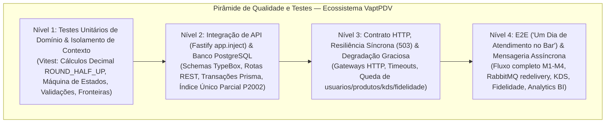

# 06 — Plano de Testes, Estratégia de Qualidade e Matriz de Rastreabilidade (TEA)

**Projeto:** VaptPDV — Ecossistema Distribuído de Ponto de Venda para Bares e Lanchonetes  
**Escopo do Ecossistema:** PDV Core (`usuarios-service`, `produtos-service`, `comandas-service`) + Microsserviços Satélites (`kds-service`, `fidelidade-service`, `analytics-bi-service`) + Mensageria (`RabbitMQ`)  
**Autor / Arquiteto de Testes:** Murat — *Master Test Architect and Quality Advisor (BMad TEA)*  
**Status:** Aprovado e Vigente | **Data:** 21/10/2026  

> [!IMPORTANT]
> **Filosofia de Qualidade (TEA):** No VaptPDV, testes não existem para inflar métricas de cobertura artificial, mas para **blindar invariantes financeiras, transacionais e de sistemas distribuídos**. Flakiness (testes intermitentes) é tratado como dívida técnica crítica: cada teste deve ser determinístico, isolado e rastreável a um requisito (`RF`), regra de negócio (`RN`) e risco operacional real do bar/lanchonete.

---

## 1. Estratégia de Qualidade Baseada em Riscos (Risk-Based Testing)

Em um ambiente de bar ou lanchonete em horário de pico, falhas de software traduzem-se imediatamente em **prejuízo financeiro no caixa**, **conflito de atendimento no salão**, **divergência física de estoque** ou **fila de clientes impedidos de pagar**.

A estratégia de qualidade do VaptPDV aplica a metodologia *Risk-Based Testing (RBT)* do BMad TEA, calculando a exposição ao risco ($\text{Risco} = \text{Probabilidade} \times \text{Impacto}$) para alocar o esforço de automação exatamente onde o dano ao negócio ou à avaliação acadêmica dos 4 módulos de Sistemas Distribuídos é mais severo.

### 1.1 Matriz de Riscos Críticos de Negócio e Arquitetura

| ID | Risco Crítico Identificado | Probabilidade | Impacto | Nível | Regras Afetadas | Estratégia de Mitigação e Verificação por Testes |
| :--- | :--- | :---: | :---: | :---: | :--- | :--- |
| **R01** | **Erro de arredondamento monetário (ponto flutuante IEEE 754):** Uso acidental de `Float`/`number` gerando dízimas (ex.: `0.1 + 0.2 = 0.30000000000000004`) no cálculo de `subtotal`, `taxa_servico` (10%) ou `total`. | Média | Crítico | **P0 (Blocker)** | RN05, RN12 | • Proibição estrita de `Float`; uso exclusivo de `Prisma.Decimal` (`NUMERIC(10,2)` no PostgreSQL).<br>• Serialização na API sempre como string decimal de 2 casas (`"12.50"`).<br>• Testes unitários exaustivos de fronteira com arredondamento `ROUND_HALF_UP` (ex.: subtotal `"33.35"` $\rightarrow$ taxa `"3.34"`). |
| **R02** | **Duplicidade de mesa aberta em lançamentos concorrentes (Race Condition / TOCTOU):** Dois garçons abrem comanda para a `mesa = "10"` no mesmo milissegundo; o `SELECT` prévio (`findFirst`) vê a mesa livre para ambos. | Alta | Crítico | **P0 (Blocker)** | RN07 | • Índice único parcial no PostgreSQL: `CREATE UNIQUE INDEX comandas_mesa_aberta_unique_idx ON comandas (mesa) WHERE status = 'aberta'`.<br>• Captura determinística do erro Prisma `P2002` mapeado para HTTP `409 MESA_OCUPADA`.<br>• Testes de condição de corrida simulada (mock P2002) e integração real com `Promise.all`. |
| **R03** | **Retroatividade indevida de preço de cardápio:** O gerente reajusta o preço da cerveja às 22h e comandas abertas às 19h (ou já pagas) têm seus valores alterados retroativamente. | Média | Crítico | **P0 (Blocker)** | RN04 | • Snapshot imutável (`nome_copiado` e `preco_copiado`) gravado em `itens_comanda` no instante do `POST /comandas/:id/itens`.<br>• Testes de mutação de cardápio: lançar item $\rightarrow$ `PATCH /produtos/:id` alterando preço $\rightarrow$ fechar comanda e validar que o cálculo usa o `preco_copiado` original. |
| **R04** | **Baixa duplicada ou fantasma de estoque:** Pagamento repetido (duplo clique no caixa) ou reentrega de mensagem (`at-least-once delivery`) pelo RabbitMQ deduzindo o estoque duas vezes, ou cancelamento de comanda baixando estoque. | Alta | Crítico | **P0 (Blocker)** | RN10, RN18 | • No Módulo 1–3: transação atômica com checagem de status `fechada` e vínculo em `movimentos_estoque`.<br>• No Módulo 4: consumidor RabbitMQ idempotente por `comanda_id` + chave única de movimento (`VENDA_COMANDA #<id>`), com `ack` manual somente após commit.<br>• Comanda `cancelada` jamais invoca `EstoqueGateway`. |
| **R05** | **Queda de microsserviço dependente ou satélite travando o caixa (Cascading Failure):** Queda ou lentidão em `kds-service`, `fidelidade-service` ou `analytics-bi-service` pendurando requisições indefinidamente. | Alta | Alto | **P0 (Blocker)** | RN16, RN17, RN20, RN21, RN22 | • Chamadas HTTP síncronas com `AbortSignal.timeout(2000)` rigoroso (`2000ms` — RNF02) e mapeamento de falha para `503 SERVICO_INDISPONIVEL` com `detalhes.servico` explícito, mantendo o processo Fastify vivo.<br>• Serviços satélites não-críticos ao fechamento operam desacoplados via eventos (`comanda.paga`, `item.lancado`, `item.pronto`, `estoque.movimentado`) no exchange `vaptpdv.eventos` ou com degradação graciosa (fallback sem travar o caixa). |
| **R06** | **Violação da máquina de estados da comanda:** Lançar item em comanda `fechada`, fechar comanda vazia (`0` itens), pagar comanda `aberta` ou alterar comanda `paga`/`cancelada`. | Média | Alto | **P1 (High)** | RN01, RN02, RN03, RN11 | • Checagem transacional de estado em cada mutação de `ServicoComandasPrisma`.<br>• Matriz completa de testes de transição inválida cobrindo todos os estados ($\text{aberta}, \text{fechada}, \text{paga}, \text{cancelada}$) retornando `409` com códigos semânticos (`COMANDA_NAO_ABERTA`, `COMANDA_NAO_FECHADA`, `COMANDA_SEM_ITENS`, `COMANDA_IMUTAVEL`). |
| **R07** | **Acoplamento oculto entre contextos de domínio:** Módulo `comandas` acessando diretamente `prisma.usuario` ou `prisma.produto`, inviabilizando a extração limpa no Módulo 2. | Baixa | Alto | **P1 (High)** | Fronteira Arquitetural | • Injeção de dependência obrigatória (`ServicoUsuarios`, `EstoqueGateway`).<br>• Testes arquiteturais que removem `delete prisma.usuario` e `delete prisma.produto` do cliente injetado em `ServicoComandasPrisma`, provando isolamento total desde o Módulo 1. |
| **R08** | **Vazamento de segredos ou stack traces na API:** Exceção de banco contendo `DATABASE_URL` com senha exposta no payload JSON de erro 500. | Baixa | Crítico | **P1 (High)** | Segurança / Constraints | • Error handler global do Fastify que sanitiza qualquer erro não tratado em `500 ERRO_INTERNO` genérico na resposta HTTP, registrando o `stack` exclusivamente no log estruturado (Pino). |

---

## 2. Pirâmide de Testes do VaptPDV

A arquitetura de testes do VaptPDV é estruturada em **4 níveis complementares**, equilibrando velocidade de feedback em desenvolvimento local (`npm.cmd test` via Vitest em $< 2\text{ s}$) com fidelidade de integração em banco relacional, contratos HTTP distribuídos e mensageria assíncrona.



### 2.1 Nível 1 — Testes Unitários de Domínio (Vitest)
- **Objetivo:** Validar regras de negócio puras, aritmética decimal exata, normalização de strings, validações defensivas e isolamento de fronteiras sem depender de rede ou I/O externo.
- **Ferramental:** `Vitest`, mocks leves de repositório (`ClienteBanco`) e spies (`vi.fn()`).
- **O que é testado neste nível:**
  - **Cálculo Monetário Exato:** Soma de `preco_copiado * quantidade` com `Prisma.Decimal`, cálculo opcional de `taxa_servico` de 10% com arredondamento `ROUND_HALF_UP` para 2 casas decimais e soma `total = subtotal + taxa_servico`.
  - **Normalização e Limites Defensivos:** `trim()` em `nome`, `categoria`, `mesa` e `nome_cliente`; conversão de `nome_cliente` composto apenas por espaços em `null`; rejeição de quantidades não inteiras, `NaN`, $\le 0$ ou preços com mais de 2 casas decimais.
  - **Validação de Ambiente (`env.ts`):** `validarEnv` e `carregarEnv` garantindo que a ausência de `DATABASE_URL` ou valores inválidos de `PORT`, `NODE_ENV` e `LOG_LEVEL` encerrem o processo com código de saída `1` e mensagem clara em português.
  - **Prova de Fronteira entre Contextos:** Testes unitários diretos em `ServicoComandasPrisma` onde `prisma.usuario` e `prisma.produto` são deletados do objeto `prisma`, provando que `comandas` conversa exclusivamente via interfaces (`ServicoUsuarios`, `ServicoProdutos`/`EstoqueGateway`).

### 2.2 Nível 2 — Testes de Integração de API e Banco (`Fastify app.inject` + PostgreSQL)
- **Objetivo:** Garantir que o contrato HTTP (`api-contract.md`), a serialização JSON (schemas TypeBox), o roteamento Fastify, os códigos de status (`200`, `201`, `204`, `400`, `404`, `409`, `422`, `500`, `503`) e as restrições relacionais do PostgreSQL funcionem em conjunto.
- **Ferramental:** `app.inject()` do Fastify (execução HTTP in-memory sem overhead de socket TCP) combinado com dublês estruturados de banco (para execução ultrarrápida) e instância real do `PrismaClient` contra PostgreSQL (para constraints físicas e health check).
- **O que é testado neste nível:**
  - **Contrato de Erro Padronizado:** Verificação estrita do envelope `{ "erro": { "codigo", "mensagem", "detalhes" } }` em todas as rotas, incluindo `404 NAO_ENCONTRADO` para rotas inexistentes e `400 VALIDACAO` com detalhamento por campo.
  - **Inativação Lógica Idempotente:** `POST /usuarios/:id/inativar` e `POST /produtos/:id/inativar` alterando `ativo=false` na primeira chamada e retornando `200` sem `UPDATE` redundante nas chamadas subsequentes; bloqueio de tentativa de reativação via `PATCH` (`ativo: true` rejeitado como propriedade não permitida).
  - **Índice Único Parcial e Concorrência de Mesa:** Garantia de que `comandas_mesa_aberta_unique_idx` permite múltiplas comandas históricas (`fechada`, `paga`, `cancelada`) na mesma mesa, mas bloqueia com `409 MESA_OCUPADA` qualquer segunda comanda `aberta` simultânea.
  - **Ordenação e Filtros Combinados:** `GET /comandas` ordenando por `aberta_em DESC, id DESC` (desempate determinístico) e filtrando por `status`, `mesa` e intervalo temporal `de`/`ate` (incluindo expansão de datas `YYYY-MM-DD` até `23:59:59.999Z`).

### 2.3 Nível 3 — Testes de Contrato e Resiliência Síncrona entre Microsserviços (Módulos 2 e 3 + Satélites)
- **Objetivo:** Comprovar que a decomposição em microsserviços independentes (`comandas-service`, `produtos-service`, `usuarios-service`) e a integração com serviços satélites (`kds-service`, `fidelidade-service`, `analytics-bi-service`) resistem a falhas parciais de rede, lentidão e quedas sem derrubar o PDV.
- **Ferramental:** Clientes HTTP instrumentados com timeout (`fetch` / `undici` com `AbortController`), servidores stub/fault-injection simulando latência alta, conexão recusada (`ECONNREFUSED`) e respostas HTTP 5xx.
- **O que é testado neste nível:**
  - **Contratos das Rotas Internas:**
    - `GET /usuarios/:id/validar-garcom` $\rightarrow$ `200 { id, nome, valido: true }` ou `422 GARCOM_INVALIDO` (`USUARIO_NAO_ENCONTRADO`, `USUARIO_INATIVO`, `PERFIL_INVALIDO`).
    - `GET /produtos/:id/disponibilidade?quantidade=N` $\rightarrow$ `200 { id, nome, preco, ativo, estoque, disponivel }`.
    - `POST /produtos/baixa-estoque` $\rightarrow$ `200` idempotente por `comanda_id`.
  - **Falha Rápida e Erro Amigável (`503 SERVICO_INDISPONIVEL`):**
    - Quando `usuarios-service` está fora do ar ou excede o timeout (ex.: $> 2000\text{ ms}$) durante `POST /comandas`, `comandas-service` responde em tempo limitado com HTTP `503` e `{ "erro": { "codigo": "SERVICO_INDISPONIVEL", "mensagem": "...", "detalhes": { "servico": "usuarios-service" } } }`.
    - Quando `produtos-service` está fora do ar durante `POST /comandas/:id/itens`, `comandas-service` responde HTTP `503` com `detalhes.servico = "produtos-service"`.
    - Quando o próprio PostgreSQL cai, `GET /health` responde HTTP `503` com `detalhes.servico = "banco"`, loga o erro e mantém o processo Node.js vivo para recuperar-se automaticamente assim que o banco volta (validado em `test/app.test.ts`).
  - **Isolamento do Caminho Crítico frente aos Satélites (`kds-service`, `fidelidade-service`, `analytics-bi-service`):**
    - Se a consulta de saldo de pontos no `fidelidade-service` ou o envio síncrono de pedido ao `kds-service` falhar/sofrer timeout, a operação retorna `503 SERVICO_INDISPONIVEL` identificando o satélite ou aplica degradação graciosa configurada, **jamais** corrompendo o estado da comanda ou bloqueando o recebimento de pagamento no caixa.

### 2.4 Nível 4 — Testes Ponta a Ponta (E2E) e Mensageria Assíncrona (Módulo 4 + Ecossistema Completo)
- **Objetivo:** Validar a jornada completa de negócio ("Um Dia de Atendimento no Bar") atravessando todos os serviços containerizados e comprovar as garantias de entrega, persistência e idempotência da arquitetura orientada a eventos no RabbitMQ.
- **Ferramental:** `Docker Compose` (`usuarios-service`, `produtos-service`, `comandas-service`, `kds-service`, `fidelidade-service`, `analytics-bi-service`, `PostgreSQL x3+`, `rabbitmq:management`), scripts E2E automatizados e inspeção de filas AMQP.
- **O que é testado neste nível:**
  - **Jornada Completa ("Success Signal" do SPEC):** Criar equipe (garçom, caixa, gerente) $\rightarrow$ cadastrar cardápio com estoque $\rightarrow$ abrir comanda na mesa $\rightarrow$ lançar itens $\rightarrow$ ajustar quantidade e remover item $\rightarrow$ alterar preço de produto no cardápio no meio do atendimento $\rightarrow$ fechar comanda com taxa de 10% $\rightarrow$ pagar via Pix $\rightarrow$ verificar imutabilidade da comanda e baixa exata no estoque.
  - **Tolerância à Indisponibilidade do Consumidor (Fila Durável):** Parar o container `produtos-service` (`docker compose stop produtos-service`) $\rightarrow$ realizar o pagamento da comanda no `comandas-service` (que responde `200 OK` imediatamente e publica `comanda.paga` na fila durável) $\rightarrow$ religar `produtos-service` (`docker compose start produtos-service`) $\rightarrow$ verificar o consumo automático da mensagem retida e a baixa de estoque consolidada.
  - **Idempotência sob Reentrega (Redelivery AMQP):** Publicar duas vezes o mesmo payload `{ "evento": "comanda.paga", "comanda_id": 42, ... }` no RabbitMQ e comprovar que:
    1. `produtos-service` deduz o estoque **uma única vez** e gera apenas 1 `MovimentoEstoque` para `comanda_id = 42`.
    2. `fidelidade-service` credita os pontos do cliente **uma única vez** por `comanda_id = 42`.
    3. `analytics-bi-service` contabiliza a receita e o ticket médio **uma única vez** sem inflar o faturamento diário.
    4. `kds-service` atualiza o status de preparo dos itens sem duplicar tickets na tela da cozinha.

---

## 3. Catálogo de Cenários de Teste em BDD (Gherkin)

Os cenários abaixo especificam o comportamento executável do sistema na linguagem ubíqua do domínio (`Dado` / `Quando` / `Então`), servindo tanto para os testes automatizados em Vitest quanto para a aceitação das entregas.

### 3.1 Contexto de Usuários e Produtos (`CAP-1`, `CAP-2`)

```gherkin
# language: pt
Funcionalidade: Gestão de Usuários e Cardápio de Produtos sem Exclusão Física

  Cenário: CT01 - Cadastrar garçom ativo e validar aptidão para abrir comandas
    Dado que não existem usuários cadastrados no sistema
    Quando o gerente envia POST "/usuarios" com nome "Carlos Garçom" e perfil "garcom"
    Então a resposta deve ter status 201 Created
    E o corpo deve conter id 1, nome "Carlos Garçom", perfil "garcom" e ativo true
    Quando o sistema consulta GET "/usuarios/1/validar-garcom"
    Então a resposta deve ter status 200 OK com {"id": 1, "nome": "Carlos Garçom", "valido": true}

  Cenário: CT02 - Inativação idempotente de usuário e bloqueio de validação como garçom
    Dado que existe o usuário id 1 com nome "Carlos Garçom", perfil "garcom" e ativo true
    Quando o gerente envia POST "/usuarios/1/inativar"
    Então a resposta deve ter status 200 OK com ativo false
    Quando o gerente envia novamente POST "/usuarios/1/inativar"
    Então a resposta deve continuar 200 OK com ativo false sem gerar erro nem mutação adicional
    Quando o sistema consulta GET "/usuarios/1/validar-garcom"
    Então a resposta deve ter status 422 Unprocessable Entity com código "GARCOM_INVALIDO" e motivo "USUARIO_INATIVO"

  Cenário: CT03 - Cadastrar produto com preço decimal exato e bloquear valores inválidos
    Quando o gerente envia POST "/produtos" com:
      | nome           | categoria | preco | estoque | estoque_minimo |
      | Cerveja Pilsen | Bebidas   | 12.5  | 20      | 5              |
    Então a resposta deve ter status 201 Created
    E o campo "preco" deve ser serializado exatamente como string "12.50"
    E o campo "ativo" deve ser true
    Quando o gerente tenta enviar POST "/produtos" com preco "10.999" ou estoque -1
    Então a resposta deve ter status 400 Bad Request com código "VALIDACAO"

  Cenário: CT04 - Inativação de produto preserva histórico e impede disponibilidade
    Dado que o produto id 1 ("Cerveja Pilsen", estoque 20) está ativo
    Quando o gerente envia POST "/produtos/1/inativar"
    Então a resposta deve ter status 200 OK com ativo false
    Quando o sistema consulta GET "/produtos/1/disponibilidade?quantidade=1"
    Então a resposta deve ter status 200 OK com {"ativo": false, "estoque": 20, "disponivel": false}
    Quando o gerente tenta reativar enviando PATCH "/produtos/1" com {"ativo": true}
    Então a resposta deve ter status 400 Bad Request com código "VALIDACAO" informando propriedade não permitida
```

### 3.2 Abertura e Concorrência de Mesa (`CAP-3`, `RN07`, `RN08`)

```gherkin
# language: pt
Funcionalidade: Abertura de Comanda e Garantia de Exclusividade de Mesa

  Cenário: CT05 - Abrir comanda em mesa livre com garçom válido
    Dado que o usuário id 1 possui perfil "garcom" e está ativo
    E a mesa "10" não possui nenhuma comanda com status "aberta"
    Quando o garçom envia POST "/comandas" com {"mesa": "10", "garcom_id": 1, "nome_cliente": "Bruno"}
    Então a resposta deve ter status 201 Created
    E a comanda deve nascer com status "aberta", subtotal null, taxa_servico null, total null e itens []
    E o campo "aberta_em" deve conter um timestamp ISO 8601 UTC válido

  Cenário: CT06 - Bloquear abertura de segunda comanda na mesma mesa (Concorrência / 409 MESA_OCUPADA)
    Dado que a mesa "10" já possui a comanda id 1 com status "aberta"
    Quando outro garçom envia POST "/comandas" com {"mesa": "10", "garcom_id": 1} simultaneamente
    Então a requisição concorrente deve ser rejeitada pelo código ou pelo índice único parcial P2002 do PostgreSQL
    E a resposta deve ter status 409 Conflict com código "MESA_OCUPADA" e detalhes indicando mesa "10"

  Cenário: CT07 - Permitir nova comanda na mesma mesa após a anterior ser fechada, paga ou cancelada
    Dado que a mesa "10" possui comandas anteriores nos estados "fechada", "paga" e "cancelada"
    E não possui nenhuma comanda no estado "aberta"
    Quando o garçom envia POST "/comandas" com {"mesa": "10", "garcom_id": 1, "nome_cliente": "Novo Cliente"}
    Então a resposta deve ter status 201 Created com uma nova comanda "aberta" na mesa "10"

  Cenário: CT08 - Rejeitar abertura de comanda por usuário com perfil caixa ou gerente
    Dado que a usuária id 2 possui perfil "caixa" e está ativa
    Quando é enviado POST "/comandas" com {"mesa": "15", "garcom_id": 2}
    Então a resposta deve ter status 422 Unprocessable Entity
    E o erro deve conter código "GARCOM_INVALIDO" e detalhes.motivo igual a "PERFIL_INVALIDO"
```

### 3.3 Lançamento de Itens e Congelamento de Preço (`CAP-4`, `RN01`, `RN04`, `RN06`, `RN09`, `RN13`)

```gherkin
# language: pt
Funcionalidade: Lançamento de Consumo e Imutabilidade do Preço Copiado

  Cenário: CT09 - Lançar item congela nome_copiado e preco_copiado imunes a reajuste posterior no cardápio
    Dado que a comanda id 1 está "aberta"
    E o produto id 7 ("Cerveja Pilsen") está ativo com preco "12.50" e estoque 20
    Quando o garçom envia POST "/comandas/1/itens" com {"produto_id": 7, "quantidade": 2}
    Então a resposta deve ter status 201 Created com nome_copiado "Cerveja Pilsen" e preco_copiado "12.50"
    Quando o gerente reajusta o cardápio enviando PATCH "/produtos/7" com {"nome": "Cerveja Premium", "preco": "18.00"}
    E o operador consulta GET "/comandas/1"
    Então o item da comanda id 1 deve permanecer com nome_copiado "Cerveja Pilsen" e preco_copiado "12.50"

  Cenário: CT10 - Rejeitar lançamento de produto inativo ou com estoque insuficiente
    Dado que a comanda id 1 está "aberta"
    E o produto id 8 está inativo (ativo = false) com estoque 10
    E o produto id 9 está ativo com estoque 3
    Quando o garçom envia POST "/comandas/1/itens" com {"produto_id": 8, "quantidade": 1}
    Então a resposta deve ter status 422 Unprocessable Entity com código "PRODUTO_INATIVO"
    Quando o garçom envia POST "/comandas/1/itens" com {"produto_id": 9, "quantidade": 5}
    Então a resposta deve ter status 409 Conflict com código "ESTOQUE_INSUFICIENTE"

  Cenário: CT11 - Ajustar quantidade e remover item apenas enquanto a comanda estiver aberta
    Dado que a comanda id 1 está "aberta" e possui o item id 10 (produto 7, quantidade 2)
    Quando o garçom envia PATCH "/comandas/1/itens/10" com {"quantidade": 4}
    Então a resposta deve ter status 200 OK com quantidade atualizada para 4
    Quando o garçom envia DELETE "/comandas/1/itens/10"
    Então a resposta deve ter status 204 No Content e o item não deve mais constar na comanda
```

### 3.4 Fechamento com e sem Taxa de 10% (`CAP-5`, `RN05`, `RN11`, `RN12`)

```gherkin
# language: pt
Funcionalidade: Fechamento de Comanda e Cálculo Monetário Decimal (ROUND_HALF_UP)

  Cenário: CT12 - Fechar comanda aplicando taxa de serviço de 10% com arredondamento ROUND_HALF_UP
    Dado que a comanda id 1 está "aberta" e possui:
      | produto_id | nome_copiado  | preco_copiado | quantidade |
      | 1          | Dose Cachaça  | 11.15         | 3          |
    Quando o caixa envia POST "/comandas/1/fechar" com {"aplicar_taxa_servico": true}
    Então a resposta deve ter status 200 OK
    E o status da comanda deve mudar para "fechada" com "fechada_em" preenchido
    E o "subtotal" deve ser "33.45" (3 * 11.15)
    E a "taxa_servico" deve ser "3.35" (33.45 * 0.10 = 3.345 arredondado via ROUND_HALF_UP)
    E o "total" deve ser "36.80" (33.45 + 3.35)

  Cenário: CT13 - Fechar comanda sem taxa de serviço (aplicar_taxa_servico = false)
    Dado que a comanda id 2 está "aberta" com subtotal acumulado nos itens igual a "50.00"
    Quando o caixa envia POST "/comandas/2/fechar" com {"aplicar_taxa_servico": false}
    Então a resposta deve ter status 200 OK com status "fechada"
    E os valores gravados devem ser subtotal "50.00", taxa_servico "0.00" e total "50.00"

  Cenário: CT14 - Bloquear fechamento de comanda vazia (sem itens) e bloquear edição após fechar
    Dado que a comanda id 3 está "aberta" e possui 0 itens
    Quando o caixa envia POST "/comandas/3/fechar" com {"aplicar_taxa_servico": true}
    Então a resposta deve ter status 409 Conflict com código "COMANDA_SEM_ITENS"
    Dado que a comanda id 1 já está "fechada"
    Quando o garçom tenta enviar POST "/comandas/1/itens" com {"produto_id": 1, "quantidade": 1}
    Então a resposta deve ter status 409 Conflict com código "COMANDA_NAO_ABERTA"
```

### 3.5 Pagamento, Baixa Única de Estoque, Cancelamento e Imutabilidade (`CAP-6`, `CAP-7`, `RN02`, `RN03`, `RN10`)

```gherkin
# language: pt
Funcionalidade: Pagamento, Baixa Única de Estoque e Imutabilidade Pós-Pagamento

  Cenário: CT15 - Pagar comanda fechada baixa o estoque uma única vez e torna a comanda imutável
    Dado que o produto id 7 possui estoque atual igual a 20
    E a comanda id 1 está "fechada" contendo 3 unidades do produto id 7
    Quando o caixa envia POST "/comandas/1/pagar" com {"forma_pagamento": "pix"}
    Então a resposta deve ter status 200 OK com status "paga", forma_pagamento "pix" e "paga_em" preenchido
    E o estoque do produto id 7 deve passar a ser 17 (baixa de 3 unidades)
    E deve existir exatamente 1 registro em "movimentos_estoque" vinculado a comanda_id 1
    Quando o caixa tenta enviar novamente POST "/comandas/1/pagar" com {"forma_pagamento": "dinheiro"}
    Então a resposta deve ter status 409 Conflict com código "COMANDA_NAO_FECHADA" ou "COMANDA_IMUTAVEL"
    E o estoque do produto id 7 deve permanecer 17

  Cenário: CT16 - Cancelar comanda aberta não movimenta estoque e bloqueia cancelamento de fechada/paga
    Dado que o produto id 7 possui estoque 17
    E a comanda id 4 está "aberta" contendo 2 unidades do produto id 7
    Quando o gerente envia POST "/comandas/4/cancelar"
    Então a resposta deve ter status 200 OK com status "cancelada"
    E o estoque do produto id 7 deve permanecer inalterado em 17
    Quando o gerente tenta enviar POST "/comandas/1/cancelar" em uma comanda já "paga"
    Então a resposta deve ter status 409 Conflict com código "COMANDA_NAO_ABERTA"
```

### 3.6 Microsserviços Satélites (`KDS`, `Fidelidade`, `Analytics BI`), Resiliência (`503`) e Mensageria (`CAP-10`, `CAP-12`)

```gherkin
# language: pt
Funcionalidade: Resiliência Síncrona (503), Mensageria RabbitMQ e Ecossistema Satélite

  Cenário: CT17 - Degradação graciosa e retorno 503 SERVICO_INDISPONIVEL quando serviço dependente cai
    Dado que o "comandas-service" está em execução no Módulo 2/3
    E o serviço "produtos-service" está fora do ar (ou excede o timeout de 2000ms)
    Quando o garçom envia POST "/comandas/1/itens" com {"produto_id": 7, "quantidade": 1}
    Então o "comandas-service" não deve sofrer crash e deve responder dentro do limite de timeout
    E a resposta deve ter status 503 Service Unavailable
    E o corpo deve conter {"erro": {"codigo": "SERVICO_INDISPONIVEL", "detalhes": {"servico": "produtos-service"}}}

  Cenário: CT18 - Processamento assíncrono e idempotência na reentrega do evento comanda.paga no RabbitMQ
    Dado que o broker RabbitMQ está ativo com a fila durável "comanda.paga"
    E a comanda id 42 foi paga gerando o evento {"evento": "comanda.paga", "comanda_id": 42, "itens": [{"produto_id": 7, "quantidade": 2}]}
    Quando o broker entrega a mensagem pela primeira vez aos consumidores
    Então o "produtos-service" registra log de confirmação, reduz o estoque do produto 7 em 2 unidades e envia ACK
    E o "fidelidade-service" credita os pontos correspondentes ao cliente da comanda 42 uma única vez
    E o "analytics-bi-service" consolida os indicadores de faturamento e giro de itens da comanda 42
    Quando o broker reentrega a mesma mensagem de "comanda_id": 42 (simulando falha de rede antes do ACK)
    Então o "produtos-service", o "fidelidade-service" e o "analytics-bi-service" detectam que "comanda_id": 42 já foi processada
    E ignoram a duplicata com log de idempotência, mantendo saldos de estoque, pontos e métricas financeiras intactos

  Cenário: CT19 - Sincronização de pedidos com kds-service e isolamento do caixa em caso de falha do KDS
    Dado que uma comanda está aberta na mesa "08"
    Quando o garçom lança o item "Porção de Batata" (categoria "Porções")
    Então o evento de preparo é encaminhado ao "kds-service" criando uma ficha de cozinha com status "recebido"
    Mas se o "kds-service" estiver temporariamente indisponível no momento do fechamento ou pagamento da comanda
    Então o caixa conclui o fechamento e o pagamento normalmente (200 OK), sem travar o recebimento financeiro
```

---

## 4. Matriz de Rastreabilidade Completa ($\text{RF01–RF33} \times \text{RN01–RN22} \times \text{RNF01–RNF12} \times \text{CT01–CT30} \times \text{M1–M4}$)

A matriz abaixo estabelece a rastreabilidade bidirecional completa exigida pela engenharia de qualidade (TEA), conectando os **Requisitos Funcionais do Core e Ecossistema (`RF01`–`RF33` conforme `02-especificacao-requisitos-srs.md`)**, as **Regras de Negócio (`RN01`–`RN22`)**, os **Requisitos Não Funcionais (`RNF01`–`RNF12`)**, os **Casos de Teste Automatizados/Documentados (`CT01`–`CT30`)** e os **Módulos da Disciplina (`M1` a `M4`)**.

### 4.1 Legenda de Regras de Negócio do Ecossistema (`RN01`–`RN22`)
- **RN01–RN13 (Núcleo de Domínio PDV Core):** Regras canônicas da comanda (`aberta`, `fechada`, `paga`, `cancelada`), itens, preço congelado (`nome_copiado`, `preco_copiado`), estoque, mesa única (índice parcial) e taxa opcional de 10%.
- **RN14 (Proibição de Exclusão Física — Soft Delete Only):** Produtos, Usuários e Clientes de Fidelidade nunca sofrem `DELETE` físico; apenas inativação (`ativo = false`).
- **RN15 (Precisão Monetária Decimal Exata):** Uso obrigatório de `DECIMAL(10,2)` no PostgreSQL, `Prisma.Decimal` no backend e strings de 2 casas decimais (`"12.50"`) na API.
- **RN16 (Isolamento de Fronteira de Contexto e Bancos de Dados):** `Database-per-Service` (`vaptpdv_db`, `kds_db`, `fidelidade_db`, `analytics_db`), sem `JOIN` SQL cruzado e com comunicação via Gateways HTTP/AMQP.
- **RN17 (Degradação Graciosa perante Falha de Satélites):** Queda de `kds-service`, `fidelidade-service` ou `analytics-bi-service` não aborta vendas no PDV Core; timeout padronizado em `2000ms` (`RNF02`) e retorno `503 SERVICO_INDISPONIVEL` quando aplicável.
- **RN18 (Idempotência de Consumidores de Eventos):** Todos os consumidores no RabbitMQ (`vaptpdv.eventos`) desduplicam mensagens por `comanda_id` ou `item_comanda_id` com `ack` manual (`RNF10`).
- **RN19 (Regra de Cálculo de Cashback e Pontos de Fidelidade):** 5% de cashback (`ROUND_HALF_UP`) e 1 ponto por R\$ 1,00 inteiro sobre o `subtotal` de comandas `pagas`.
- **RN20 (Sequenciamento de Estados da Ficha KDS):** Ciclo linear `recebido` $\rightarrow$ `em_preparo` $\rightarrow$ `pronto` $\rightarrow$ `entregue` (ou `cancelado` se ainda em `recebido`).
- **RN21 (Isolamento Estrito OLTP vs. OLAP):** Consultas analíticas, Curva ABC e rankings rodam exclusivamente em `analytics_db` (`analytics-bi-service`), sem onerar `vaptpdv_db`.
- **RN22 (Roteamento de Setor no KDS por Categoria):** Classificação automática do destino da ficha (`cozinha` vs. `bar`) conforme a categoria do produto lançado.

### 4.2 Tabela de Rastreabilidade Cruzada (`RF01` a `RF33`)

| RF | Descrição do Requisito Funcional (Alinhado ao SRS `02`) | Regras (`RN` / `RNF`) | Casos de Teste (`CT`) | Evidência / Suite de Teste | M1 (Cloud) | M2 (µServ.) | M3 (Docker) | M4 (Eventos) |
| :---: | :--- | :---: | :---: | :--- | :---: | :---: | :---: | :---: |
| **RF01** | Gerenciar Produtos do Cardápio (CRUD + Inativação) | RN04, RN06, RN13, RN14, RN15, RNF04 | CT03, CT04 | `test/produtos.test.ts` | ✅ | ✅ | ✅ | ✅ |
| **RF02** | Gerenciar Usuários Operadores (CRUD + Inativação) | RN08, RN14, RNF06 | CT01, CT02 | `test/usuarios.test.ts` | ✅ | ✅ | ✅ | ✅ |
| **RF03** | Abrir Comanda em Mesa Livre | RN07, RN08, RNF01, RNF03 | CT05, CT06, CT07, CT08 | `test/comandas.test.ts` | ✅ | ✅ | ✅ | ✅ |
| **RF04** | Lançar Item em Comanda Aberta com Congelamento de Preço | RN01, RN04, RN06, RN09, RN13, RN15 | CT09, CT10 | `test/comandas.test.ts` | ✅ | ✅ | ✅ | ✅ |
| **RF05** | Ajustar Quantidade ou Remover Item de Comanda Aberta | RN01, RN09, RN13 | CT11 | `test/comandas.test.ts` | ✅ | ✅ | ✅ | ✅ |
| **RF06** | Fechar Comanda e Calcular Subtotal | RN01, RN05, RN11, RN15, RNF04 | CT12, CT13, CT14 | `test/comandas.test.ts` | ✅ | ✅ | ✅ | ✅ |
| **RF07** | Registrar Pagamento da Comanda (`dinheiro`, `pix`, `cartao`) | RN02, RN03, RN10, RNF01, RNF03 | CT15 | `test/comandas.test.ts` | ✅ | ✅ | ✅ | ✅ |
| **RF08** | Cancelar Comanda Aberta sem Baixar Estoque | RN01, RN03, RN07, RN10 | CT16 | `test/comandas.test.ts` | ✅ | ✅ | ✅ | ✅ |
| **RF09** | Listar e Filtrar Comandas (`status`, `mesa`, `de`, `ate`) | RN01–RN03, RNF11 | CT20 | `test/comandas.test.ts` | ✅ | ✅ | ✅ | ✅ |
| **RF10** | Consultar Detalhe Completo da Comanda | RN04, RN05, RN12, RN15 | CT09, CT20 | `test/comandas.test.ts` | ✅ | ✅ | ✅ | ✅ |
| **RF11** | Bloquear Lançamento de Produto Inativo (`422 PRODUTO_INATIVO`) | RN06 | CT04, CT10 | `test/produtos.test.ts`, `test/comandas.test.ts` | ✅ | ✅ | ✅ | ✅ |
| **RF12** | Executar Baixa de Estoque e Registrar Movimento no Pagamento | RN10, RN18, RNF03, RNF10 | CT15, CT18, CT26 | `test/comandas.test.ts`, E2E M4 | ✅ | ✅ | ✅ | ✅ |
| **RF13** | Bloquear Lançamento sem Estoque Disponível (`409 ESTOQUE_INSUFICIENTE`) | RN13 | CT10 | `test/produtos.test.ts`, `test/comandas.test.ts` | ✅ | ✅ | ✅ | ✅ |
| **RF14** | Aplicar Taxa de Serviço Opcional de 10% no Fechamento (`ROUND_HALF_UP`) | RN05, RN12, RN15, RNF04 | CT12, CT13 | `test/comandas.test.ts` | ✅ | ✅ | ✅ | ✅ |
| **RF15** | Interface Frontend Web/PWA — Modo Garçom (Salão) | RN01, RN04, RN07, RNF05 | CT05, CT09, CT21 | E2E UI / Contrato REST `:3000` | ✅ | ✅ | ✅ | ✅ |
| **RF16** | Interface Frontend Web/PWA — Modo Caixa e Retaguarda | RN02, RN05, RN12, RN14, RNF05 | CT12, CT15, CT21 | E2E UI / Contrato REST `:3000` | ✅ | ✅ | ✅ | ✅ |
| **RF17** | Expor Endpoints Internos de Fronteira de Contexto (Gateways) | RN08, RN13, RN16, RN17, RNF02 | CT01, CT04, CT17, CT23 | `test/usuarios.test.ts`, `test/produtos.test.ts` | ✅ | ✅ | ✅ | ✅ |
| **RF18** | Monitoramento de Saúde (`GET /health`) e Documentação OpenAPI (`/docs`) | RN17, RNF06, RNF07, RNF08, RNF11, RNF12 | CT21, CT22, CT24, CT25 | `test/app.test.ts` | ✅ | ✅ | ✅ | ✅ |
| **RF19** | Receber Fichas de Preparo de Itens Lançados (`kds-service` `:3001`) | RN16, RN18, RN20, RN22, RNF10 | CT19, CT27 | Suite `kds-service` (`kds_db`) | ➖ | ✅ | ✅ | ✅ |
| **RF20** | Gerenciar Transição de Estados de Preparo (`recebido` $\rightarrow$ `entregue`) | RN20, RNF11 | CT27 | Suite `kds-service` (`kds_db`) | ➖ | ✅ | ✅ | ✅ |
| **RF21** | Listar Fila de Preparo para o Painel Visual (Cozinha e Bar) | RN20, RN22 | CT19, CT27 | Suite `kds-service` (`kds_db`) | ➖ | ✅ | ✅ | ✅ |
| **RF22** | Consultar Pendências de Preparo por Comanda (Integração Síncrona) | RN16, RN17, RNF02 | CT17, CT19 | Suite `kds-service` + Resiliência | ➖ | ✅ | ✅ | ✅ |
| **RF23** | Cancelar Fichas de Preparo de Itens Estornados/Cancelados | RN20 | CT16, CT27 | Suite `kds-service` | ➖ | ✅ | ✅ | ✅ |
| **RF24** | Cadastrar e Consultar Participante do Clube de Fidelidade (`:3002`) | RN14, RN15, RN16 | CT28, CT29 | Suite `fidelidade-service` (`fidelidade_db`) | ➖ | ✅ | ✅ | ✅ |
| **RF25** | Consultar Elegibilidade e Saldo de Cliente pelo PDV Core (HTTP Síncrono) | RN16, RN17, RNF02 | CT17, CT28 | Suite `fidelidade-service` | ➖ | ✅ | ✅ | ✅ |
| **RF26** | Creditar Pontos e Cashback (5%) Automaticamente por Comanda Paga | RN15, RN18, RN19, RNF04, RNF10 | CT18, CT28 | Suite `fidelidade-service` | ➖ | ✅ | ✅ | ✅ |
| **RF27** | Gerar e Armazenar Recibo Digital da Comanda Paga | RN15, RN19 | CT28 | Suite `fidelidade-service` | ➖ | ✅ | ✅ | ✅ |
| **RF28** | Consultar Extrato de Movimentações de Fidelidade | RN15, RN19 | CT28, CT29 | Suite `fidelidade-service` | ➖ | ✅ | ✅ | ✅ |
| **RF29** | Ingerir Eventos de Domínio e Consolidar Base OLAP (`analytics-bi` `:3003`) | RN16, RN18, RN21, RNF09, RNF10 | CT18, CT30 | Suite `analytics-bi-service` (`analytics_db`) | ➖ | ✅ | ✅ | ✅ |
| **RF30** | Relatório de Faturamento por Período e Forma de Pagamento | RN15, RN21, RNF04 | CT30 | Suite `analytics-bi-service` | ➖ | ✅ | ✅ | ✅ |
| **RF31** | Ranking de Produtos Mais Vendidos e Curva ABC | RN15, RN21 | CT30 | Suite `analytics-bi-service` | ➖ | ✅ | ✅ | ✅ |
| **RF32** | Relatório de Desempenho e Comissões por Garçom | RN12, RN15, RN21 | CT30 | Suite `analytics-bi-service` | ➖ | ✅ | ✅ | ✅ |
| **RF33** | Histórico de Giro e Painel de Alertas de Estoque Mínimo | RN10, RN16, RN21 | CT22, CT30 | Suite `analytics-bi-service` | ➖ | ✅ | ✅ | ✅ |

### 4.3 Catálogo Sintético dos Casos de Teste (`CT01`–`CT30`)

| Caso | Título do Caso de Teste | Nível da Pirâmide | Resultado Esperado Principal |
| :---: | :--- | :---: | :--- |
| **CT01** | Criação de usuário `garcom` e validação na rota interna | Nível 2 (Integração API) | `201 Created` (`ativo: true`) e `200 OK` (`valido: true`) |
| **CT02** | Inativação idempotente de usuário e bloqueio de garçom inativo | Nível 2 (Integração API) | `200 OK` (`ativo: false`) nas 2 chamadas; `422 GARCOM_INVALIDO` |
| **CT03** | Criação de produto com serialização Decimal `"12.50"` e validação de schema | Nível 1 & 2 | `201 Created` com string de 2 casas; `400 VALIDACAO` para $>2$ casas ou negativos |
| **CT04** | Inativação idempotente de produto e bloqueio de reativação via `PATCH` | Nível 2 (Integração API) | `200 OK` (`disponivel: false`); `400 VALIDACAO` ao enviar `ativo: true` |
| **CT05** | Abertura de comanda em mesa livre com normalização de strings | Nível 2 (Integração API) | `201 Created` com `status: "aberta"`, valores monetários `null` e `aberta_em` UTC |
| **CT06** | Concorrência na abertura de mesma mesa ( Índice Parcial `P2002`) | Nível 2 (Concorrência DB) | Segunda requisição simultânea recebe `409 MESA_OCUPADA` |
| **CT07** | Reutilização de mesa após comanda anterior `fechada`, `paga` ou `cancelada` | Nível 2 (Integração API) | `201 Created` abrindo nova comanda na mesma mesa |
| **CT08** | Bloqueio de abertura de comanda por perfil `caixa` ou `gerente` | Nível 2 (Integração API) | `422 GARCOM_INVALIDO` com `detalhes.motivo = "PERFIL_INVALIDO"` |
| **CT09** | Congelamento de `nome_copiado` e `preco_copiado` após reajuste no cardápio | Nível 2 & 4 | `PATCH /produtos/:id` não altera preço nem nome do item já lançado |
| **CT10** | Bloqueio de lançamento de produto inativo ou sem estoque suficiente | Nível 2 (Integração API) | `422 PRODUTO_INATIVO` e `409 ESTOQUE_INSUFICIENTE` |
| **CT11** | Ajuste de quantidade (`PATCH`) e remoção (`DELETE`) de item em comanda aberta | Nível 2 (Integração API) | `200 OK` no ajuste e `204 No Content` na exclusão |
| **CT12** | Fechamento com taxa de 10% e arredondamento `ROUND_HALF_UP` | Nível 1 & 2 | Subtotal `"33.45"`, taxa `"3.35"`, total `"36.80"`, `status: "fechada"` |
| **CT13** | Fechamento sem taxa de serviço (`aplicar_taxa_servico: false`) | Nível 1 & 2 | `taxa_servico: "0.00"` e `total == subtotal` |
| **CT14** | Bloqueio de fechamento de comanda vazia e bloqueio de edição pós-fechamento | Nível 2 (Máquina Estados) | `409 COMANDA_SEM_ITENS` e `409 COMANDA_NAO_ABERTA` |
| **CT15** | Pagamento de comanda fechada, baixa única de estoque e imutabilidade | Nível 2 & 4 | `200 OK` (`status: "paga"`), estoque deduzido 1x, `409` em segundo pagamento |
| **CT16** | Cancelamento de comanda aberta sem baixa de estoque | Nível 2 (Máquina Estados) | `200 OK` (`status: "cancelada"`), estoque intacto, `409` se já fechada/paga |
| **CT17** | Resiliência síncrona HTTP quando `produtos-service` ou `usuarios-service` cai | Nível 3 (Resiliência) | `503 SERVICO_INDISPONIVEL` dentro do timeout, indicando `detalhes.servico` |
| **CT18** | Idempotência assíncrona no RabbitMQ sob reentrega de `comanda.paga` | Nível 4 (Mensageria E2E) | Duas entregas do mesmo `comanda_id` geram apenas 1 baixa de estoque |
| **CT19** | Integração e isolamento de falha do `kds-service` | Nível 3 & 4 | Ticket criado no KDS; queda do KDS não impede fechamento/pagamento no caixa |
| **CT20** | Listagem de comandas com filtros combinados (`status`, `mesa`, `de`, `ate`) | Nível 2 (Integração API) | `200 OK` ordenado por `aberta_em DESC, id DESC` respeitando paginação |
| **CT21** | Verificação de saúde (`GET /health`) e especificação OpenAPI (`GET /docs`) | Nível 2 (Infraestrutura) | `200 {"status":"ok"}` com banco ativo e Swagger UI servindo `/docs/json` |
| **CT22** | Validação de variáveis de ambiente no boot e sanitização de erro `500` | Nível 1 & 2 (Segurança) | `process.exit(1)` sem `DATABASE_URL`; resposta `500` sem `stack` nem credenciais |
| **CT23** | Isolamento arquitetural de `ServicoComandasPrisma` via Gateways injetados | Nível 1 (Arquitetura) | `comandas` opera com `prisma.usuario` e `prisma.produto` indefinidos |
| **CT24** | Recuperação automática de `GET /health` após queda temporária do PostgreSQL | Nível 2 & 3 (Resiliência) | Retorna `503` durante queda e volta a `200 OK` sem reiniciar o processo Node |
| **CT25** | Persistência de dados após ciclo `docker compose down` e `docker compose up` | Nível 4 (Containers M3) | Usuários, produtos e comandas permanecem gravados nos volumes nomeados |
| **CT26** | Retenção de mensagem na fila RabbitMQ com `produtos-service` desligado | Nível 4 (Mensageria M4) | Pagamento responde `200 OK`; estoque baixa assim que `produtos-service` sobe |
| **CT27** | Transição completa de preparo no `kds-service` (`recebido` $\rightarrow$ `em_preparo` $\rightarrow$ `pronto` $\rightarrow$ `entregue`) | Nível 2 & 3 (Satélite KDS) | Atualização de estado registrada com timestamps de cozinha e emissão de `item.pronto` |
| **CT28** | Crédito automático e idempotente de pontos no `fidelidade-service` via evento | Nível 4 (Satélite Fidel.) | Pontos calculados sobre subtotal pago, sem duplicar em reentregas |
| **CT29** | Bloqueio de resgate de pontos acima do saldo no `fidelidade-service` | Nível 1 & 2 (Satélite Fidel.) | `409 SALDO_PONTOS_INSUFICIENTE` mantendo saldo íntegro |
| **CT30** | Projeção de faturamento diário, comissão de garçom e curva ABC (`analytics-bi`) | Nível 4 (Satélite BI) | Indicadores batem exatamente com a soma das comandas `paga` do período |

---

## 5. Roteiro Reproduzível de Demonstração para Avaliação Acadêmica (Módulos 1 a 4)

Os roteiros abaixo foram desenhados para serem copiados e colados diretamente no terminal durante a **gravação dos vídeos não listados no YouTube** e nas **demonstrações presenciais para as professoras Glaucia Melissa e Luiziane Paulino dos Santos (DCC/UERN)**, cobrindo os 40% de peso de Funcionalidade e 20% de Documentação Reproduzível em cada entrega.

> [!TIP]
> **Variável de Ambiente para os Scripts:** Antes de iniciar a gravação, defina `BASE_URL` apontando para o IP público da instância **AWS EC2** (no Módulo 1) ou para as portas locais/EC2 de cada microsserviço (nos Módulos 2 a 4).

### 5.1 Roteiro Base (Módulo 1 — Computação em Nuvem / IaaS AWS EC2 — Tag `entrega-1-cloud`)

Este script executa "Um Dia de Atendimento no Bar" de ponta a ponta, comprovando todas as invariantes de negócio em 12 passos sequenciais:

```bash
# ==============================================================================
# ROTEIRO OFICIAL DE DEMONSTRAÇÃO — MÓDULO 1 (COMPUTAÇÃO EM NUVEM - AWS EC2)
# ==============================================================================
export BASE_URL="http://SEU_IP_PUBLICO_EC2:3000"

# 1. Verificar saúde da API e conectividade com o PostgreSQL na VM EC2
curl -i -s "$BASE_URL/health"

# 2. Cadastrar um Garçom ativo (id esperado: 1) e um Caixa ativo (id esperado: 2)
curl -s -X POST "$BASE_URL/usuarios" \
  -H "Content-Type: application/json" \
  -d '{"nome": "Carlos Garçom", "perfil": "garcom"}'

curl -s -X POST "$BASE_URL/usuarios" \
  -H "Content-Type: application/json" \
  -d '{"nome": "Maria Caixa", "perfil": "caixa"}'

# 3. Cadastrar 2 Produtos no cardápio com preço Decimal e estoque inicial
# Produto 1: Cerveja Pilsen 600ml (R$ 12.50, estoque: 20)
curl -s -X POST "$BASE_URL/produtos" \
  -H "Content-Type: application/json" \
  -d '{"nome": "Cerveja Pilsen 600ml", "categoria": "Bebidas", "preco": "12.50", "estoque": 20, "estoque_minimo": 5}'

# Produto 2: Porção de Batata Frita (R$ 25.00, estoque: 10)
curl -s -X POST "$BASE_URL/produtos" \
  -H "Content-Type: application/json" \
  -d '{"nome": "Porção de Batata Frita", "categoria": "Petiscos", "preco": "25.00", "estoque": 10, "estoque_minimo": 2}'

# 4. Abrir uma comanda na Mesa "10" com o garçom Carlos (id: 1)
curl -s -X POST "$BASE_URL/comandas" \
  -H "Content-Type: application/json" \
  -d '{"mesa": "10", "garcom_id": 1, "nome_cliente": "Cliente Mesa 10"}'

# 5. PROVA DE REGRA (RN07): Tentar abrir segunda comanda na mesma Mesa "10" -> Deve retornar 409 MESA_OCUPADA
curl -i -s -X POST "$BASE_URL/comandas" \
  -H "Content-Type: application/json" \
  -d '{"mesa": "10", "garcom_id": 1, "nome_cliente": "Intruso"}'

# 6. Lançar itens na Comanda 1: 2x Cerveja (R$ 12.50) e 1x Batata (R$ 25.00)
curl -s -X POST "$BASE_URL/comandas/1/itens" \
  -H "Content-Type: application/json" \
  -d '{"produto_id": 1, "quantidade": 2}'

curl -s -X POST "$BASE_URL/comandas/1/itens" \
  -H "Content-Type: application/json" \
  -d '{"produto_id": 2, "quantidade": 1}'

# 7. Ajustar quantidade da Cerveja (item 1) de 2 para 3 unidades
curl -s -X PATCH "$BASE_URL/comandas/1/itens/1" \
  -H "Content-Type: application/json" \
  -d '{"quantidade": 3}'

# 8. PROVA DE REGRA (RN04 - Preço Congelado): Reajustar preço da Cerveja no cardápio para R$ 18.00
curl -s -X PATCH "$BASE_URL/produtos/1" \
  -H "Content-Type: application/json" \
  -d '{"preco": "18.00"}'

# Consultar Comanda 1 e provar que o item lançado continua com preco_copiado = "12.50"!
curl -s "$BASE_URL/comandas/1"

# 9. Fechar a Comanda 1 com taxa de serviço de 10%
# Cálculo esperado: Subtotal = (3 * 12.50) + (1 * 25.00) = "62.50" | Taxa 10% = "6.25" | Total = "68.75"
curl -s -X POST "$BASE_URL/comandas/1/fechar" \
  -H "Content-Type: application/json" \
  -d '{"aplicar_taxa_servico": true}'

# 10. Registrar pagamento da Comanda 1 via Pix
curl -s -X POST "$BASE_URL/comandas/1/pagar" \
  -H "Content-Type: application/json" \
  -d '{"forma_pagamento": "pix"}'

# 11. PROVA DE REGRA (RN10 - Baixa Única): Conferir que o estoque da Cerveja caiu de 20 para 17
curl -s "$BASE_URL/produtos/1"

# 12. PROVA DE REGRA (RN03 - Imutabilidade): Tentar pagar novamente -> Deve retornar 409 e manter estoque em 17
curl -i -s -X POST "$BASE_URL/comandas/1/pagar" \
  -H "Content-Type: application/json" \
  -d '{"forma_pagamento": "dinheiro"}'
curl -s "$BASE_URL/produtos/1"
```

### 5.2 Roteiro Adicional — Módulo 2 (Microsserviços e Resiliência HTTP 503 — Tag `entrega-2-microsservicos`)

```bash
# ==============================================================================
# ROTEIRO DE DEMONSTRAÇÃO — MÓDULO 2 (COMUNICAÇÃO SÍNCRONA, TIMEOUT 2000ms E 503)
# ==============================================================================
export PDV_CORE_URL="http://SEU_IP_PUBLICO_EC2:3000"
export KDS_URL="http://SEU_IP_PUBLICO_EC2:3001"
export FIDELIDADE_URL="http://SEU_IP_PUBLICO_EC2:3002"
export ANALYTICS_URL="http://SEU_IP_PUBLICO_EC2:3003"

# 1. Verificar saúde individual do PDV Core (:3000) e dos 3 microsserviços satélites (:3001, :3002, :3003)
curl -s "$PDV_CORE_URL/health"
curl -s "$KDS_URL/health"
curl -s "$FIDELIDADE_URL/health"
curl -s "$ANALYTICS_URL/health"

# 2. Abrir comanda e lançar item no PDV Core (:3000), que cria ficha sincronicamente no kds-service (:3001)
curl -s -X POST "$PDV_CORE_URL/comandas" \
  -H "Content-Type: application/json" \
  -d '{"mesa": "20", "garcom_id": 1, "nome_cliente": "Teste Microsservicos"}'

curl -s -X POST "$PDV_CORE_URL/comandas/2/itens" \
  -H "Content-Type: application/json" \
  -d '{"produto_id": 1, "quantidade": 1}'

# 3. PROVA DE RESILIÊNCIA (RN17 / RNF02): Parar um serviço satélite ou dependente (ex.: pm2 stop kds-service)
# Consultar status de preparo ou serviço indisponível -> Timeout de 2000ms / HTTP 503 SERVICO_INDISPONIVEL
# E comprovar que o PDV Core (:3000) continua abrindo mesas, fechando e pagando comandas normalmente!
```

### 5.3 Roteiro Adicional — Módulo 3 (Containers e Persistência em Volumes — Tag `entrega-3-containers`)

```bash
# ==============================================================================
# ROTEIRO DE DEMONSTRAÇÃO — MÓDULO 3 (DOCKER COMPOSE E PERSISTÊNCIA DE VOLUMES)
# ==============================================================================

# 1. Subir toda a arquitetura (PDV Core :3000, KDS :3001, Fidelidade :3002, Analytics :3003 + PostgreSQL :5432)
docker compose up -d --build
docker compose ps

# 2. Criar dados (Garçom, Produto e Comanda) via API containerizada (:3000)
curl -s -X POST "http://localhost:3000/usuarios" -H "Content-Type: application/json" -d '{"nome": "Garçom Docker", "perfil": "garcom"}'
curl -s -X POST "http://localhost:3000/produtos" -H "Content-Type: application/json" -d '{"nome": "Chopp 300ml", "categoria": "Bebidas", "preco": "9.00", "estoque": 50}'
curl -s -X POST "http://localhost:3000/comandas" -H "Content-Type: application/json" -d '{"mesa": "30", "garcom_id": 1}'

# 3. PROVA DE PERSISTÊNCIA (RNF09): Derrubar todos os containers e redes (preservando os volumes nomeados)
docker compose down

# 4. Subir novamente os containers e consultar os registros criados antes do down
docker compose up -d
curl -s "http://localhost:3000/usuarios/1"
curl -s "http://localhost:3000/produtos/1"
curl -s "http://localhost:3000/comandas/1"
```

### 5.4 Roteiro Adicional — Módulo 4 (Mensageria RabbitMQ e Baixa Assíncrona — Tag `entrega-4-mensageria`)

```bash
# ==============================================================================
# ROTEIRO DE DEMONSTRAÇÃO — MÓDULO 4 (RABBITMQ :5672/:15672, EXCHANGE vaptpdv.eventos E IDEMPOTÊNCIA)
# ==============================================================================

# 1. Verificar painel do RabbitMQ Management ativo na porta 15672 e saúde dos serviços (:3000 a :3003)
docker compose ps

# 2. CENÁRIO DE DESACOPLAMENTO TEMPORAL (RN17 / RN18 / RNF10):
# Parar os consumidores satélites (ex.: fidelidade-service e analytics-bi-service) ANTES do pagamento no caixa
docker compose stop fidelidade-service analytics-bi-service

# 3. Pagar a Comanda fechada no PDV Core (:3000):
# O caixa recebe 200 OK imediatamente! Os eventos "comanda.paga" e "estoque.movimentado" ficam retidos nas filas duráveis do exchange "vaptpdv.eventos".
curl -i -s -X POST "http://localhost:3000/comandas/1/pagar" \
  -H "Content-Type: application/json" \
  -d '{"forma_pagamento": "cartao", "documento_cliente": "12345678909"}'

# 4. Religar os serviços consumidores e exibir os logs em tempo real:
# Os serviços consomem as mensagens da fila, validam idempotência por comanda_id, enviam ACK manual e atualizam cashback/BI!
docker compose start fidelidade-service analytics-bi-service
docker compose logs -f fidelidade-service analytics-bi-service
```

---

## 6. Governança de Qualidade e Critérios de Aprovação (Quality Gates)

Para que qualquer entrega (`entrega-1-cloud`, `entrega-2-microsservicos`, `entrega-3-containers`, `entrega-4-mensageria`) seja considerada pronta para tagueamento e submissão acadêmica, os seguintes **Quality Gates** obrigatórios devem estar verdes:

1. **Gate 1 — Tipagem Estática Estrita (`npm.cmd run typecheck`):** Zero erros do compilador TypeScript (`tsc --noEmit`) com `strict: true`.
2. **Gate 2 — Suite Automatizada Vitest (`npm.cmd test`):** 100% dos testes unitários e de integração passando de forma determinística, sem flakiness e sem dependência de ordem de execução.
3. **Gate 3 — Build Limpo de Produção (`npm.cmd run build`):** Geração limpa dos artefatos em `dist/` e validação de inicialização com `node dist/server.js`.
4. **Gate 4 — Auditoria de Segredos e Contrato OpenAPI:** Nenhum arquivo `.env` ou credencial versionada no Git; `GET /health` respondendo `200 {"status":"ok"}` e `GET /docs/json` refletindo fielmente `api-contract.md`.
