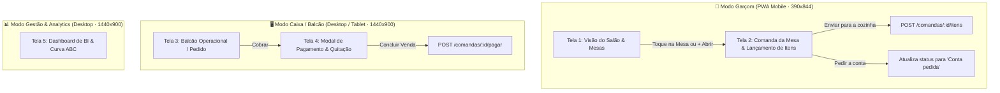

# 08 — Especificação de UX/UI Design e Frontend — VaptPDV

> **Responsáveis:** Sally (BMad UX/UI Designer) & John (BMad Product Manager)  
> **Projeto:** VaptPDV — Sistema Distribuído de Ponto de Venda, KDS, Fidelidade e Analytics para Bares e Lanchonetes  
> **Disciplina:** Sistemas Distribuídos (3ª Unidade — DCC/UERN)  
> **Autores:** Kaio França & Mateus Neri  
> **Status:** Aprovado e Baseline Oficial de Interface (PDV Core & Satélites)

---

## 1. Visão Geral e Princípios de Design

O design do **VaptPDV** foi concebido sob o lema: **"Mostarda, café e creme. Cantos arredondados, sem neon e sem emoji."**  
A prioridade máxima é a **velocidade, precisão e estabilidade operacional** durante os horários de pico (rush) de bares, botecos e lanchonetes:

* **Zero Poluição Visual:** Proibido o uso de emojis aleatórios, efeitos neon ou sombras pesadas.
* **Ergonomia e Foco Operacional:** Alvos de toque generosos ($\ge 44\text{ px}$ em mobile e telas touch), tipografia com números estritamente tabulares (`tabular-nums`) para evitar desalinhamento de preços e cálculos monetários.
* **Tolerância a Ambientes Ruidosos e Acelerados:** Estados de mesa e itens de preparo utilizam redundância de cor e texto (ex.: status nunca depende apenas de verde/amarelo/vermelho; há sempre texto explícito como *Livre*, *Ocupada*, *Conta pedida*).

---

## 2. Design System e Tokens Visuais (DESIGN.md)

### 2.1. Paleta de Cores Semântica

| Token | Modo Claro | Modo Escuro | Semântica e Uso |
| :--- | :---: | :---: | :--- |
| **`bg` (Creme)** | `#FBF7F1` | `#17120F` | Fundo principal das telas e páginas |
| **`surface`** | `#FFFFFF` | `#221A15` | Superfície de cards, modais e painéis elevados |
| **`surface-2`** | `#F3ECE1` | `#2D231C` | Campos de formulário, steppers de quantidade, estados desabilitados |
| **`border`** | `#E5DACB` | `#43342A` | Bordas estruturais e divisores sutis |
| **`text` (Café)** | `#2B2019` | `#F6EEE4` | Tipografia principal (títulos, totais, valores) |
| **`text-2`** | `#6A5849` | `#C2B1A0` | Tipografia secundária (apoio, legendas, categorias) |
| **`brand` (Mostarda)** | `#F2A81D` | `#F5B335` | Ação primária (*Call to Action*), botão Cobrar, abas ativas |
| **`on-brand`** | `#2B2019` | `#2B2019` | Texto de alto contraste sobre botões `brand` |
| **`brand-soft`** | `#FDF0D2` | `#3D2E14` | Destaque suave, seleção, status *"Em preparo"* / *"Ocupada"* |
| **`brand-text`** | `#8A5200` | `#F5C766` | Texto legível sobre fundos `brand-soft` |
| **`nav` (Café Profundo)**| `#3A2A21` | `#0F0B09` | Barra lateral de navegação (desktop do caixa e gerência) |
| **`success` (Manjericão)**| `#2F7D4F` | `#5FC083` | Status *"Livre"*, *"Pronto"*, sincronização ativa e confirmações |
| **`success-soft`** | `#DDF0E4` | `#1D3326` | Fundo suave de badges de sucesso |
| **`danger` (Tomate)** | `#C4391D` | `#F07A60` | Ações destrutivas, erros, itens esgotados e status *"Conta pedida"* |
| **`danger-soft`** | `#FBE3DC` | `#3D1E17` | Fundo suave de alertas e produtos esgotados |

### 2.2. Tipografia e Escala

* **Família Tipográfica:** **Plus Jakarta Sans** (pesos 400 a 800); fallback `system-ui, -apple-system, sans-serif`.
* **Formatação Numérica:** Obrigatoriedade de `font-variant-numeric: tabular-nums` em todos os preços, quantidades e relógios.
* **Escala:**
  * **Total / KPI:** `30–32px / 800`
  * **Título de Tela:** `24–26px / 800`
  * **Título de Seção:** `16–18px / 700–800`
  * **Corpo / Lista de Itens:** `14–15px / 600`
  * **Metadados / Apoio:** `12–13px / 600` (mínimo absoluto de 12px)

### 2.3. Formas, Espaçamentos e Elevação

* **Raios de Borda (`border-radius`):**
  * Controles de formulário e inputs: `14px`
  * Cards de mesas e produtos: `20px` a `24px`
  * Chips de categorias e status pills: `999px` (Pill completa)
  * Botões de ação primária grande: `18px` a `20px`
* **Sistema de Espaçamento:** Base em múltiplos de 4 (`8px`, `12px`, `16px`, `24px`, `32px`).
* **Elevação:** Borda sutil de `1px solid #E5DACB` combinada com sombra levíssima (`box-shadow: 0 1px 2px rgba(43, 32, 25, 0.06)`).

---

## 3. Especificação Detalhada das Telas do Sistema

---

### 3.1. Tela 1 — Modo Garçom: Visão do Salão e Grade de Mesas (Mobile)

* **Dispositivo Alvo:** Smartphones (390×844 px), uso móvel com uma única mão.
* **Estrutura Visual:**
  * **Cabeçalho:** Identificação do turno (*"Sábado · jantar"*), título *"Salão"*, indicador de status de conexão (*"Online"* com badge verde suave) e avatar do garçom logado (*"RM"*).
  * **Filtros por Chips:** `Todas`, `Minhas`, `Livres`, `Conta pedida`.
  * **Grade de Mesas (2 Colunas):**
    * **Mesa Livre:** Borda tracejada suave (`#E5DACB`), badge `Livre` (`#DDF0E4`), capacidade de lugares. Ao tocar, abre o modal rápido de abertura de mesa.
    * **Mesa Ocupada:** Borda sólida, badge `Ocupada` (`#FDF0D2`), tempo de permanência decorrido (ex.: *"34 min"*), valor subtotal acumulado em negrito (ex.: *"R$ 186,40"*). Ao tocar, navega para a comanda da mesa.
    * **Mesa com Conta Pedida:** Borda destacada em Tomate (`#C4391D`, 2px), badge `Conta pedida` (`#FBE3DC`). Sinaliza urgência no fechamento para o garçom e para o caixa.
  * **Botão Flutuante (FAB):** `+ Abrir mesa` posicionado estrategicamente na **Thumb Zone** (canto inferior direito), cor Mostarda (`#F2A81D`).
  * **Barra de Navegação Inferior:** 4 destinos com ícones e rótulos legíveis: `Mesas` (ativa), `Comandas`, `Cozinha` e `Perfil`.

---

### 3.2. Tela 2 — Modo Garçom: Comanda da Mesa e Lançamento de Pedidos (Mobile)

* **Estrutura Visual:**
  * **Barra Superior:** Botão voltar (`<`), identificação da mesa (*"Mesa 2 · 3 pessoas · aberta há 34 min"*), botão secundário *"Transferir"*.
  * **Banner de Confirmação:** Card com fundo verde suave (`#DDF0E4`) informando os pedidos já processados: *"4 itens enviados · Cozinha confirmou às 19:42 · R$ 186,40"*.
  * **Filtro de Categorias:** Carrossel horizontal de chips pill (`Bebidas`, `Lanches`, `Porções`, `Sobremesas`).
  * **Lista de Produtos do Cardápio:**
    * Placeholder de foto com tint pastel suave.
    * Nome do item em negrito e preço unitário.
    * **Controle de Quantidade (Stepper):** Botões `+` e `-` com área de toque mínima de `44px`.
    * **Item Esgotado:** Opacidade reduzida para `0.55`, badge `Esgotado` em vermelho suave (`#FBE3DC`), interação bloqueada.
  * **Rodapé Fixo (Floating Bottom Action):**
    * Contador e valor dos novos itens pendentes de envio: *"3 novos itens · R$ 44,00"*.
    * **Botão Primário:** `Enviar para a cozinha` (60px de altura, Mostarda `#F2A81D`, texto em `#2B2019`).
    * **Botão Secundário:** `Pedir a conta` (fundo branco, borda suave), que aciona o fechamento preliminar com o caixa.

---

### 3.3. Tela 3 — Modo Caixa / Balcão: Ponto de Venda Operacional (Desktop)

* **Dispositivo Alvo:** Telas widescreen (1440×900 px), operado via mouse, leitor de código de barras, teclado ou touch.
* **Estrutura Visual:**
  * **Barra Lateral Esquerda (88px):** Fundo Café Profundo (`#3A2A21`), ícone Vapt e navegação vertical: `Venda` (ativo), `Mesas`, `Pedidos`, `Caixa`, `Ajustes`.
  * **Área Superior (Header):**
    * Campo de busca global com atalho: `Buscar item ou ler código de barras (F2)`.
    * Indicadores de hardware e rede: `Sincronizado` (verde), `Impressora cozinha` (status operacional), operador ativo (*"Ana L. Caixa 01"*).
  * **Painel Central (Catálogo de Venda):**
    * Abas em chips: `Todos`, `Lanches`, `Porções`, `Bebidas`, `Sobremesas`, `Combos`.
    * Grade responsiva de 4 colunas com cards de produtos (foto tinted, título, preço em destaque e badge de esgotado quando aplicável).
  * **Painel Lateral Direito (Conferência do Pedido · 440px):**
    * Cabeçalho: Identificação da comanda (*"Pedido 0482 · Balcão · senha 27"*), botão para vincular cliente por CPF.
    * Linhas do pedido com detalhes de observação (ex.: *"Sem cebola · ponto da carne: médio"*), steppers individuais de ajuste de quantidade e subtotal da linha.
    * Bloco Financeiro de Fechamento:
      * `Subtotal`: `R$ 131,80`
      * `Gorjeta 10%`: Switch acessível com valor calculado (`R$ 13,18`). Ligar/desligar recalcula instantaneamente o total via API.
      * `Total`: `R$ 144,98` em destaque tipográfico (32px / 800).
    * Botões de Ação: `Desconto`, `Cancelar` (destrutivo) e **`Cobrar R$ 144,98`** (botão grande em Mostarda, 68px de altura).
  * **Rodapé de Atalhos de Teclado:** Guia de operação rápida (`F2 Buscar`, `F4 Cliente / CPF`, `F6 Desconto`, `F7 Nota fiscal`, `F8 Cobrar`).

---

### 3.4. Tela 4 — Modo Caixa: Modal / Tela de Pagamento e Quitação

* **Estrutura Visual em 3 Colunas:**
  1. **Coluna Esquerda (Resumo da Venda):**
     * Lista resumida dos itens consolidados com quantidades.
     * Subtotal, taxa de serviço de 10% e Total.
     * **Barra de Progresso de Quitação:** Indicador visual de saldo com *"Já pago: R$ 60,00"* e *"Falta pagar: R$ 84,98"*.
     * Histórico de pagamentos já registrados (ex.: *Dinheiro R$ 60,00* com check verde).
  2. **Coluna Central (Meios de Pagamento & Pix Dinâmico):**
     * Seleção em abas: `Pix` (selecionado), `Crédito`, `Débito`, `Dinheiro`, `Vale-refeição`.
     * Campo com o valor específico a ser cobrado nesta parcela (`R$ 84,98`).
     * Atalhos de divisão rápida de conta: `Valor igual`, `Por item`, `Por pessoa`.
     * **Área Pix:** Renderização do QR Code oficial para pagamento, aviso com cronômetro regressivo (*"Aguardando pagamento · expira em 04:32"*), botões de suporte (*Copiar código Pix*, *Cancelar cobrança*).
  3. **Coluna Direita (Opções Fiscais e Emissão):**
     * Campo para CPF/CNPJ do cliente na nota (opcional).
     * Switches para `Emitir NFC-e` e `Imprimir via do cliente`.
  4. **Ação Final:** Botão `Concluir venda`. Desabilitado enquanto houver saldo pendente, exibindo o motivo: *"Faltam R$ 84,98"*. Habilita em Mostarda com o total integralmente quitado.

---

### 3.5. Tela 5 — Modo Gestão e BI: Dashboard Executivo (Analytics)

* **Dispositivo Alvo:** Desktop gerencial (1440×900 px).
* **Estrutura Visual:**
  * **Barra Lateral Expandida (248px):** `Visão geral`, `Cardápio`, `Estoque`, `Vendas`, `Equipe`, `Fiscal`.
  * **Cabeçalho:** Seletor de período temporal (`Hoje`, `7 dias`, `30 dias`) e botão `Exportar`.
  * **4 Cards de KPIs Executivos:**
    1. **Faturamento Hoje:** `R$ 12.480,00` (+8% em relação a ontem, verde).
    2. **Pedidos Realizados:** `214` (+12 em relação a ontem).
    3. **Ticket Médio:** `R$ 58,32` (Estável).
    4. **Tempo Médio de Preparo (KDS):** `14 min` (Meta: 15 min).
  * **Gráficos e Detalhamento Operacional:**
    * **Pedidos por Hora:** Gráfico de colunas na cor Mostarda (`#F2A81D`) com identificação direta do horário de pico (*"Pico às 20h · 36 pedidos"*).
    * **Meios de Pagamento:** Gráfico de barras horizontais indicando a distribuição percentual das vendas (`Pix: 46%`, `Crédito: 28%`, `Débito: 14%`, `Dinheiro: 9%`, `Vale: 3%`).
    * **Ranking de Mais Vendidos (Curva ABC):** Tabela com item, volume vendido e receita gerada (ex.: Hambúrguer artesanal: 62 un. / R$ 2.163,80).
    * **Card "Precisa de Atenção" (Alertas Operacionais):** Destaque em Tomate/Mostarda suave para itens esgotados, insumos com estoque baixo e alertas de sincronização pendente.

---

## 4. Mapeamento entre Elementos Visuais e a API REST do PDV Core

A interface Web/PWA opera estritamente como cliente da API REST modular do **PDV Core**:

| Ação no Frontend | Método HTTP | Rota da API Backend | Dados Enviados / Recebidos |
| :--- | :---: | :--- | :--- |
| **Carregar Cardápio** | `GET` | `/produtos?ativo=true` | Recebe catálogo com IDs, nomes, preços e estoque atual. |
| **Carregar Salão (Mesas)**| `GET` | `/comandas?status=aberta` | Recebe comandas ativas para pintar as mesas ocupadas e calcular tempo aberto. |
| **Abrir Mesa (FAB)** | `POST` | `/comandas` | Envia `{ mesa, garcom_id, nome_cliente }`. Recebe comanda criada (`201`). |
| **Lançar Pedido (Cozinha)**| `POST` | `/comandas/:id/itens` | Envia `{ produto_id, quantidade }` por item selecionado. |
| **Ajustar Quantidade (+/-)**| `PATCH` | `/comandas/:id/itens/:itemId`| Envia `{ quantidade }`. Valida estoque em tempo real. |
| **Remover Item da Conta** | `DELETE` | `/comandas/:id/itens/:itemId`| Remove item de comanda aberta (`204`). |
| **Alternar 10% / Fechar**| `POST` | `/comandas/:id/fechar` | Envia `{ aplicar_taxa_servico: boolean }`. Backend calcula subtotal, taxa e total. |
| **Pagar e Liberar Mesa** | `POST` | `/comandas/:id/pagar` | Envia `{ forma_pagamento }`. Baixa estoque atomicamente e libera a mesa. |
| **Cancelar Comanda** | `POST` | `/comandas/:id/cancelar` | Cancela comanda aberta liberando a mesa sem alterar o estoque. |
| **Indicadores do BI** | `GET` | `/analytics/...` | Consulta métricas consolidadas (Módulo 2+). |

---

## 5. Diretrizes de Acessibilidade e Resiliência Operacional

1. **Contraste Mínimo Garantido (WCAG 2.1 AA):**
   * Texto normal sobre fundo: relação mínima de $4.5:1$ (Café `#2B2019` sobre Creme `#FBF7F1` atinge $> 10:1$).
   * Elementos gráficos e botões: relação mínima de $3:1$.
2. **Navegação por Teclado no Caixa:**
   * Todos os inputs e botões recebem anel de foco visível de `2px solid #2B2019`.
   * Atalhos de teclado (F2, F4, F6, F7, F8) com `preventDefault()` configurado para agilizar o atendimento.
3. **Resiliência e Feedback de Conexão:**
   * Estados de loading com esqueletos pulsantes (`skeleton screen`), evitando pulos de layout (*Layout Shift*).
   * Tratamento de falha de conexão: exibição do banner de contingência *"Offline — vendas na fila"* sem bloquear a navegação local.
