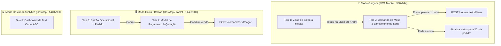

# 08 — Especificação de UX/UI Design e Frontend — VaptPDV

> **Responsáveis:** Sally (BMad UX/UI Designer), Winston (BMad System Architect) & John (BMad Product Manager)  
> **Projeto:** VaptPDV — Sistema Distribuído de Ponto de Venda, KDS, Fidelidade e Analytics para Bares e Lanchonetes  
> **Disciplina:** Sistemas Distribuídos (3ª Unidade — DCC/UERN)  
> **Autores:** Kaio França & Mateus Neri  
> **Status:** Aprovado e Baseline Oficial de Interface (PDV Core & Satélites)

---

## 1. Visão Geral e Princípios de Design

O design do **VaptPDV** foi concebido sob o lema: **"Mostarda, café e creme. Cantos arredondados, sem neon e sem emoji."**  
A prioridade máxima é a **velocidade, precisão e estabilidade operacional** durante os horários de pico (rush) de bares, botecos e lanchonetes:

* **Zero Poluição Visual:** Proibido o uso de emojis aleatórios, efeitos neon ou sombras pesadas.
* **Ergonomia e Foco Operacional:** Alvos de toque generosos ($\ge 44\text{ px}$ em mobile e telas touch), tipografia com números estritamente tabulares (`tabular-nums`) para evitar desalinhamento de preços e cálculos monetários.
* **Tolerância a Ambientes Ruidosos e Acelerados:** Estados de mesa e itens de preparo utilizam redundância de cor e texto (ex.: status nunca depende apenas de verde/amarelo/vermelho; há sempre texto explícito como *Livre*, *Ocupada*, *Conta pedida*).

---

## 2. Design System e Tokens Visuais (DESIGN.md)

### 2.1. Paleta de Cores Semântica

| Token | Modo Claro | Modo Escuro | Semântica e Uso |
| :--- | :---: | :---: | :--- |
| **`bg` (Creme)** | `#FBF7F1` | `#17120F` | Fundo principal das telas e páginas |
| **`surface`** | `#FFFFFF` | `#221A15` | Superfície de cards, modais e painéis elevados |
| **`surface-2`** | `#F3ECE1` | `#2D231C` | Campos de formulário, steppers de quantidade, estados desabilitados |
| **`border`** | `#E5DACB` | `#43342A` | Bordas estruturais e divisores sutis |
| **`text` (Café)** | `#2B2019` | `#F6EEE4` | Tipografia principal (títulos, totais, valores) |
| **`text-2`** | `#6A5849` | `#C2B1A0` | Tipografia secundária (apoio, legendas, categorias) |
| **`brand` (Mostarda)** | `#F2A81D` | `#F5B335` | Ação primária (*Call to Action*), botão Cobrar, abas ativas |
| **`on-brand`** | `#2B2019` | `#2B2019` | Texto de alto contraste sobre botões `brand` |
| **`brand-soft`** | `#FDF0D2` | `#3D2E14` | Destaque suave, seleção, status *"Em preparo"* / *"Ocupada"* |
| **`brand-text`** | `#8A5200` | `#F5C766` | Texto legível sobre fundos `brand-soft` |
| **`nav` (Café Profundo)**| `#3A2A21` | `#0F0B09` | Barra lateral de navegação (desktop do caixa e gerência) |
| **`success` (Manjericão)**| `#2F7D4F` | `#5FC083` | Status *"Livre"*, *"Pronto"*, sincronização ativa e confirmações |
| **`success-soft`** | `#DDF0E4` | `#1D3326` | Fundo suave de badges de sucesso |
| **`danger` (Tomate)** | `#C4391D` | `#F07A60` | Ações destrutivas, erros, itens esgotados e status *"Conta pedida"* |
| **`danger-soft`** | `#FBE3DC` | `#3D1E17` | Fundo suave de alertas e produtos esgotados |

### 2.2. Tipografia e Escala

* **Família Tipográfica:** **Plus Jakarta Sans** (pesos 400 a 800); fallback `system-ui, -apple-system, sans-serif`.
* **Formatação Numérica:** Obrigatoriedade de `font-variant-numeric: tabular-nums` em todos os preços, quantidades e relógios.
* **Escala:**
  * **Total / KPI:** `30–32px / 800`
  * **Título de Tela:** `24–26px / 800`
  * **Título de Seção:** `16–18px / 700–800`
  * **Corpo / Lista de Itens:** `14–15px / 600`
  * **Metadados / Apoio:** `12–13px / 600` (mínimo absoluto de 12px)

### 2.3. Formas, Espaçamentos e Elevação

* **Raios de Borda (`border-radius`):**
  * Controles de formulário e inputs: `14px`
  * Cards de mesas e produtos: `20px` a `24px`
  * Chips de categorias e status pills: `999px` (Pill completa)
  * Botões de ação primária grande: `18px` a `20px`
* **Sistema de Espaçamento:** Base em múltiplos de 4 (`8px`, `12px`, `16px`, `24px`, `32px`).
* **Elevação:** Borda sutil de `1px solid #E5DACB` combinada com sombra levíssima (`box-shadow: 0 1px 2px rgba(43, 32, 25, 0.06)`).

---

## 3. Especificação Detalhada das Telas do Sistema



### 3.1. Tela 1 — Modo Garçom: Visão do Salão e Grade de Mesas (Mobile)
* **Dispositivo Alvo:** Smartphones (390×844 px), uso móvel com uma única mão.
* **Estrutura Visual:**
  * **Cabeçalho:** Identificação do turno (*"Sábado · jantar"*), título *"Salão"*, indicador de status de conexão (*"Online"* com badge verde suave) e avatar do garçom logado (*"RM"*).
  * **Filtros por Chips:** `Todas`, `Minhas`, `Livres`, `Conta pedida`.
  * **Grade de Mesas (2 Colunas):**
    * **Mesa Livre:** Borda tracejada suave (`#E5DACB`), badge `Livre` (`#DDF0E4`), capacidade de lugares. Ao tocar, abre o modal rápido de abertura de mesa.
    * **Mesa Ocupada:** Borda sólida, badge `Ocupada` (`#FDF0D2`), tempo de permanência decorrido (ex.: *"34 min"*), valor subtotal acumulado em negrito (ex.: *"R$ 186,40"*). Ao tocar, navega para a comanda da mesa.
    * **Mesa com Conta Pedida:** Borda destacada em Tomate (`#C4391D`, 2px), badge `Conta pedida` (`#FBE3DC`). Sinaliza urgência no fechamento para o garçom e para o caixa.
  * **Botão Flutuante (FAB):** `+ Abrir mesa` posicionado estrategicamente na **Thumb Zone** (canto inferior direito), cor Mostarda (`#F2A81D`).
  * **Barra de Navegação Inferior:** 4 destinos com ícones e rótulos legíveis: `Mesas` (ativa), `Comandas`, `Cozinha` e `Perfil`.

### 3.2. Tela 2 — Modo Garçom: Comanda da Mesa e Lançamento de Pedidos (Mobile)
* **Estrutura Visual:**
  * **Barra Superior:** Botão voltar (`<`), identificação da mesa (*"Mesa 2 · 3 pessoas · aberta há 34 min"*), botão secundário *"Transferir"*.
  * **Banner de Confirmação:** Card com fundo verde suave (`#DDF0E4`) informando os pedidos já processados: *"4 itens enviados · Cozinha confirmou às 19:42 · R$ 186,40"*.
  * **Filtro de Categorias:** Carrossel horizontal de chips pill (`Bebidas`, `Lanches`, `Porções`, `Sobremesas`).
  * **Lista de Produtos do Cardápio:**
    * Placeholder de foto com tint pastel suave.
    * Nome do item em negrito e preço unitário.
    * **Controle de Quantidade (Stepper):** Botões `+` e `-` com área de toque mínima de `44px`.
    * **Item Esgotado:** Opacidade reduzida para `0.55`, badge `Esgotado` em vermelho suave (`#FBE3DC`), interação bloqueada.
  * **Rodapé Fixo (Floating Bottom Action):**
    * Contador e valor dos novos itens pendentes de envio: *"3 novos itens · R$ 44,00"*.
    * **Botão Primário:** `Enviar para a cozinha` (60px de altura, Mostarda `#F2A81D`, texto em `#2B2019`).
    * **Botão Secundário:** `Pedir a conta` (fundo branco, borda suave), que aciona o fechamento preliminar com o caixa.

### 3.3. Tela 3 — Modo Caixa / Balcão: Ponto de Venda Operacional (Desktop)
* **Dispositivo Alvo:** Telas widescreen (1440×900 px), operado via mouse, leitor de código de barras, teclado ou touch.
* **Estrutura Visual:**
  * **Barra Lateral Esquerda (88px):** Fundo Café Profundo (`#3A2A21`), ícone Vapt e navegação vertical: `Venda` (ativo), `Mesas`, `Pedidos`, `Caixa`, `Ajustes`.
  * **Área Superior (Header):**
    * Campo de busca global com atalho: `Buscar item ou ler código de barras (F2)`.
    * Indicadores de hardware e rede: `Sincronizado` (verde), `Impressora cozinha` (status operacional), operador ativo (*"Ana L. Caixa 01"*).
  * **Painel Central (Catálogo de Venda):**
    * Abas em chips: `Todos`, `Lanches`, `Porções`, `Bebidas`, `Sobremesas`, `Combos`.
    * Grade responsiva de 4 colunas com cards de produtos (foto tinted, título, preço em destaque e badge de esgotado quando aplicável).
  * **Painel Lateral Direito (Conferência do Pedido · 440px):**
    * Cabeçalho: Identificação da comanda (*"Pedido 0482 · Balcão · senha 27"*), botão para vincular cliente por CPF.
    * Linhas do pedido com detalhes de observação, steppers individuais de ajuste de quantidade e subtotal da linha.
    * Bloco Financeiro de Fechamento:
      * `Subtotal`: `R$ 131,80`
      * `Gorjeta 10%`: Switch acessível com valor calculado (`R$ 13,18`). Ligar/desligar recalcula instantaneamente o total via API.
      * `Total`: `R$ 144,98` em destaque tipográfico (32px / 800).
    * Botões de Ação: `Desconto`, `Cancelar` (destrutivo) e **`Cobrar R$ 144,98`** (botão grande em Mostarda, 68px de altura).
  * **Rodapé de Atalhos de Teclado:** Guia de operação rápida (`F2 Buscar`, `F4 Cliente / CPF`, `F6 Desconto`, `F7 Nota fiscal`, `F8 Cobrar`).

### 3.4. Tela 4 — Modo Caixa: Modal / Tela de Pagamento e Quitação
* **Estrutura Visual em 3 Colunas:**
  1. **Coluna Esquerda (Resumo da Venda):**
     * Lista resumida dos itens consolidados com quantidades.
     * Subtotal, taxa de serviço de 10% e Total.
     * **Barra de Progresso de Quitação:** Indicador visual de saldo com *"Já pago: R$ 60,00"* e *"Falta pagar: R$ 84,98"*.
     * Histórico de pagamentos já registrados.
  2. **Coluna Central (Meios de Pagamento & Pix Dinâmico):**
     * Seleção em abas: `Pix` (selecionado), `Crédito`, `Débito`, `Dinheiro`, `Vale-refeição`.
     * Campo com o valor específico a ser cobrado nesta parcela (`R$ 84,98`).
     * **Área Pix:** Renderização do QR Code oficial para pagamento, aviso com cronômetro regressivo (*"Aguardando pagamento · expira em 04:32"*), botões de suporte (*Copiar código Pix*, *Cancelar cobrança*).
  3. **Coluna Direita (Opções Fiscais e Emissão):**
     * Campo para CPF/CNPJ do cliente na nota (opcional).
     * Switches para `Emitir NFC-e` e `Imprimir via do cliente`.
  4. **Ação Final:** Botão `Concluir venda`. Desabilitado enquanto houver saldo pendente. Habilita em Mostarda com o total integralmente quitado.

### 3.5. Tela 5 — Modo Gestão e BI: Dashboard Executivo (Analytics)
* **Dispositivo Alvo:** Desktop gerencial (1440×900 px).
* **Estrutura Visual:**
  * **4 Cards de KPIs Executivos:** Faturamento Hoje, Pedidos Realizados, Ticket Médio, Tempo Médio de Preparo (KDS).
  * **Gráficos e Detalhamento:** Pedidos por Hora, Meios de Pagamento, Curva ABC de Produtos e Alertas de Ruptura de Estoque.

---

## 4. Mapeamento entre Elementos Visuais e a API REST do PDV Core

| Ação no Frontend | Método HTTP | Rota da API Backend | Dados Enviados / Recebidos |
| :--- | :---: | :--- | :--- |
| **Carregar Cardápio** | `GET` | `/produtos?ativo=true` | Recebe catálogo com IDs, nomes, preços e estoque atual. |
| **Carregar Salão (Mesas)**| `GET` | `/comandas?status=aberta` | Recebe comandas ativas para pintar as mesas ocupadas e calcular tempo aberto. |
| **Abrir Mesa (FAB)** | `POST` | `/comandas` | Envia `{ mesa, garcom_id, nome_cliente }`. Recebe comanda criada (`201`). |
| **Lançar Pedido (Cozinha)**| `POST` | `/comandas/:id/itens` | Envia `{ produto_id, quantidade }` por item selecionado. |
| **Ajustar Quantidade (+/-)**| `PATCH` | `/comandas/:id/itens/:itemId`| Envia `{ quantidade }`. Valida estoque em tempo real. |
| **Remover Item da Conta** | `DELETE` | `/comandas/:id/itens/:itemId`| Remove item de comanda aberta (`204`). |
| **Alternar 10% / Fechar**| `POST` | `/comandas/:id/fechar` | Envia `{ aplicar_taxa_servico: boolean }`. Backend calcula subtotal, taxa e total. |
| **Pagar e Liberar Mesa** | `POST` | `/comandas/:id/pagar` | Envia `{ forma_pagamento }`. Baixa estoque atomicamente e libera a mesa. |
| **Cancelar Comanda** | `POST` | `/comandas/:id/cancelar` | Cancela comanda aberta liberando a mesa sem alterar o estoque. |
| **Indicadores do BI** | `GET` | `/analytics/...` | Consulta métricas consolidadas (Módulo 2+). |

---

## 5. Diretrizes de Acessibilidade e Resiliência Operacional

1. **Contraste Mínimo Garantido (WCAG 2.1 AA):** Relação $> 10:1$ entre Café `#2B2019` e Creme `#FBF7F1`.
2. **Navegação por Teclado no Caixa:** Atalhos de teclado (F2, F4, F6, F7, F8) com `preventDefault()` configurado.
3. **Resiliência e Feedback de Conexão:** Estados de loading com esqueletos pulsantes (`skeleton screen`), revalidações em background via TanStack Query.

---

## 6. Arquitetura Técnica da Aplicação Frontend Completa (`frontend/`)

A aplicação frontend do **VaptPDV** é desenvolvida como uma Single Page Application (SPA) / Progressive Web App (PWA) moderna no diretório dedicado `/frontend` da raiz do repositório, garantindo desacoplamento total, tipagem estrita de ponta a ponta e máxima ergonomia operacional.

### 6.1. Stack Tecnológica Oficial do Frontend

| Camada | Tecnologia | Versão / Configuração | Papel e Justificativa Arquitetural |
| :--- | :--- | :--- | :--- |
| **Runtime & Build** | `Vite` | `v6+` | Servidor de desenvolvimento instantâneo com Hot Module Replacement (HMR) e build de produção via Rollup/esbuild gerando assets estáticos altamente otimizados. |
| **Core & Framework** | `React` + `TypeScript` | `React 19` / `TS 5.7+` | Biblioteca líder de componentes com tipagem estrita de ponta a ponta compartilhando interfaces DTO da API. |
| **Design System & CSS** | `Tailwind CSS` | `v3.4+` | Framework utilitário configurado com os tokens semânticos exatos de `DESIGN.md` (Creme `#FBF7F1`, Mostarda `#F2A81D`, Café `#2B2019`, Manjericão `#2F7D4F`, Tomate `#C4391D`). |
| **Ícones do Sistema** | `Lucide React` | `latest` | Ícones minimalistas limpos em SVG vetorizado (sem emojis, alinhado à diretriz de zero poluição visual). |
| **Data Fetching & Cache**| `TanStack Query` | `v5` (`@tanstack/react-query`) | Gerenciamento de estado assíncrono do servidor: cache inteligente de comandas/produtos, revalidação automática, mutations atômicas e sincronização em segundo plano com a API Fastify. |
| **Estado Global do Cliente**| `Zustand` | `v5` (`zustand`) | Store leve e rápida para estados puramente locais da sessão: modo operacional ativo (`garcom` vs `caixa`), mesa selecionada, operador/garçom ativo e carrinho temporário de novos itens. |
| **Formulários & Schemas**| `React Hook Form` + `Zod`| `@hookform/resolvers` + `zod` | Validação declarativa em tempo real para formulários de cadastros de produtos (validação de preços decimais positivos e estoque) e colaboradores. |
| **Capacidade PWA / Mobile**| `vite-plugin-pwa` | `latest` | Configuração de Service Worker, web app manifest e suporte a instalação em tela cheia nos smartphones Android/iOS dos garçons. |

### 6.2. Árvore de Diretórios Estruturada (`frontend/`)

```
frontend/
├── public/
│   ├── favicon.ico
│   ├── icon-192.png
│   ├── icon-512.png
│   └── manifest.json             # Manifest PWA (standalone, theme-color #2B2019)
├── src/
│   ├── api/                      # Clientes HTTP e Custom Hooks TanStack Query
│   │   ├── client.ts             # Instância Fetch/Axios com base /api e tratamento padronizado de ErroDominio
│   │   ├── useComandas.ts        # Hooks: useComandas(), useComanda(id), useAbrirComanda(), useLancarItens(), useFecharComanda(), usePagarComanda()
│   │   ├── useProdutos.ts        # Hooks: useProdutos(), useCriarProduto(), useInativarProduto()
│   │   └── useUsuarios.ts        # Hooks: useUsuarios(), useCriarUsuario(), useInativarUsuario()
│   ├── components/               # Componentes Reutilizáveis do Design System
│   │   ├── ui/
│   │   │   ├── Button.tsx        # Botões padronizados (Primary Mostarda, Secondary, Danger, Ghost)
│   │   │   ├── Input.tsx         # Inputs com anel de foco Café e label flutuante
│   │   │   ├── Modal.tsx         # Modal com backdrop blur e acessibilidade ARIA
│   │   │   ├── Stepper.tsx       # Controle de quantidade (+ / -) com alvo de toque >= 44px
│   │   │   ├── Badge.tsx         # Pills de status (Livre, Ocupada, Conta pedida, Esgotado)
│   │   │   └── ToggleSwitch.tsx  # Switch acessível para gorjeta de 10%
│   │   └── layout/
│   │       ├── TopNav.tsx        # Barra superior com logo Vapt, status de conexão e operador ativo
│   │       ├── ModeSwitcher.tsx  # Alternador de abas entre Modo Garçom e Modo Caixa
│   │       └── ToastContainer.tsx# Notificações flutuantes de sucesso e erro
│   ├── features/                 # Módulos de Domínio e Fluxos Operacionais
│   │   ├── garcom/
│   │   │   ├── SalaoMesasGrid.tsx   # Grade responsiva de mesas (2 colunas no mobile) com filtros por status
│   │   │   ├── ComandaMesaView.tsx  # Tela de atendimento da mesa, banner de confirmação e ações
│   │   │   ├── CardapioList.tsx     # Carrossel de categorias e lista de produtos com steppers
│   │   │   └── AbrirMesaModal.tsx   # Modal rápido de abertura de mesa vinculado a garçom ativo
│   │   ├── caixa/
│   │   │   ├── BalcaoView.tsx       # Layout desktop widescreen (Toolbar + Catálogo + ComandaPanel)
│   │   │   ├── CatalogoGrid.tsx     # Grade de produtos em 4 colunas com busca por atalho F2
│   │   │   ├── ComandaPanel.tsx     # Painel lateral de 440px com resumo financeiro, switch de 10% e botão Cobrar (F8)
│   │   │   └── ModalPagamento.tsx   # Modal de quitação em 3 colunas (Resumo, Meios de Pagamento com Pix QR Code e Fiscal)
│   │   └── admin/
│   │       └── CadastrosModal.tsx   # Gestão rápida de produtos e colaboradores em tempo de execução
│   ├── store/
│   │   └── useAppStore.ts        # Zustand Store: mode, mesaAtiva, garcomAtivoId, carrinhoNovosItens
│   ├── types/
│   │   └── index.ts              # Definições de tipos TypeScript (Comanda, ItemComanda, Produto, Usuario)
│   ├── App.tsx                   # Roteamento condicional e orquestração dos modos operacionais
│   ├── index.css                 # Importação do Tailwind CSS e fontes Plus Jakarta Sans
│   └── main.tsx                  # Ponto de entrada com QueryClientProvider do TanStack Query
├── index.html                    # Shell HTML com meta viewport mobile e fontes Google Fonts
├── tailwind.config.js            # Extensão de cores e fontes do DESIGN.md
├── tsconfig.json                 # Configuração TypeScript estrita
├── vite.config.ts                # Configuração do Vite, Proxy para :3000 e plugin PWA
└── package.json                  # Manifesto de dependências do frontend
```

### 6.3. Contratos Técnicos de Infraestrutura Frontend

#### 1. Contrato de Proxy Reverso em Desenvolvimento (`vite.config.ts`)
Para garantir fluxo de desenvolvimento sem atritos com CORS e compatibilidade idêntica ao ambiente de produção:
```typescript
import { defineConfig } from 'vite';
import react from '@vitejs/plugin-react';
import { VitePWA } from 'vite-plugin-pwa';

export default defineConfig({
  plugins: [
    react(),
    VitePWA({
      registerType: 'autoUpdate',
      includeAssets: ['favicon.ico', 'apple-touch-icon.png'],
      manifest: {
        name: 'VaptPDV — Sistema de Ponto de Venda',
        short_name: 'VaptPDV',
        description: 'PDV e Operação de Salão para Bares e Lanchonetes',
        theme_color: '#2B2019',
        background_color: '#FBF7F1',
        display: 'standalone',
        orientation: 'portrait',
        icons: [
          { src: '/icon-192.png', sizes: '192x192', type: 'image/png' },
          { src: '/icon-512.png', sizes: '512x512', type: 'image/png' }
        ]
      }
    })
  ],
  server: {
    port: 5173,
    proxy: {
      '/comandas': { target: 'http://localhost:3000', changeOrigin: true },
      '/produtos': { target: 'http://localhost:3000', changeOrigin: true },
      '/usuarios': { target: 'http://localhost:3000', changeOrigin: true },
      '/health': { target: 'http://localhost:3000', changeOrigin: true },
      '/docs': { target: 'http://localhost:3000', changeOrigin: true }
    }
  }
});
```

#### 2. Contrato de Build e Deploy em Nuvem (AWS EC2 / Produção)
* **Desenvolvimento Local:** `npm run dev:frontend` (Vite dev server na porta `:5173`) consumindo a API Fastify rodando na `:3000`.
* **Deploy de Produção:** O comando de build do frontend (`npm run build:frontend`) gera o bundle estático minificado em `frontend/dist/`. No backend Fastify, o plugin `@fastify/static` serve diretamente `frontend/dist/` na porta `:3000`, eliminando necessidade de servidores web adicionais e mantendo o deploy na AWS EC2 enxuto via PM2.
