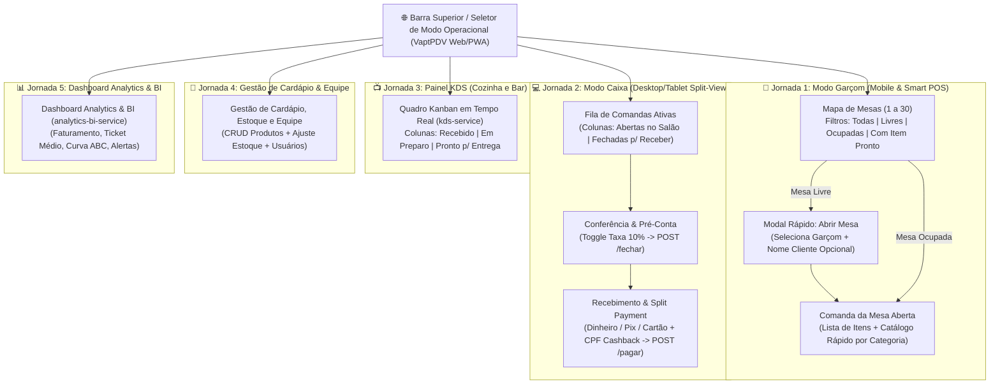

# 08 — Design de Experiência do Usuário (UX/UI) e Arquitetura Frontend PWA

> **Responsável:** Sally (UX Designer & UI Specialist — BMad Method)  
> **Co-Autoria Técnica:** Winston (System Architect)  
> **Projeto:** VaptPDV — Interfaces Operacionais de Alta Densidade e Velocidade para Salão, Caixa, Cozinha (KDS) e Gestão  
> **Abordagem:** Functional Enterprise POS (Square POS & Stripe Dashboard Style), Paleta Estrutural Slate/Zinc, Geometria Técnica (`rounded-md` 6px e `rounded-lg` 8px), Tipografia Inter com `tabular-nums` e Superfície Flat (`1px solid #E2E8F0`).

---

## 1. Visão de UX e Princípios de Design (Functional Enterprise POS)

O **VaptPDV** adota uma abordagem estritamente funcional voltada à produtividade ininterrupta de caixas, garçons e gerentes:
1. **Pragmatismo Operacional & Silêncio Visual:** Telas de PDV com giro intenso precisam de estabilidade visual contínua. Elimina-se qualquer elemento puramente decorativo, gradientes, efeitos neon ou sombras difusas. A hierarquia da tela é expressa exclusivamente por **densidade de informação, contraste tipográfico em escala Slate e divisórias sólidas de 1px solid #E2E8F0**.
2. **Paleta Neutra Estrutural (Zero Cores Neon):** Fundo neutro e repousante em Slate-50 (`#F8FAFC`), superfícies e cartões em branco puro (`#FFFFFF`) e textos em Slate-900 (`#0F172A`). A ação definitiva de pagamento e confirmação utiliza exclusivamente um **Verde Operacional Fechado (`#15803D` - Green 700)** com texto branco puro (`#FFFFFF`), e ações secundárias utilizam **Azul Corporativo Sóbrio (`#1D4ED8` - Blue 700)**.
3. **Sem Brilhos e Sombras Difusas (Flat Design Rigoroso):** Todos os componentes utilizam `box-shadow: none`. Containers, cartões, tabelas e cabeçalhos são delimitados por bordas secas de `1px solid #E2E8F0`.
4. **Geometria Compacta e Técnica:** Proibição de formatos circulares e pílulas (`rounded-full`). Adoção de cantos retos e técnicos: **`rounded-md` (`6px`)** para botões, inputs, abas e badges, e **`rounded-lg` (`8px`)** para cartões e modais.
5. **Tipografia Unificada e Precisão Numérica:** Fonte exclusiva **`Inter`** com aplicação compulsória de **`font-variant-numeric: tabular-nums`** (`tabular-nums` no Tailwind/CSS) em todos os preços (`R$ 12,50`), quantidades, códigos de comanda (`#42`), contadores de KDS (`08:42`) e totais monetários.
6. **Zero Cálculo no Cliente (*Backend Single Source of Truth*):** O frontend jamais calcula subtotal, taxa de serviço de 10%, troco ou estoque. Cada alteração exibe exatamente os valores `Decimal` (`"12.50"`) retornados pela API do `vapt-pdv-core`.
7. **Visibilidade de Estado Distribuído (*Graceful Degradation UI*):** Indicador discreto e sóbrio em cinza Slate caso um microsserviço satélite (`kds-service`, `fidelidade-service` ou `analytics-bi-service`) esteja operando em fila assíncrona, sem bloquear a operação do caixa nem assustar o operador.

---

## 2. Design System: Tokens Semânticos, Cores e Tipografia

### 2.1. Paleta Semântica Estrutural

| Token Semântico | Hexadecimal | Aplicação no Mapa de Mesas e Caixa | Aplicação no Painel KDS (Cozinha/Bar) |
| :--- | :---: | :--- | :--- |
| **Fundo Geral (`surface-canvas`)** | `#F8FAFC` (Slate-50) | Fundo plano geral de todas as telas operacionais. | Fundo plano geral da tela de TV/Tablet. |
| **Superfície (`surface-card`)** | `#FFFFFF` (White) | Cartões de mesa, painéis do caixa e formulários. | Fichas de preparo brancas com borda sólida. |
| **Borda Sólida (`border-default`)** | `#E2E8F0` (Slate-200) | Delimitação de 1px de cards, tabelas e botões. | Delimitação de 1px entre colunas e tickets. |
| **Texto Principal (`ink-primary`)** | `#0F172A` (Slate-900) | Títulos, valores de pagamento e dados contábeis. | Número da mesa, itens e tempo decorrido. |
| **Verde Operacional (`action-primary` / `--status-free`)** | `#15803D` (Green-700) | **Ação Primária:** Confirmar Pagamento / Mesa Livre. | **Dentro do Prazo:** SLA ideal de preparo. |
| **Âmbar Técnico (`status-open`)** | `#B45309` (Amber-700) | **Mesa Aberta:** Consumo em andamento no salão. | **Atenção:** Preparo próximo do limite de SLA. |
| **Azul Corporativo (`action-secondary` / `--status-closed`)** | `#1D4ED8` (Blue-700) | **Comanda Fechada:** Pré-conta aguardando recebimento. | **Em Preparo Ativo:** Cozinha manipulando prato. |
| **Cinza Neutro (`status-ready`)** | `#475569` (Slate-600) | **Item Pronto:** Notificação discreta de prato pronto. | **Pronto p/ Entrega:** Aguardando retirada no balcão. |
| **Vermelho Sóbrio (`status-alert`)** | `#B91C1C` (Red-700) | **Cancelamento / Estoque Zerado / Erro.** | **SLA Atrasado:** Destaque sóbrio no topo da coluna. |

### 2.2. Tipografia e Numeração Tabular
- **Fonte Única:** `Inter` em toda a aplicação.
- **Números Tabulares Obrigatórios:** `font-variant-numeric: tabular-nums` (Tailwind: `tabular-nums`) em todos os preços, cronômetros, quantidades e identificadores, garantindo alinhamento vertical absoluto de centavos (`R$ 12,50` vs `R$ 148,90`).

---

## 3. Fluxo Global de Navegação entre as 5 Visões



---

## 4. Jornada 1 — Visão do Garçom (Mobile PWA & Smart POS)

### 4.1. Objetivos Operacionais
- Visualizar em menos de 1 segundo quais mesas estão livres (`verde fechado`), ocupadas (`âmbar queimado`) ou aguardando pagamento (`azul sóbrio`).
- Lançar itens rapidamente com filtro retangular por categoria (`[Todas]`, `[Bebidas]`, `[Porções]`, `[Lanches]`) e observações rápidas por chips retangulares (`[Sem cebola]`, `[Ao ponto]`, `[Gelo e limão]`).
- Ajustar quantidades (`[-]` / `[+]`) com alvos de toque de 44px e solicitar fechamento da mesa sem sair da tela.

### 4.2. Wireframe Estrutural — Mapa de Mesas e Lançamento Mobile

```text
+--------------------------------------------------+   +--------------------------------------------------+
| VaptPDV • Garçom: Carlos              Online     |   | [<-] Mesa 07 • Carlos              [ ABERTA ]    |
|--------------------------------------------------|   | Cliente: Mateus                      Comanda #42 |
| PRONTO NO BAR: Mesa 07 (Cerveja Pilsen)     [OK] |   |--------------------------------------------------|
|--------------------------------------------------|   | ITENS DA COMANDA (3)           Parcial: R$ 88,90 |
| [Todas (30)] [Livres (18)] [Minhas (5)]          |   |--------------------------------------------------|
|                                                  |   | Cerveja Pilsen 600ml                             |
|  +-----------+  +-----------+  +-----------+     |   | 2x   R$ 25,00              [ - ]  2  [ + ] R$ 50,00 |
|  |  MESA 01  |  |  MESA 02  |  |  MESA 03  |     |   |                                                  |
|  |  LIVRE    |  |  ABERTA   |  |  FECHADA  |     |   | Porção Batata Frita                              |
|  |           |  | R$ 64,00  |  | R$ 132,00 |     |   | 1x   R$ 38,90   Obs: crocante    [ - ] 1 [ + ] R$ 38,90 |
|  | [ Abrir ] |  | 18 min    |  | No Caixa  |     |   |--------------------------------------------------|
|  +-----------+  +-----------+  +-----------+     |   | ADICIONAR ITEM:                                  |
|                                                  |   | [ Buscar produto...                            ] |
|  +-----------+  +-----------+  +-----------+     |   | [Bebidas] [Porções] [Lanches] [Todos]            |
|  |  MESA 04  |  |  MESA 07  |  |  MESA 08  |     |   |--------------------------------------------------|
|  |  LIVRE    |  |  ABERTA   |  |  LIVRE    |     |   | Refrigerante Lata 350ml (Est: 42)       R$  7,50 |
|  |           |  | R$ 88,90  |  |           |     |   | Obs rápida: [Gelo e limão]               [ + ]   |
|  | [ Abrir ] |  | 22 min    |  | [ Abrir ] |     |   | Espetinho Alcatra (Est: 15)             R$ 14,00 |
|  +-----------+  +-----------+  +-----------+     |   | Obs rápida: [Ao ponto]                   [ + ]   |
|--------------------------------------------------|   |--------------------------------------------------|
| [ Mesas ]                     [ Avisos KDS (1) ] |   | [ Confirmar Pedido e Solicitar Pré-Conta ]       |
+--------------------------------------------------+   +--------------------------------------------------+
```

---

## 5. Jornada 2 — Visão do Caixa (Desktop / Tablet Landscape)

### 5.1. Objetivos Operacionais
- Operação em tela dividida (*Split-View Master-Detail*): à esquerda (35%), a fila de comandas ativas; à direita (65%), o extrato detalhado da comanda.
- **Conferência e Fechamento (`POST /comandas/:id/fechar`):** Exibir os itens com preços congelados no lançamento (RN04) e switch retangular sóbrio para a Taxa de Serviço de 10% (RN05, RN12).
- **Recebimento e Pagamento (`POST /comandas/:id/pagar`):** Registro imediato nas formas `dinheiro`, `pix` ou `cartao`, com suporte a divisão de pagamento (*Split Payment*), vínculo opcional de CPF para cashback (5%) e baixa de estoque atômica.

### 5.2. Wireframe Estrutural — Painel do Caixa (Estilo Stripe Dashboard)

```text
+----------------------------------------------------------------------------------------------------------+
| VaptPDV • Módulo Caixa                                      Satélites: [KDS: OK] [Fidelidade: OK] [BI: OK]|
+----------------------------------------+-----------------------------------------------------------------+
| FILA DE COMANDAS                       | EXTRATO DA COMANDA #42 — MESA 07                    [ FECHADA ] |
| [ Buscar Mesa ou Comanda...          ] | Garçom: Carlos (#3)   | Cliente: Mateus   | Aberta às: 20:10    |
| Filtros: [Ativas (8)] [Fechadas (3)]   |-----------------------------------------------------------------|
|----------------------------------------| ITEM                                   QTD   UNITÁRIO  SUBTOTAL |
| MESA 07 — Comanda #42                  | Cerveja Pilsen 600ml                     2   R$ 25,00  R$ 50,00 |
| Cliente: Mateus             R$ 97,79   | Porção Batata Frita                      1   R$ 38,90  R$ 38,90 |
| Status: FECHADA (Aguardando Pagamento) |-----------------------------------------------------------------|
|----------------------------------------| RESUMO FINANCEIRO (Decimal Exato — Backend Single Source)       |
| MESA 03 — Comanda #39                  | Subtotal dos Itens:                                    R$ 88,90 |
| Cliente: Ana               R$ 132,00   | [x] Taxa de Serviço Opcional (10%):                    R$  8,89 |
| Status: FECHADA                        | --------------------------------------------------------------- |
|----------------------------------------| TOTAL A RECEBER:                                       R$ 97,79 |
| MESA 02 — Comanda #44                  |-----------------------------------------------------------------|
| Cliente: Balcão             R$ 64,00   | PROGRAMA DE FIDELIDADE (fidelidade-service):                    |
| Status: ABERTA (No Salão)              | CPF / Celular: [ 84999990000 ] -> Gera +R$ 4,45 em Cashback     |
|----------------------------------------|-----------------------------------------------------------------|
| MESA 11 — Comanda #45                  | FORMA DE PAGAMENTO:                                             |
| Cliente: João               R$ 45,50   | [ Dinheiro ]            [ PIX ]            [ Cartão ]           |
| Status: ABERTA                         |                                                                 |
|                                        | [ CONFIRMAR PAGAMENTO E LIBERAR MESA (R$ 97,79) ]               |
+----------------------------------------+-----------------------------------------------------------------+
```

---

## 6. Jornada 3 — Painel KDS da Cozinha e Bar (TV / Tablet Horizontal)

### 6.1. Objetivos Operacionais (`kds-service`)
- Quadro Kanban plano de 3 colunas em fundo neutro Slate-50 (`#F8FAFC`).
- Tickets brancos retangulares delimitados exclusivamente por bordas sólidas de `1px solid #E2E8F0`.
- Cronômetro tabular `08:42` e botão de avanço em 1 toque na base do ticket.

### 6.2. Wireframe Estrutural — Painel KDS

```text
+----------------------------------------------------------------------------------------------------------+
| VAPT-KDS • PREPARO EM TEMPO REAL                   Estação: [ Todas ] [ Cozinha (4) ] [ Bar (2) ]        |
| Tempo Médio: 08m 20s   |   Na Fila: 6 itens   |   Broker RabbitMQ: Conectado                             |
+-----------------------------------+-----------------------------------+----------------------------------+
| 1. RECEBIDOS (3)                  | 2. EM PREPARO (2)                 | 3. PRONTOS P/ ENTREGA (1)        |
+-----------------------------------+-----------------------------------+----------------------------------+
| +-------------------------------+ | +-------------------------------+ | +------------------------------+ |
| | MESA 11 • #45     TEMPO: 21:14| | | MESA 02 • #44     TEMPO: 12:40| | | MESA 07 • #42     TEMPO: 11:00| |
| | Garçom: Carlos       [COZINHA]| | | Garçom: Pedro        [COZINHA]| | | Garçom: Carlos       [COZINHA]| |
| |-------------------------------| | |-------------------------------| | |------------------------------| |
| | 2x Hambúrguer Artesanal       | | | 1x Isca de Peixe              | | | 1x Porção Batata Frita       | |
| | Obs: Sem cebola, ao ponto     | | | Obs: Molho tártaro à parte    | | | Status: Garçom Notificado    | |
| |                               | | |                               | | |                              | |
| | [ INICIAR PREPARO ]           | | | [ MARCAR COMO PRONTO ]        | | | [ ENTREGUE AO SALÃO ]        | |
| +-------------------------------+ | +-------------------------------+ | +------------------------------+ |
+-----------------------------------+-----------------------------------+----------------------------------+
```

---

## 7. Jornada 4 — Gestão de Cardápio, Estoque e Equipe

### 7.1. Wireframe Estrutural — Gestão de Produtos e Estoque (Estilo Stripe)

```text
+----------------------------------------------------------------------------------------------------------+
| VaptPDV • Retaguarda & Gestão                       Abas: [ Produtos & Estoque ] [ Equipe ] [ BI ]       |
+----------------------------------------------------------------------------------------------------------+
| PRODUTOS CADASTRADOS (Fonte: vapt-pdv-core)                                      [ + Novo Produto ]      |
| [ Buscar produto por nome...             ]   Filtros: [ Todos ] [ Bebidas ] [ Porções ] [ Lanches ]      |
|----------------------------------------------------------------------------------------------------------|
| NOME DO PRODUTO               CATEGORIA    PREÇO (R$)  ESTOQUE ATUAL  ESTOQUE MÍNIMO  SITUAÇÃO   AÇÕES   |
| Cerveja Pilsen 600ml          Bebidas        R$ 25,00           4 un            6 un  [ Ativo ]  [Editar]|
| Porção Batata Frita           Porções        R$ 38,90          18 un            5 un  [ Ativo ]  [Editar]|
| Hambúrguer Artesanal          Lanches        R$ 32,00          12 un            5 un  [ Ativo ]  [Editar]|
| Refrigerante Lata 350ml       Bebidas        R$  7,50          42 un           12 un  [ Ativo ]  [Editar]|
+----------------------------------------------------------------------------------------------------------+
```

---

## 8. Jornada 5 — Dashboard Analytics & BI (`analytics-bi-service`)

### 8.1. Wireframe Estrutural — Painel OLAP

```text
+----------------------------------------------------------------------------------------------------------+
| INDICADORES DO TURNO (Fonte: analytics-bi-service / OLAP)                                                |
| +-----------------------+  +-----------------------+  +-----------------------+  +---------------------+ |
| | RECEITA BRUTA         |  | COMANDAS PAGAS        |  | TICKET MÉDIO          |  | TAXA SERVIÇO (10%)  | |
| | R$ 4.850,90           |  | 52 comandas           |  | R$ 93,28              |  | R$ 440,99           | |
| +-----------------------+  +-----------------------+  +-----------------------+  +---------------------+ |
|----------------------------------------------------------------------------------------------------------|
| ALERTAS DE ESTOQUE MÍNIMO                                                                                |
| • Cerveja Pilsen 600ml — Estoque Atual: 4 un (Mínimo: 6 un)                       [ Repor Estoque ]      |
|----------------------------------------------------------------------------------------------------------|
| CURVA ABC DE PRODUTOS                              | DESEMPENHO DE GARÇONS                               |
| CLASSE  PRODUTO                 QTD    RECEITA     | POS  GARÇOM           COMANDAS   VENDAS    COMISSÃO |
| [ A ]   Cerveja Pilsen 600ml    110x   R$ 2.750,00 | 1º   Carlos (#3)      24 mesas   R$ 2.340  R$ 234,00|
| [ A ]   Porção Batata Frita      32x   R$ 1.244,80 | 2º   Pedro (#5)       18 mesas   R$ 1.680  R$ 168,00|
| [ B ]   Hambúrguer Artesanal     18x   R$   540,00 | 3º   Mariana (#6)     10 mesas   R$   830  R$  83,00|
+----------------------------------------------------+-----------------------------------------------------+
```

---

## 9. Matriz de Integração Frontend ↔ Endpoints da API

| Visão / Componente UI | Ação do Usuário | Endpoint Consumido | Comportamento em Caso de Falha de Satélite |
| :--- | :--- | :--- | :--- |
| **Mapa de Mesas** | Listar ocupação do salão | `GET /comandas?status=aberta` e `GET /comandas?status=fechada` | Operação local ao Core; sem dependência externa. |
| **Modal Abrir Mesa** | Abrir comanda em mesa livre | `POST /comandas` | Valida garçom e unicidade de mesa aberta no PostgreSQL. |
| **Lançamento de Item** | Adicionar prato à mesa | `POST /comandas/:id/itens` | Grava cópia de nome e preço (`RN04`). No Mód. 4 emite evento RabbitMQ. |
| **Fechamento de Mesa** | Aplicar/dispensar 10% | `POST /comandas/:id/fechar` | Cálculo Decimal exato no Core; comanda passa a ser imutável para itens. |
| **Pagamento e Baixa** | Registrar Dinheiro/PIX/Cartão | `POST /comandas/:id/pagar` | Baixa estoque atômica idempotente; libera a mesa instantaneamente. |
| **Quadro KDS** | Avançar status de preparo | `PATCH /kds/fichas/:id/status` | Dispara `item.pronto` para o salão via mensageria/REST. |
| **Aba Analytics BI** | Consultar métricas OLAP | `GET /analytics/resumo` | Se indisponível, exibe badge sóbrio sem afetar o caixa. |
