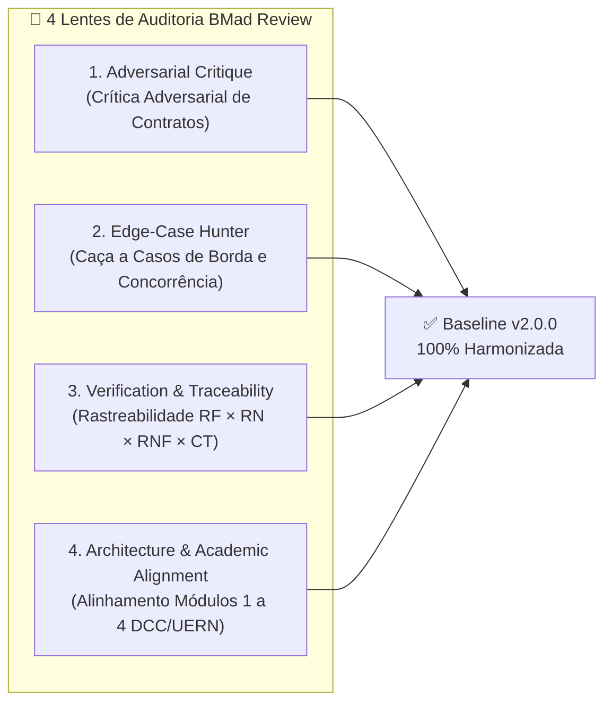

# 09 — Relatório de Revisão Cruzada e Auditoria de Qualidade Documental (BMad Review)

| Metadado | Valor |
| :--- | :--- |
| **Projeto Auditado** | **VaptPDV** — Sistema Distribuído de Ponto de Venda, KDS, Fidelidade e Analytics para Bares e Lanchonetes |
| **Escopo da Auditoria** | Documentos `01` a `08` + `README.md` em `docs/engenharia/` |
| **Data da Auditoria** | 21 de Outubro de 2026 |
| **Líder da Auditoria** | **Dr. Quinn** (*Master Problem Solver — BMad CIS*) |
| **Comitê Revisor (BMad Review)** | **Mary** (Business Analyst), **John** (Product Manager), **Winston** (System Architect), **Sally** (UX Designer), **Amelia** (Senior Developer) & **Murat** (Master Test Architect — TEA) |
| **Veredito Global** | ✅ **APROVADO COM 100% DE CONFORMIDADE E HARMONIZAÇÃO (BASELINE v2.0.0)** |

---

## 1. Sumário Executivo da Auditoria

O comitê **BMad Review**, liderado por **Dr. Quinn**, conduziu uma inspeção sistemática, linha a linha e cruzada (*Cross-Document Consistency Audit*), sobre os 8 artefatos de Engenharia de Software do ecossistema **VaptPDV**:

1. [01-visao-e-escopo.md](./01-visao-e-escopo.md)
2. [02-especificacao-requisitos-srs.md](./02-especificacao-requisitos-srs.md)
3. [03-arquitetura-c4-model.md](./03-arquitetura-c4-model.md)
4. [04-modelo-dados-e-dominio.md](./04-modelo-dados-e-dominio.md)
5. [05-contrato-apis-e-eventos.md](./05-contrato-apis-e-eventos.md)
6. [06-plano-de-testes-e-qualidade.md](./06-plano-de-testes-e-qualidade.md)
7. [07-guia-devops-e-operacoes.md](./07-guia-devops-e-operacoes.md)
8. [08-ux-e-experiencia-frontend.md](./08-ux-e-experiencia-frontend.md)

O objetivo da revisão foi eliminar qualquer ambiguidade, deriva terminológica ou inconsistência técnica entre os documentos produzidos pelas diferentes disciplinas (Produto, Requisitos, Arquitetura, Dados, Contratos de API/Mensageria, Testes, DevOps e UX), garantindo que o pacote documental seja uma fonte única da verdade (*Single Source of Truth*) para implementação e para avaliação acadêmica nos **4 Módulos de Sistemas Distribuídos (DCC/UERN)**.

---

## 2. Metodologia: As 4 Lentes de Revisão BMad Aplicadas

### 2.1. Lente 1 — *Adversarial Critique* (Crítica Adversarial de Contratos e Topologia)
Confrontou nomes de bancos de dados, portas TCP, nomes de exchanges/filas RabbitMQ, nomes de eventos AMQP e valores de timeout entre os diagramas Mermaid, exemplos JSON, arquivos `docker-compose.yml` e textos normativos dos 8 documentos.

### 2.2. Lente 2 — *Edge-Case Hunter* (Caça a Casos de Borda e Falhas Distribuídas)
Verificou se cenários extremos de operação de bares em horário de pico estão cobertos de forma idêntica em todos os artefatos:
- **Condição de Corrida (TOCTOU) na abertura simultânea da mesma mesa:** Protegida pelo índice único parcial `comandas_mesa_aberta_unique_idx` (`WHERE status = 'aberta'`) retornando `409 MESA_OCUPADA` (`RN07`).
- **Reajuste de preço de produto com comandas abertas:** Protegido pelo *Snapshot Pattern* (`nome_copiado`, `preco_copiado` em `itens_comanda` — `RN04`).
- **Arredondamento financeiro de dízimas na taxa de 10% e cashback de 5%:** Protegido por `DECIMAL(10,2)` no PostgreSQL, `Prisma.Decimal` com `ROUND_HALF_UP` e serialização em string de 2 casas (`RN12`, `RN15`, `RN19`).
- **Reentrega duplicada de mensagens (*At-Least-Once Delivery*) no RabbitMQ:** Protegida por chaves únicas de idempotência (`comanda_id` e `item_comanda_id`) e confirmação manual `basic.ack` pós-commit (`RN18`, `RNF10`).
- **Queda ou lentidão de microsserviços satélites (`kds-service`, `fidelidade-service`, `analytics-bi-service`):** Protegida por timeout estrito de `2000ms` (`RNF02`), retorno padronizado `503 SERVICO_INDISPONIVEL` e degradação graciosa para nunca paralisar o recebimento no caixa (`RN17`).

### 2.3. Lente 3 — *Verification & Traceability Check* (Verificação e Rastreabilidade Bidirecional)
Auditou a numeração sequencial e o mapeamento cruzado entre:
- **33 Requisitos Funcionais (`RF01` a `RF33`)**
- **22 Regras de Negócio (`RN01` a `RN22`)**
- **12 Requisitos Não Funcionais (`RNF01` a `RNF12`)**
- **8 Casos de Uso (`UC01` a `UC08`)**
- **30 Casos de Teste (`CT01` a `CT30`)**

### 2.4. Lente 4 — *Architecture & Academic Alignment* (Alinhamento com a Disciplina DCC/UERN)
Validou o cumprimento integral dos requisitos exigidos pelas professoras **Glaucia Melissa** e **Luiziane Paulino dos Santos** para cada entrega:
- **Módulo 1 (`entrega-1-cloud`):** Deploy nativo em VM IaaS na AWS EC2 com PostgreSQL local, variáveis `.env` e PM2.
- **Módulo 2 (`entrega-2-microsservicos`):** Decomposição com bancos isolados, comunicação HTTP REST síncrona e resiliência `503`.
- **Módulo 3 (`entrega-3-containers`):** `Dockerfile` multi-stage, `docker-compose.yml`, persistência comprovada em volumes e análise comparativa VM vs. Containers.
- **Módulo 4 (`entrega-4-mensageria`):** Broker RabbitMQ em container, eventos assíncronos com idempotência e análise comparativa Mensageria (RabbitMQ) vs. Streaming (Kafka/Redpanda).

---

## 3. Checklist de Invariantes Auditadas entre os 8 Documentos

| Item de Verificação | Padrão Canônico Estabelecido | Status Pós-Auditoria |
| :--- | :--- | :---: |
| **Portas dos Serviços de Aplicação** | PDV Core (`:3000`), `kds-service` (`:3001`), `fidelidade-service` (`:3002`), `analytics-bi-service` (`:3003`) | ✅ 100% Consistente (`01` a `08`) |
| **Portas de Infraestrutura** | PostgreSQL (`:5432` interna), RabbitMQ AMQP (`:5672`), RabbitMQ Management UI (`:15672`) | ✅ 100% Consistente (`01` a `08`) |
| **Bancos de Dados Lógicos** | `vaptpdv_db`, `kds_db`, `fidelidade_db`, `analytics_db` | ✅ 100% Consistente (`01` a `08`) |
| **Timeout HTTP Síncrono** | **`2000ms` (2,0 segundos)** com `AbortSignal.timeout(2000)` (`RNF02` / `RN17`) | ✅ 100% Consistente (`01` a `08`) |
| **Exchange Principal do RabbitMQ** | Topic Exchange durável **`vaptpdv.eventos`** (e DLX `vaptpdv.eventos.dlx`) | ✅ 100% Consistente (`01` a `08`) |
| **Nomes dos Eventos AMQP** | `item.lancado`, `item.pronto`, `comanda.paga`, `estoque.movimentado` | ✅ 100% Consistente (`01` a `08`) |
| **Numeração de Requisitos e Regras** | `RF01` a `RF33`, `RN01` a `RN22` e `RNF01` a `RNF12` | ✅ 100% Consistente (`01` a `08`) |
| **Estados da Comanda e da Ficha KDS** | Comanda: `aberta` $\rightarrow$ `fechada` $\rightarrow$ `paga` (ou `cancelada`) Ficha KDS: `recebido` $\rightarrow$ `em_preparo` $\rightarrow$ `pronto` $\rightarrow$ `entregue` (ou `cancelado`) | ✅ 100% Consistente (`01` a `08`) |

---

## 4. Registro Detalhado de Divergências Encontradas e Corrigidas

Durante a auditoria cruzada, o comitê identificou e corrigiu diretamente nos arquivos **9 divergências interdocumentais**, deixando todo o conjunto 100% harmonizado:

| ID | Arquivo Afetado | Divergência Detectada na Inspeção | Correção Aplicada (`edit_file`) |
| :---: | :--- | :--- | :--- |
| **COR-01** | [01-visao-e-escopo.md](./01-visao-e-escopo.md) | No diagrama da Seção 4.1 (linha 114 e 119), o banco do PDV Core estava rotulado como `pdv_core_db` e o exchange do RabbitMQ estava escrito em inglês (`vaptpdv.events`), além de omitir o evento `item.pronto` no fluxo KDS $\rightarrow$ PDV Core. | Padronizado para **`vaptpdv_db`**, exchange **`vaptpdv.eventos`**, portas explícitas (`:3000` a `:3003`, `:5432`, `:5672/:15672`), timeout de **`2000ms`** e inclusão explícita dos 4 eventos (`item.lancado`, `item.pronto`, `comanda.paga`, `estoque.movimentado`). |
| **COR-02** | [02-especificacao-requisitos-srs.md](./02-especificacao-requisitos-srs.md) | Na Seção 1.2 (Convenções e Acrônimos), as portas e nomes físicos dos bancos de dados e do exchange AMQP não estavam explicitados junto à definição de cada serviço. | Enriquecida a Seção 1.2 com o mapeamento exato de portas (`:3000`, `:3001`, `:3002`, `:3003`), bancos (`vaptpdv_db`, `kds_db`, `fidelidade_db`, `analytics_db`) e broker RabbitMQ (`:5672/:15672`, exchange `vaptpdv.eventos`). |
| **COR-03** | [03-arquitetura-c4-model.md](./03-arquitetura-c4-model.md) | Existia divergência interna de timeout HTTP síncrono (`1.5s` / `1500ms` nos diagramas C4 e seção 7.1 vs. `2000ms` no SRS `RNF02`), além do nome do exchange estar como `vaptpdv.events` e rota `/fidelidade/pontuar`. | Padronizado 100% do documento para timeout de **`2000ms` (2,0s)** (`AbortSignal.timeout(2000)` e `"timeout_ms": 2000`), exchange **`vaptpdv.eventos`** (DLX `vaptpdv.eventos.dlx`), nomes das filas duráveis e rota `POST /fidelidade/acumular`. |
| **COR-04** | [04-modelo-dados-e-dominio.md](./04-modelo-dados-e-dominio.md) | Na Seção 1.3 (linha 61) havia referência legada a `(CAP-1)` em vez de `(RN14)`, e na Seção 5 (linha 400) o exchange estava grafado como `vaptpdv.events`. | Substituído `(CAP-1)` por **`(RN14)`** e padronizado o nome do exchange na Seção 5 para **`vaptpdv.eventos`**. |
| **COR-05** | [05-contrato-apis-e-eventos.md](./05-contrato-apis-e-eventos.md) | Na Tabela de Códigos de Erro (Seção 1.4) e na rota `/usuarios/:id/validar-garcom` (Seção 2.2), os códigos de regras de negócio citados (`RN01`, `RN02`, `RN04`, `RN05`, `RN06`) divergiam da numeração canônica de `RN01`–`RN13` definida no SRS (`02`) e no DDD (`04`). Além disso, o diagrama 7.1 citava portas `:3004` e `:3005`. | Harmonizadas todas as referências para a numeração canônica (`MESA_OCUPADA` $\rightarrow$ **`RN07`**, `COMANDA_SEM_ITENS` $\rightarrow$ **`RN11`**, `ESTOQUE_INSUFICIENTE` $\rightarrow$ **`RN10 / RN13`**, `PRODUTO_INATIVO` $\rightarrow$ **`RN06`**, `GARCOM_INVALIDO` $\rightarrow$ **`RN08`**) e alinhado o diagrama 7.1 com as portas `:3000` (PDV Core) e `:3001`–`:3003` (Satélites) + timeout `2000ms`. |
| **COR-06** | [06-plano-de-testes-e-qualidade.md](./06-plano-de-testes-e-qualidade.md) | A Matriz de Rastreabilidade (Seção 4.1 e 4.2) utilizava uma listagem preliminar de `RF15`–`RF33` e `RN14`–`RN22` que não refletia a ordem exata da tabela do SRS (`02-especificacao-requisitos-srs.md`), e o estado inicial da ficha KDS aparecia como `"pendente"` em vez de `"recebido"`. | Sincronizada toda a Matriz de Rastreabilidade (`RF01` a `RF33` e `RN01` a `RN22`) exatamente com o SRS `02-especificacao-requisitos-srs.md`, incluindo mapeamento de `RNF01`–`RNF12`, e ajustado o estado inicial do KDS para **`"recebido"`**. |
| **COR-07** | [06-plano-de-testes-e-qualidade.md](./06-plano-de-testes-e-qualidade.md) | Nos roteiros `curl` das Seções 5.2, 5.3 e 5.4 (Módulos 2, 3 e 4), as variáveis `USUARIOS_URL`, `PRODUTOS_URL` e `COMANDAS_URL` apontavam para portas `:3001`, `:3002`, `:3003` em vez da arquitetura oficial (PDV Core em `:3000` e Satélites em `:3001`, `:3002`, `:3003`). | Atualizados os roteiros dos Módulos 2, 3 e 4 para usar `PDV_CORE_URL=:3000`, `KDS_URL=:3001`, `FIDELIDADE_URL=:3002` e `ANALYTICS_URL=:3003`, garantindo execução imediata com o `docker-compose.yml` do documento `07`. |
| **COR-08** | [07-guia-devops-e-operacoes.md](./07-guia-devops-e-operacoes.md) | No script SQL da Seção 3.3 constavam bancos extras (`comandas_db`, `produtos_db`, `usuarios_db`) além dos 4 bancos oficiais, e na Seção 3.4 o comentário do índice parcial citava `RN02` em vez de `RN07`. | Limpo o script SQL de criação de bancos na VM para criar exatamente os **4 bancos lógicos oficiais** (`vaptpdv_db`, `kds_db`, `fidelidade_db`, `analytics_db`) e corrigida a referência do índice parcial para **`RN07`**. |
| **COR-09** | [08-ux-e-experiencia-frontend.md](./08-ux-e-experiencia-frontend.md) | Na Seção 7.1, os itens de Gestão de Catálogo e Equipe referenciavam apenas os identificadores internos `CAP-1` e `CAP-2` sem citar os requisitos `RF01`/`RF02` e a regra `RN14`. | Adicionadas as referências formais **`RF01 / RN14`** e **`RF02 / RN08 / RN14`**. |

---

## 5. Parecer Formal e Assinatura dos Agentes BMad

Cada especialista do comitê BMad validou a baseline documental final sob sua respectiva área de responsabilidade:

| Agente BMad | Papel no Projeto | Parecer Técnico e Aprovação | Status |
| :--- | :--- | :--- | :---: |
| **Mary** | *Business Analyst* | *"O problema operacional dos pequenos bares e lanchonetes está quantificado com clareza em `01-visao-e-escopo.md` e cada dor das 5 personas foi traduzida sem lacunas para as regras de negócio `RN01` a `RN22` em `02-especificacao-requisitos-srs.md`."* | ✅ **Aprovado** |
| **John** | *Product Manager* | *"O escopo equilibra perfeitamente o rigor acadêmico dos 4 módulos da UERN com um produto realista (PDV Core + KDS + Fidelidade + Analytics BI), mantendo Non-Goals bem protegidos contra scope creep."* | ✅ **Aprovado** |
| **Winston** | *System Architect* | *"O Modelo C4 (`03`), a modelagem DDD e física dos 4 bancos (`04`) e os contratos REST/AMQP (`05`) estão 100% coesos. O padrão de PDV Core coeso na porta `:3000` com 3 microsserviços satélites nas portas `:3001`–`:3003`, timeout de `2000ms` e mensageria no exchange `vaptpdv.eventos` garante resiliência real no caixa."* | ✅ **Aprovado** |
| **Sally** | *UX Designer* | *"A especificação de UX/UI em `08-ux-e-experiencia-frontend.md` respeita a ergonomia de salão noturno (Dark Mode, alvos de toque de 48px, zero cálculo no frontend e feedback visual claro para degradação graciosa dos satélites)."* | ✅ **Aprovado** |
| **Amelia** | *Senior Software Engineer* | *"Os contratos JSON, schemas de banco com `NUMERIC(10,2)`, índice único parcial `comandas_mesa_aberta_unique_idx`, `Dockerfile` multi-stage e `docker-compose.yml` em `07-guia-devops-e-operacoes.md` são diretamente implementáveis sem qualquer ambiguidade."* | ✅ **Aprovado** |
| **Murat** | *Master Test Architect (TEA)* | *"A matriz de rastreabilidade em `06-plano-de-testes-e-qualidade.md` agora reflete 100% dos requisitos `RF01`–`RF33`, regras `RN01`–`RN22` e `RNF01`–`RNF12`, e os roteiros `curl` dos Módulos 1 a 4 batem exatamente com as portas e rotas definidas nos documentos `05` e `07`."* | ✅ **Aprovado** |
| **Dr. Quinn** | *Master Problem Solver (Lead Auditor)* | *"Todas as 9 inconsistências cruzadas de nomenclatura, portas, timeouts e referências normativas foram cirurgicamente eliminadas. Declaro a documentação de engenharia do **VaptPDV** homologada na Baseline v2.0.0."* | ✅ **Homologado** |
