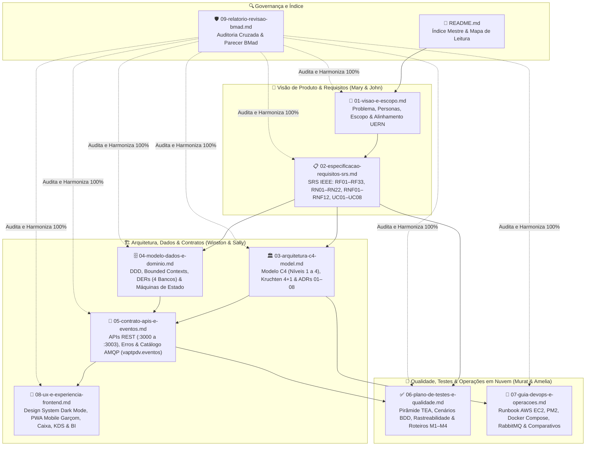

# 📘 Documentação Oficial de Engenharia de Software — Ecossistema VaptPDV

| Metadado | Valor |
| :--- | :--- |
| **Sistema** | **VaptPDV** — Plataforma Distribuída de Ponto de Venda, KDS, Fidelidade e Analytics para Bares, Botecos e Lanchonetes |
| **Versão da Baseline** | `2.0.0` (100% Harmonizada e Auditada pelo Comitê BMad Review) |
| **Data** | 21 de Outubro de 2026 |
| **Instituição / Curso** | Universidade do Estado do Rio Grande do Norte (UERN) — Departamento de Ciência da Computação (DCC) |
| **Disciplina** | Sistemas Distribuídos — 3ª Unidade (Projeto Prático Incremental) |
| **Docentes Avaliadoras** | Profa. Dra. Glaucia Melissa e Profa. Ma. Luiziane Paulino dos Santos |
| **Autores (Discentes)** | Kaio França e Mateus Neri |
| **Metodologia de Engenharia** | **BMad Method** (Mary, John, Winston, Sally, Amelia, Murat & Dr. Quinn) + IEEE 830 / ISO 29148 / C4 Model / Kruchten 4+1 |

---

## 1. Visão Geral da Suite Documental

Esta pasta (`docs/engenharia/`) reúne a **Documentação Completa de Engenharia de Software e Arquitetura de Sistemas Distribuídos** do projeto **VaptPDV**, cobrindo de ponta a ponta os **4 Módulos Avaliativos** da 3ª Unidade de Sistemas Distribuídos (DCC/UERN):

1. **Módulo 1 — Computação em Nuvem IaaS (`entrega-1-cloud` — 21/10/2026):** Implantação nativa do **PDV Core** (`:3000`) e banco **PostgreSQL** (`:5432` — `vaptpdv_db`) diretamente em máquina virtual **AWS EC2 (Ubuntu LTS)**, gerenciada via **PM2** e configurada por `.env`.
2. **Módulo 2 — Microsserviços (`entrega-2-microsservicos` — 30/10/2026):** Evolução para arquitetura distribuída integrando o **PDV Core (`:3000`)** aos **3 Microsserviços Satélites** independentes — **`kds-service` (`:3001`)**, **`fidelidade-service` (`:3002`)** e **`analytics-bi-service` (`:3003`)** — com bancos de dados lógicos isolados (`Database-per-Service`), chamadas HTTP REST síncronas com **timeout padronizado de `2000ms`** e tratamento de indisponibilidade (`503 SERVICO_INDISPONIVEL`) + degradação graciosa.
3. **Módulo 3 — Containers e Orquestração (`entrega-3-containers` — 06/11/2026):** Empacotamento em `Dockerfile` multi-stage (`node:20-alpine`) com usuário não-root, orquestração completa via `docker-compose.yml`, rede interna `vaptpdv-net` e comprovação prática de persistência de dados em volumes nomeados.
4. **Módulo 4 — Mensageria e Streaming (`entrega-4-mensageria` — 13/11/2026):** Desacoplamento assíncrono via **RabbitMQ (`:5672` AMQP / `:15672` Management)** através do Topic Exchange `vaptpdv.eventos` com filas duráveis, Dead Letter Queues (`.dlq`), confirmação manual (`ack`), Transactional Outbox e consumidores idempotentes para os eventos `item.lancado`, `item.pronto`, `comanda.paga` e `estoque.movimentado`.

---

## 2. Diagrama Geral da Arquitetura Documental

---

## 3. Catálogo de Documentos e Resumo Executivo

| # | Documento | Responsáveis BMad | Conteúdo Principal |
| :---: | :--- | :--- | :--- |
| **01** | [01-visao-e-escopo.md](./01-visao-e-escopo.md) | **Mary** (Analyst) & **John** (PM) | Declaração de problema de bares/lanchonetes, proposta de valor, KPIs (`OBJ-01` a `OBJ-06`), 5 personas detalhadas, visão geral da topologia (PDV Core + 3 Satélites), alinhamento com os 4 Módulos da UERN e limites de escopo (*In-Scope* vs. *Out-of-Scope*). |
| **02** | [02-especificacao-requisitos-srs.md](./02-especificacao-requisitos-srs.md) | **Mary** (Analyst) & **John** (PM) | Especificação formal IEEE 830 / ISO 29148 contendo **33 Requisitos Funcionais (`RF01` a `RF33`)**, **22 Regras de Negócio (`RN01` a `RN22`)**, **12 Requisitos Não Funcionais (`RNF01` a `RNF12`)**, **8 Casos de Uso expandidos (`UC01` a `UC08`)** e matriz de rastreabilidade. |
| **03** | [03-arquitetura-c4-model.md](./03-arquitetura-c4-model.md) | **Winston** (Architect) | Visão 4+1 de Kruchten, **Modelo C4 Completo** (Contexto, Contêineres, Componentes e Implantação M1 a M4 na AWS EC2), padrões de resiliência (Timeout `2000ms`, Degradação Graciosa, Transactional Outbox, DLQ), comparativo RabbitMQ vs. Kafka e **8 ADRs (`ADR-01` a `ADR-08`)**. |
| **04** | [04-modelo-dados-e-dominio.md](./04-modelo-dados-e-dominio.md) | **Winston** (Architect) | Modelagem estratégica e tática DDD (*Bounded Contexts*, *Context Map*, *Aggregates*, *Value Objects*), **DERs físicos dos 4 bancos** (`vaptpdv_db`, `kds_db`, `fidelidade_db`, `analytics_db`), dicionário de dados, índices únicos parciais (`RN07`, `RN10`) e máquinas de estado. |
| **05** | [05-contrato-apis-e-eventos.md](./05-contrato-apis-e-eventos.md) | **Winston** (Architect) & **Amelia** (Dev) | Contrato REST JSON das APIs nas portas `:3000` (PDV Core), `:3001` (`kds-service`), `:3002` (`fidelidade-service`) e `:3003` (`analytics-bi-service`), catálogo de erros padronizados, topologia AMQP no exchange `vaptpdv.eventos` e diagramas de sequência M2–M4. |
| **06** | [06-plano-de-testes-e-qualidade.md](./06-plano-de-testes-e-qualidade.md) | **Murat** (Test Architect — TEA) | Estratégia de testes baseada em riscos (`R01` a `R08`), Pirâmide de Testes de 4 níveis, **19 cenários BDD Gherkin**, **Matriz de Rastreabilidade (`RF01–RF33` × `RN01–RN22` × `CT01–CT30`)** e **Roteiros `curl` prontos para gravação dos vídeos dos Módulos 1 a 4**. |
| **07** | [07-guia-devops-e-operacoes.md](./07-guia-devops-e-operacoes.md) | **Amelia** (Dev) & **Winston** (Architect) | Runbook completo: setup local (Windows PowerShell `npm.cmd` e Linux), provisionamento **AWS EC2 + Security Group + PM2**, `Dockerfile` multi-stage, `docker-compose.yml` de referência, prova de persistência em volumes, comparativos técnicos (VM vs. Containers e RabbitMQ vs. Kafka) e troubleshooting. |
| **08** | [08-ux-e-experiencia-frontend.md](./08-ux-e-experiencia-frontend.md) | **Sally** (UX Designer) & **Winston** (Architect) | Princípios de UX para hospitalidade noturna (*One-Handed Mobile UX*, *Zero Cálculo no Cliente*, *Graceful Degradation UI*), Design System Dark Mode, fluxos de navegação e wireframes das 4 jornadas (Garçom, Caixa, KDS Cozinha/Bar e Gerente/BI). |
| **09** | [09-relatorio-revisao-bmad.md](./09-relatorio-revisao-bmad.md) | **Dr. Quinn** & **Comitê BMad Review** | Relatório formal de Auditoria Cruzada aplicando 4 lentes (*Adversarial Critique*, *Edge-Case Hunter*, *Verification & Traceability Check* e *Architecture & Academic Alignment*), registro das divergências sanadas e assinatura de aprovação de cada agente. |

---

## 4. Mapa de Leitura Recomendado por Perfil

### 🎓 Perfil 1: Avaliadoras Acadêmicas / Professoras de Sistemas Distribuídos (Profa. Glaucia Melissa & Profa. Luiziane Paulino)
Para avaliar rapidamente a aderência aos critérios de cada um dos 4 Módulos da 3ª Unidade:
1. **Alinhamento Geral e Entregáveis por Módulo:** [01-visao-e-escopo.md — Seção 5](./01-visao-e-escopo.md#5-alinhamento-com-os-4-módulos-de-sistemas-distribuídos-dccuern)
2. **Arquitetura Distribuída, Evolução M1→M4 e Decisões (ADRs):** [03-arquitetura-c4-model.md — Seções 4, 6, 7 e 8](./03-arquitetura-c4-model.md)
3. **Isolamento de Bancos (`Database-per-Service`) e Máquina de Estados:** [04-modelo-dados-e-dominio.md — Seções 2 e 4](./04-modelo-dados-e-dominio.md)
4. **Roteiros Reproduzíveis de Teste (`curl` / Docker / RabbitMQ) para Módulos 1 a 4:** [06-plano-de-testes-e-qualidade.md — Seção 5](./06-plano-de-testes-e-qualidade.md#5-roteiro-reproduzível-de-demonstração-para-avaliação-acadêmica-módulos-1-a-4)
5. **Comparativos Obrigatórios (VM vs. Containers no M3; RabbitMQ vs. Kafka no M4):** [07-guia-devops-e-operacoes.md — Seção 5](./07-guia-devops-e-operacoes.md#5-análises-comparativas-técnicas-exigência-dos-módulos-3-e-4)
6. **Auditoria de Qualidade e Rastreabilidade BMad:** [09-relatorio-revisao-bmad.md](./09-relatorio-revisao-bmad.md)

### 💻 Perfil 2: Desenvolvedor Backend / Frontend (Implementação de Código)
1. **Regras de Negócio (`RN01`–`RN22`) e Casos de Uso (`UC01`–`UC08`):** [02-especificacao-requisitos-srs.md — Seções 3, 4 e 6](./02-especificacao-requisitos-srs.md)
2. **Schemas de Banco, Colunas `NUMERIC(10,2)` e Índices Parciais:** [04-modelo-dados-e-dominio.md — Seções 2 e 3](./04-modelo-dados-e-dominio.md)
3. **Payloads JSON de Request/Response, Códigos de Erro e Eventos AMQP:** [05-contrato-apis-e-eventos.md](./05-contrato-apis-e-eventos.md)
4. **Wireframes, Tokens de Cor e Integração Frontend ↔ API:** [08-ux-e-experiencia-frontend.md](./08-ux-e-experiencia-frontend.md)

### 🏛️ Perfil 3: Arquiteto de Software / Engenheiro de Sistemas Distribuídos
1. **Modelo C4 Completo, Visão 4+1 e ADRs (`ADR-01` a `ADR-08`):** [03-arquitetura-c4-model.md](./03-arquitetura-c4-model.md)
2. **Bounded Contexts, Context Map e Contratos de Eventos:** [04-modelo-dados-e-dominio.md](./04-modelo-dados-e-dominio.md)
3. **Diagramas de Sequência Síncronos (M2/M3) e Assíncronos (M4):** [05-contrato-apis-e-eventos.md — Seção 7](./05-contrato-apis-e-eventos.md#7-diagramas-de-sequência-arquiteturais)

### 🧪 Perfil 4: Engenheiro de QA / Test Architect
1. **Matriz de Riscos (`R01`–`R08`), Pirâmide de Testes e Cenários Gherkin:** [06-plano-de-testes-e-qualidade.md — Seções 1 a 3](./06-plano-de-testes-e-qualidade.md)
2. **Matriz de Rastreabilidade Bidirecional (`RF01–RF33` × `RN01–RN22` × `CT01–CT30`):** [06-plano-de-testes-e-qualidade.md — Seção 4](./06-plano-de-testes-e-qualidade.md#4-matriz-de-rastreabilidade-completa-textrf01rf33-times-textrn01rn22-times-textrnf01rnf12-times-textct01ct30-times-textm1m4)

### 🚀 Perfil 5: Engenheiro DevOps / SRE / Operação em Nuvem
1. **Provisionamento AWS EC2, Security Group, PM2, Docker Compose e Troubleshooting:** [07-guia-devops-e-operacoes.md](./07-guia-devops-e-operacoes.md)

---

## 5. Tabela de Referência Rápida da Topologia Padronizada

| Componente / Serviço | Porta Padrão | Banco de Dados Lógico | Tecnologia Base | Papel na Arquitetura |
| :--- | :---: | :---: | :--- | :--- |
| **`vapt-pdv-core` (PDV Core)** | `:3000` | `vaptpdv_db` | Node.js 20 + Fastify + TypeScript + Prisma + Web/PWA | Núcleo transacional OLTP: módulos `usuarios`, `produtos`, `comandas`, `saude` e interface Web/PWA. |
| **`kds-service`** | `:3001` | `kds_db` | Node.js 20 + Fastify + TypeScript + Prisma | Microsserviço satélite de Cozinha e Bar: fila de preparo (`recebido` $\rightarrow$ `em_preparo` $\rightarrow$ `pronto` $\rightarrow$ `entregue`) e SLA visual. |
| **`fidelidade-service`** | `:3002` | `fidelidade_db` | Node.js 20 + Fastify + TypeScript + Prisma | Microsserviço satélite de Fidelidade: 5% de cashback, 1 pt por R\$ 1,00 de subtotal e emissão de recibos digitais. |
| **`analytics-bi-service`** | `:3003` | `analytics_db` | Node.js 20 + Fastify + TypeScript + Prisma | Microsserviço satélite Analítico (OLAP/CQRS): faturamento por período, Curva ABC, ranking de garçons e alertas de estoque mínimo. |
| **PostgreSQL 16** | `:5432` *(interna)* | 4 bancos lógicos isolados | `postgres:16-alpine` / Nativo Ubuntu LTS | Persistência relacional ACID com `NUMERIC(10,2)` e índices únicos parciais (`comandas_mesa_aberta_unique_idx`). |
| **RabbitMQ 3.13** | `:5672` (AMQP) `:15672` (Web UI) | Armazenamento Mnesia (`rabbitmq_data`) | `rabbitmq:3.13-management-alpine` | Topic Exchange `vaptpdv.eventos` e Dead Letter Exchange `vaptpdv.eventos.dlx` roteando `item.lancado`, `item.pronto`, `comanda.paga` e `estoque.movimentado`. |
