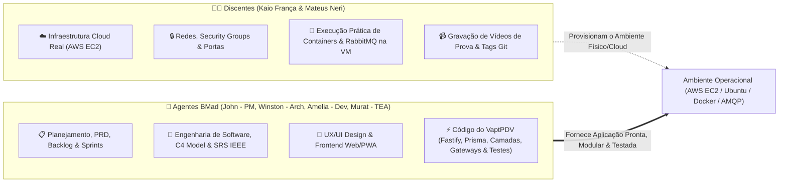
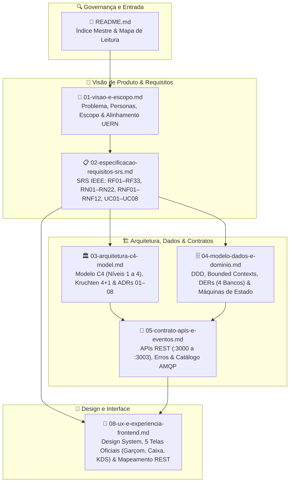

# 📘 Documentação Oficial de Engenharia de Software — Ecossistema VaptPDV

| Metadado | Valor |
| :--- | :--- |
| **Sistema** | **VaptPDV** — Plataforma Distribuída de Ponto de Venda, KDS, Fidelidade e Analytics para Bares, Botecos e Lanchonetes |
| **Versão da Baseline** | `2.0.0` (Arquitetura e Engenharia de Software) |
| **Data** | 23 de Outubro de 2026 |
| **Instituição / Curso** | Universidade do Estado do Rio Grande do Norte (UERN) — Departamento de Ciência da Computação (DCC) |
| **Disciplina** | Sistemas Distribuídos — 3ª Unidade (Projeto Prático Incremental) |
| **Docentes Avaliadoras** | Profa. Dra. Glaucia Melissa e Profa. Ma. Luiziane Paulino dos Santos |
| **Autores (Discentes)** | Kaio França e Mateus Neri |
| **Metodologia de Engenharia** | **BMad Method** + IEEE 830 / ISO 29148 / C4 Model / Kruchten 4+1 |

---

## 1. Visão Geral da Suite Documental

Esta pasta (`docs/engenharia/`) reúne a **Documentação Central de Engenharia de Software e Arquitetura de Sistemas Distribuídos** do projeto **VaptPDV**, cobrindo o ciclo operacional completo e o planejamento da arquitetura distribuída:

1. **Módulo 1 — Computação em Nuvem IaaS (`entrega-1-cloud`):** Implantação nativa do **PDV Core** (`:3000` — Backend em Camadas + Frontend Web/PWA integrado com Modo Garçom e Modo Caixa) e banco **PostgreSQL** (`:5432` — `vaptpdv_db`) diretamente em máquina virtual **AWS EC2 (Ubuntu LTS)** gerenciada via **PM2**.
2. **Módulo 2 — Microsserviços (`entrega-2-microsservicos`):** Integração do PDV Core aos **3 Microsserviços Satélites** — `kds-service` (`:3001`), `fidelidade-service` (`:3002`) e `analytics-bi-service` (`:3003`) — com bancos isolados (`Database-per-Service`), chamadas HTTP REST síncronas com timeout de 2000ms e degradação graciosa (`503 SERVICO_INDISPONIVEL`).
3. **Módulo 3 — Containers e Orquestração (`entrega-3-containers`):** Empacotamento em `Dockerfile` multi-stage com orquestração completa via `docker-compose.yml` e persistência de dados em volumes.
4. **Módulo 4 — Mensageria e Streaming (`entrega-4-mensageria`):** Desacoplamento assíncrono via **RabbitMQ** com filas duráveis, Dead Letter Queues (`.dlq`), confirmação manual (`ack`) e consumidores idempotentes para eventos do PDV.

---

## 2. Divisão de Responsabilidades e Modelo de Governança

Para assegurar eficiência na execução acadêmica e máxima qualidade técnica, os papéis e fronteiras de atuação do projeto estão rigorosamente divididos entre os **Discentes** e a **Equipe de Agentes BMad**:

* **Discentes (Kaio França e Mateus Neri):**
  - Provisionamento e administração da infraestrutura em nuvem na **AWS EC2 (IaaS)**.
  - Configuração de rede, Security Groups (liberação controlada de portas `:3000`, `:5432`, `:5672`, `:15672`), chaves SSH e sistema operacional Ubuntu LTS.
  - Execução operacional de containers Docker, Docker Compose e broker RabbitMQ na nuvem.
  - Gravação dos vídeos comprobatórios no YouTube e publicação das tags Git da disciplina (`entrega-1-cloud`, etc.).
* **Agentes BMad (PM, Arquitetura, Dev, TEA e UX):**
  - **Foco 100% no Sistema VaptPDV:** Planejamento executivo, refinamento de requisitos e sustentação de todas as documentações formais de engenharia.
  - Construção do código da aplicação (Backend Fastify em camadas limpas, Prisma ORM, suíte de testes Vitest e Frontend Web/PWA responsivo com Modo Garçom e Modo Caixa).
  - Preparação e desacoplamento arquitetural do código (interfaces de serviço, gateways e isolamento por módulos) para que o sistema se encaixe nativa e perfeitamente nas arquiteturas exigidas em cada um dos 4 módulos da disciplina.

---

## 3. Diagrama da Arquitetura Documental

---

## 4. Catálogo de Documentos de Engenharia

| # | Documento | Conteúdo Principal |
| :---: | :--- | :--- |
| **01** | [01-visao-e-escopo.md](./01-visao-e-escopo.md) | Declaração de problema de bares/lanchonetes, proposta de valor, KPIs (`OBJ-01` a `OBJ-06`), 5 personas, visão geral da topologia (PDV Core + 3 Satélites), divisão de papéis (Discentes vs. BMad) e alinhamento com os 4 Módulos da UERN. |
| **02** | [02-especificacao-requisitos-srs.md](./02-especificacao-requisitos-srs.md) | Especificação formal IEEE 830 / ISO 29148 contendo **33 Requisitos Funcionais (`RF01` a `RF33`)**, **22 Regras de Negócio (`RN01` a `RN22`)**, **12 Requisitos Não Funcionais (`RNF01` a `RNF12`)** e **8 Casos de Uso expandidos**. |
| **03** | [03-arquitetura-c4-model.md](./03-arquitetura-c4-model.md) | Visão 4+1 de Kruchten, **Modelo C4 Completo** (Contexto, Contêineres, Componentes e Implantação M1 a M4 na AWS EC2), padrões de resiliência (Timeout `2000ms`, Degradação Graciosa, Outbox, DLQ) e **8 ADRs (`ADR-01` a `ADR-08`)**. |
| **04** | [04-modelo-dados-e-dominio.md](./04-modelo-dados-e-dominio.md) | Modelagem estratégica e tática DDD (*Bounded Contexts*, *Aggregates*), **DERs físicos dos 4 bancos** (`vaptpdv_db`, `kds_db`, `fidelidade_db`, `analytics_db`), dicionário de dados, índices únicos parciais (`RN07`) e máquinas de estado. |
| **05** | [05-contrato-apis-e-eventos.md](./05-contrato-apis-e-eventos.md) | Contrato REST JSON das APIs nas portas `:3000` (PDV Core), `:3001` (`kds-service`), `:3002` (`fidelidade-service`) e `:3003` (`analytics-bi-service`), catálogo de erros padronizados e eventos AMQP no exchange `vaptpdv.eventos`. |
| **08** | [08-ux-e-experiencia-frontend.md](./08-ux-e-experiencia-frontend.md) | Especificação detalhada de UX/UI, tokens visuais (Mostarda `#F2A81D`, Café `#2B2019`, Creme `#FBF7F1`), design system das 5 telas oficiais (Salão/Mesas, Lançamento de Pedido, Fechamento de Conta, Fila KDS Cozinha e Métricas Rápidas) e mapeamento REST 1:1. |

---

## 5. Mapa de Leitura para Avaliadoras Acadêmicas (Profas. Glaucia Melissa e Luiziane Paulino)

Para conferir a aderência aos requisitos dos módulos da disciplina:
1. **Alinhamento do Projeto e Escopo:** [01-visao-e-escopo.md — Seção 5](./01-visao-e-escopo.md)
2. **Requisitos do Sistema e Regras de Negócio:** [02-especificacao-requisitos-srs.md](./02-especificacao-requisitos-srs.md)
3. **Decisões Arquiteturais e Modelo C4:** [03-arquitetura-c4-model.md](./03-arquitetura-c4-model.md)
4. **Isolamento de Dados (`Database-per-Service`) e Índices:** [04-modelo-dados-e-dominio.md](./04-modelo-dados-e-dominio.md)
5. **Contrato de Interfaces REST e Mensageria:** [05-contrato-apis-e-eventos.md](./05-contrato-apis-e-eventos.md)
6. **Experiência do Usuário e Telas do PDV Core:** [08-ux-e-experiencia-frontend.md](./08-ux-e-experiencia-frontend.md)
